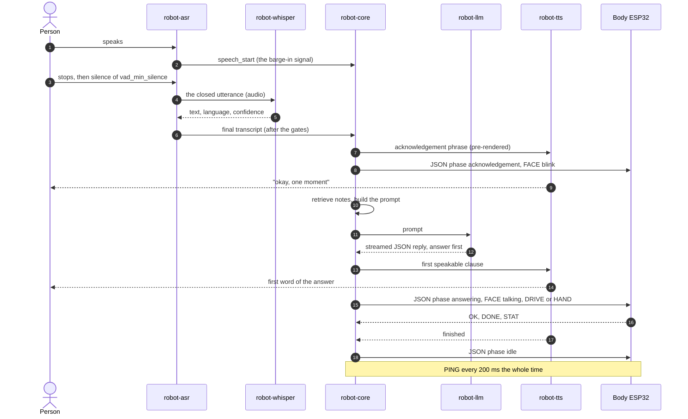
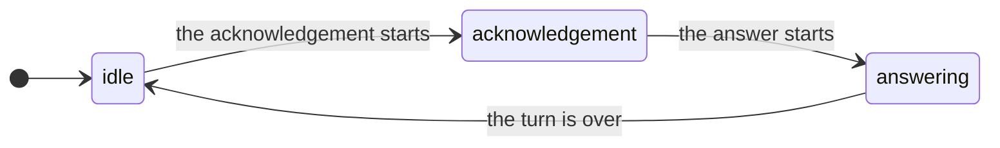

# One turn, end to end

A **turn** is one exchange: you say something, the robot answers. This page follows a single
turn through the nine programs. Each step has a longer page in the
[voice pipeline](../04-brain/voice-pipeline.md).

## Step by step

| # | Step | Where | What happens | What governs it |
|---|---|---|---|---|
| 1 | **Listen** | `robot-asr` | The microphone is always open. A voice detector (Silero) notices speech starting and tells the core at once, so the robot can stop talking over you. It closes the utterance after a pause | `vad_min_silence`: how long a pause ends a sentence |
| 2 | **Gate and decode** | `robot-asr`, `robot-whisper` | A level check drops sounds barely above the room's noise. whisper.cpp turns the audio into text on the GPU and reports its own confidence. A low-confidence or wrong-language result is dropped, and the drop is logged | `ASR_NOISE_GATE_DB`, `ASR_MAX_NO_SPEECH`, `ASR_LANGUAGES`, and the whisper model size |
| 3 | **Acknowledge** | `robot-core`, `robot-tts` | A short "okay, one moment" plays from a cache of pre-rendered phrases, so the silence is filled while the answer is still being worked out | `CORE_FILLER` |
| 4 | **Retrieve** | `robot-core` | Notes from your documents that match the question are looked up | `RAG_K` (how many) |
| 5 | **Think** | `robot-llm` | The prompt is assembled and the model streams back a JSON object with the `answer` first | the model, `LLM_CTX`, `CORE_MAX_TOKENS` |
| 6 | **Speak** | `robot-core`, `robot-tts` | The first clause of the answer is sent to the voice as soon as it is speakable. The rest follows while it plays | `CORE_FIRST_MAX_CHARS`, `CORE_FIRST_MIN_CHARS` |
| 7 | **Act** | `robot-core`, body | The other fields of the reply (move, gesture) become serial commands that start while the sentence is still being spoken | the reply JSON, clamped in three places |
| 8 | **Return to idle** | all | The face goes back to idle, the microphone reopens after a short tail | `CORE_LISTEN_TAIL_MS` |

## How long each step takes, and what to turn

The figures below are what [`AGENTS.md`](../../../AGENTS.md) § How fast it answers lists next
to each setting. **They do not add up to the end-to-end median**, so read them as "which
setting governs which stage", not as a budget.

| Stage | Figure | Governed by |
|---|---|---|
| Endpointing: waiting to be sure you finished | 200 ms | `vad_min_silence` |
| ASR decode | 510 ms | the whisper model size (`WHISPER_MODEL`) |
| First token from the model | +92 ms | prompt size: `rag_k`, the persona |
| First speakable clause | +926 ms | the model writing something speakable |
| Synthesis of the first chunk | +963 ms | `CORE_FIRST_MAX_CHARS` |

End to end, from the real end of speech to the first spoken word: **median 2181 ms, best
1554 ms** (target 1500 ms) ✅.

**To see a real turn instead of a table**, open the **Conversation** page of the dashboard
and expand **Timing** under any spoken reply. It breaks that one turn into stages, marks the
slowest, and names the setting that governs it. The stage durations add up exactly to the
turn's total, which is tested.

**One thing outweighs every setting: swap.** If the board is out of memory and a service has
been pushed to disk, the first word can take ten seconds instead of one. See
[Models and memory](../04-brain/models-and-memory.md).

## Can it be interrupted?

`CORE_LISTEN_MODE` decides what the microphone may do while the robot is talking:

| Mode | Behaviour | Trade-off |
|---|---|---|
| `interrupt` | Speaking over the robot stops it at once (barge-in) | Responsive, but the robot can hear itself through its own speaker |
| `no_interrupt` | The microphone is **shut** while the robot talks, and for `CORE_LISTEN_TAIL_MS` after | Never hears itself. This is the configured mode |
| `wake_word` | Like `no_interrupt`, and nothing starts a turn unless the transcript contains the wake word (`CORE_WAKE_WORD`, `robot`) | For a noisy room. No keyword-spotting model is needed: the word is matched in the text |

## What the face does

The face follows the turn by rule, not by the model's choice (`CORE_FACE_MODE=phases`):

| Phase | Face | When |
|---|---|---|
| `acknowledgement` | `blink` | The "okay, one moment" is playing |
| `answering` | `talking` | The reply is being spoken |
| `idle` | `random` | Nothing is happening |

With `CORE_FILLER=0` there is no acknowledgement phase and the turn goes straight from
`idle` to `answering`. The same three phases go to the dashboard, the on-robot panel and the
body, so all three always agree.

## Which language does it answer in?

The language of the **words you spoke** decides, not what the decoder guessed. English in,
English out. See [Deciding the language](../04-brain/voice-pipeline.md#2-deciding-the-language).

## Where to look when a turn felt wrong

| Symptom | Look at |
|---|---|
| It answered something nobody said | `grep 'robot-asr: dropped' .cache/tmp/asr.log`, which lists every rejected sound with its numbers |
| It answered slowly | The **Timing** breakdown, then `./scripts/measure/whats_running.py` for swap |
| It answered in the wrong language | `grep 'recogniser said' .cache/tmp/core.log` |
| Its answer was cut off | The `truncated` warning in `core.log`; see [Voice pipeline § Thinking](../04-brain/voice-pipeline.md#3-thinking) |
| It never answered | [Reliability](../04-brain/reliability.md) and [`TROUBLESHOOTING.md`](../../../dev-docs/ai/TROUBLESHOOTING.md) |
