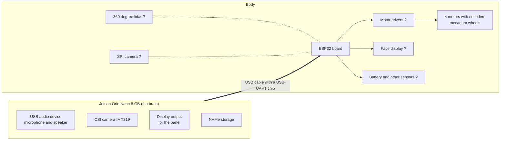

# Hardware: what is known and what is not

This chapter is **partial on purpose**. The Jetson side can be checked on this machine; the body
cannot, because no body was attached while these pages were written and its firmware is not in the
repository. Every line says which kind of knowledge it is:
✅ measured here, 🧪 simulated only, 📐 reported by the owner or designed, ❓ unknown.

*Solid lines are reported by the owner; dotted lines are things the owner listed but whose
connection is not known; "?" marks a part whose type is unknown. Nothing on the body side has been
checked here.*

## The Jetson side

| Part | What is known | Badge |
|---|---|---|
| Board | Jetson Orin Nano **8 GB (Super)**, JetPack **6.2.1** (L4T 36.4.7), power mode **MAXN_SUPER**, headless | ✅ `check_board.sh`, 2026-11-16 |
| Memory | **7619 MiB** visible, **7620 MiB** the budget. Shared by CPU and GPU. The rest is Tegra carve-out | ✅ |
| Storage | Root filesystem 99 GB, **96% used, 3.9 GB free**. The repo and models are on a separate NVMe partition with **225 GB free** | ✅ 2026-11-16 |
| Microphone and speaker | **One USB audio device** does both. The speaker accepts only **16 kHz mono**, so PulseAudio resamples the voice's 44.1 kHz | ✅ for the device in the config; ❓ none was plugged in on 2026-11-16 (the check warned) |
| Camera | **IMX219 on CSI**, sensor 0, used at 640×360 and 2 fps. Only Argus reaches it, and it allows **one process** on the sensor | ✅ (an empty room; never with a live person) |
| Display | The panel needs a display on the DisplayPort/HDMI output, seen as `card1-DP-1` | ✅ measured once; ❓ no real panel fitted |
| Body link | A serial device. The Jetson opens `ttyACM*`, `ttyUSB*` and `ttyTHS*` and looks for the body by ping | 📐 |

Two traps that belong here, from the project's own logs:

* **On this board `/dev/ttyACM0` has been the USB soundcard**, because that device is a composite
  with a serial interface. Never address the body by a `ttyACM` number.
* **A new microphone or speaker changes its PulseAudio name**, and a configured name that matches
  nothing leaves the robot deaf with no error. Pick the device on Config → Hardware, where a missing
  one is shown rather than hidden.

## The body, as reported

From the owner on 2026-11-12, **not verified** because the board was not at hand:

| Part | What the owner said | What is missing |
|---|---|---|
| Controller | An **ESP32** | the module, the firmware source |
| Link | USB cable, with a **USB-UART chip**, speaking this repository's line protocol | the chip, the baud rate |
| Drive | **4 motors with encoders**, mecanum wheels | the driver, gearing, encoder counts per revolution, wheel diameter, wheelbase and track |
| Face | a **face display** | its type and wiring |
| Sensors | **battery** and other sensors | which, and how they are read |
| Lidar | a **360° lidar** | the model and how it connects. **No code or protocol for it exists** |
| Camera | an **SPI camera** | the model, and which processor reads it. **No code for it exists** |
| Servos | **not listed** | whether any exist (the `HAND` command assumes some) |
| Power | not described | the battery, the regulators, what feeds what |

The body's **reference design** (an STM32 Black Pill and two TB6612FNG drivers) is on
[Reference wiring](reference-wiring.md). It is a proposal, not what is built.

## What this chapter will contain when it is finished

Each of these needs the owner and the robot, and the page that holds it is ready to be written:

* a parts list with the real modules,
* a **power diagram**: battery to every consumer, with voltages and fuses,
* a **wiring list** and pin table for the ESP32, generated from the firmware's pin header,
* the **mecanum chassis** dimensions that feed [the kinematics constants](../03-firmware/motion.md),
* a **sensors page** (battery sense, lidar, SPI camera) and the scope decision around the lidar,
* **photographs** of the chassis and wiring, and a bring-up record.

The list of what to send is in [Waiting for the owner](../08-decisions/open-decisions.md#e-what-the-handbook-still-needs-from-you).

## Safety, until it is measured

* **Put the robot on blocks** for any wheel test. Every wheel gets driven.
* **Prove the watchdog on the real board before connecting motors**:
  [The watchdog](../03-firmware/watchdog.md).
* Connect the motor supply **last**, and check what the motor driver inputs do while the ESP32
  boots and resets ([the ESP32 checklist, row 16](../03-firmware/esp32-conformance.md)).
