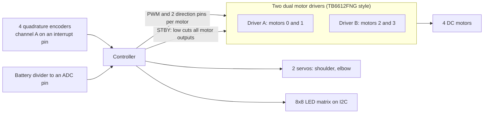

# Reference wiring: the proposal in `robot_pins.h`

> ⚠️ **Unverified.** [`robot_pins.h`](../../../firmware/stm32/include/robot_pins.h) says so in its
> first lines: *nothing here has been checked against real hardware*. Every pin is "a plausible
> default for a WeAct Black Pill (STM32F411CE) driving two TB6612FNG dual motor drivers". It is the
> design the reference firmware was written against, **not the robot's wiring**, which is an ESP32.
> Use it as a map of *what has to be connected*, and make an ESP32 pin table of your own.

## What has to be connected

## The pin map in the file

Wheel order everywhere is **0 front-left, 1 front-right, 2 rear-left, 3 rear-right**.

| Function | Pins (STM32 names) | Notes |
|---|---|---|
| Motor 0 | PWM `PB0`, IN1 `PB1`, IN2 `PB2` | one PWM and two direction lines per wheel |
| Motor 1 | PWM `PB3`, IN1 `PB4`, IN2 `PB5` | |
| Motor 2 | PWM `PB6`, IN1 `PB7`, IN2 `PB8` | |
| Motor 3 | PWM `PB9`, IN1 `PB12`, IN2 `PB13` | |
| Driver standby | `PB14` | pulled **low to cut all motor outputs in hardware**; the watchdog drives it as well as zeroing PWM |
| Encoders | A/B: `PA0`/`PA1`, `PA2`/`PA3`, `PA4`/`PA5`, `PA6`/`PA7` | A on an interrupt-capable pin, B read directly |
| Servos | shoulder `PA8`, elbow `PA9` | for the preset gestures |
| LED matrix | SDA `PB11`, SCL `PB10`, address `0x70` | I²C, e.g. HT16K33 8×8 |
| Battery sense | `PA10`, divider ratio **11** | 10 kΩ over 1 kΩ: 0 to 36 V into 0 to 3.3 V |

## Constants that depend on the build

| Constant | Value | Meaning | Badge |
|---|---|---|---|
| `ENCODER_COUNTS_PER_REV` | 1440 | counts per wheel revolution after gearing and 4× decoding. **Wrong means every velocity is wrong by a constant factor.** Measure it: turn a wheel exactly one revolution by hand and read the count | ❓ placeholder |
| `CONTROL_HZ` | 100 | PID loop rate | 📐 |
| `VBAT_DIVIDER_RATIO` | 11 | battery divider | 📐 |
| PID gains | `kp 0.020, ki 0.120, kd 0` | starting point only | ❓ tune on the bench |
| Geometry | r 0.048 m, half-width 0.085 m, half-length 0.095 m | the kinematics | ❓ placeholder, [see Motion](../03-firmware/motion.md) |

## Two things to carry over to the ESP32 build

* **The standby line is the hardware backstop.** If the PID loop wedges, pulling the driver's
  standby low still stops the robot. An ESP32 design should keep an equivalent that does not depend
  on the control code.
* **Do not put motor-driver inputs on pins that move while the chip boots.** The ESP32 has strapping
  pins and flash pins; see the datasheet, and check the inputs with a scope or LEDs while resetting.
