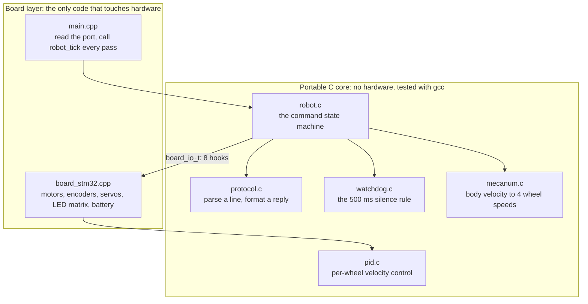
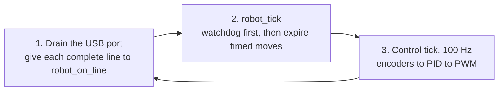
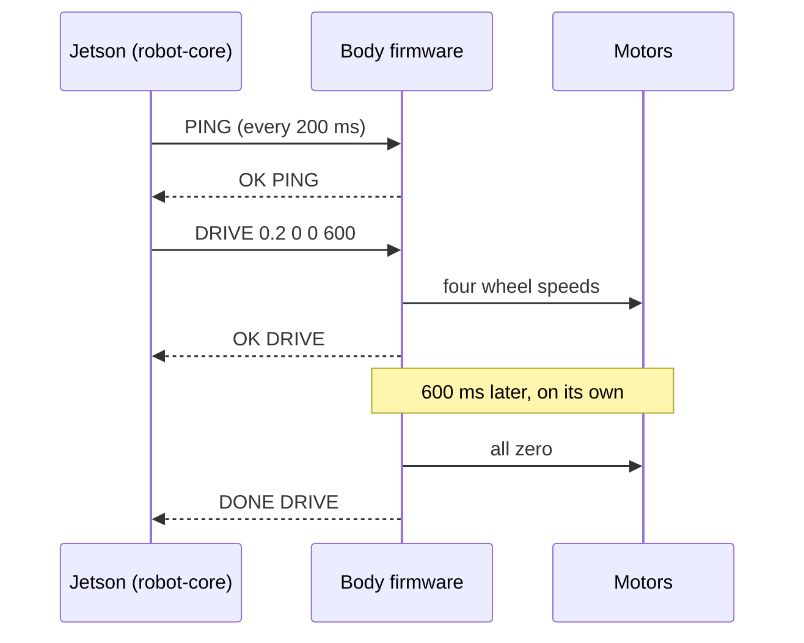

# The body: firmware

The body is the part of the robot that **moves and shows a face**. From the brain's point of
view it has one job: read a line of text, do what it says, answer with one line, and **stop by
itself if the brain goes quiet**.

> **Where things stand (2026-11-16)**
>
> * The firmware in this repository, `firmware/stm32/`, is written for an **STM32F411 "Black
>   Pill"** with two TB6612FNG motor drivers. It is the **reference implementation** of the body
>   protocol. Its portable core passes **634 checks, 0 failures** 🧪 (run today with `gcc`
>   only), and it was driven through a pseudo-terminal by the host simulator 🧪. It has **never
>   run on a board** ❓.
> * The robot's real body is an **ESP32** (reported by the owner 📐). **Its firmware is not in
>   this repository**, so nothing on these pages has been checked against it. The pages say
>   what the ESP32 firmware has to do to be a body: see
>   [The ESP32 as the body](esp32-conformance.md).

## Two bodies, one contract

| | Reference body (in this repo) | The robot's real body |
|---|---|---|
| Controller | STM32F411CE "Black Pill" (PROJECT_BRIEF: "F4-class or better") | **ESP32** 📐, exact module unknown ❓ |
| Link to the Jetson | USB-CDC, a virtual serial port (vendor id `0483`) | USB cable with a **USB-UART chip** 📐 |
| Firmware | `firmware/stm32/`: portable C core plus an Arduino-framework board layer | **not in this repo** ❓ |
| Motors | 4 DC motors, 2× TB6612FNG drivers, 4 quadrature encoders | 4 motors with encoders 📐, driver unknown ❓ |
| Face | 8×8 LED matrix on I²C (HT16K33) | "a face display" 📐, type unknown ❓ |
| Other | 2 servos for gestures, a battery divider | battery and other sensors 📐; **servos not mentioned** ❓; a 360° lidar and an SPI camera 📐 |

The **contract** is the same for both:
[`serial-protocol.md`](../../../dev-docs/architecture/serial-protocol.md), written out on
[the interfaces chapter](../05-interfaces/serial-protocol.md). A body is any program that keeps
that contract.

## The design: decisions in portable C, hardware at the edge

Everything that *decides* anything is plain C with no hardware library in it. The hardware sits
behind **one struct of eight function pointers**. That is why the safety rule can be tested on an
ordinary computer.

*How to read it: `main.cpp` hands each received line to `robot.c`. `robot.c` parses it,
feeds the watchdog, works out the wheel speeds, and asks the board to do things only through the
eight hooks. The PID loop is run by the board layer, because it needs the encoders.*

| File | Hardware? | Lines | What |
|---|---|---|---|
| `src/protocol.c` | no | 237 | Line parsing, limits, response formatting |
| `src/watchdog.c` | no | 46 | **The 500 ms heartbeat timeout** |
| `src/mecanum.c` | no | 45 | Body velocity to four wheel velocities |
| `src/pid.c` | no | 52 | Per-wheel velocity control with anti-windup |
| `src/robot.c` | no | 181 | The state machine that ties them together |
| `src/board_stm32.cpp` | **yes** | 250 | Motors, encoders, servos, LED matrix, battery |
| `src/main.cpp` | **yes** | 61 | The USB read loop; calls `robot_tick` on every pass |

### The eight hooks (`board_io_t`)

A new board (an ESP32, for example) implements exactly these and reuses the core unchanged.

| Hook | Does | If the board leaves it out |
|---|---|---|
| `set_wheels(w[4])` | Target angular speed per wheel, rad/s. **All zeros means stop**, and the watchdog uses it | the core skips the call |
| `set_face(name)` | Show an expression; return non-zero for an unknown name | the core answers `OK` |
| `start_gesture(name, &ms)` | Start a servo sequence and say how long it takes | the core answers `OK` |
| `emit(line)` | Send one line to the Jetson | nothing is ever answered |
| `now_ms()` | Milliseconds since boot, monotonic | **crash**: the only hook the core calls without checking it |
| `battery_volts()` | for `STAT` | reported as `0.00` |
| `motors_stalled()` | for `STAT` | reported as `ok` |
| `temperature_c()` | for `STAT` | reported as `0.0` |

Source: [`robot_board.h`](../../../firmware/stm32/include/robot_board.h) and
[`robot.c`](../../../firmware/stm32/src/robot.c).

## One pass of the main loop

The order is deliberate. **Reading comes first and nothing slow may precede it**, because a late
received line is a missed watchdog feed. **The watchdog check runs every pass,
unconditionally**: if the loop stops calling it, the robot cannot stop itself. The PID comes
last, because it is the only part that can afford to be late: "a late control tick is a wobble,
a late received line is a missed watchdog feed" (the comment in `board_stm32.cpp`).

A line that does not fit the 256-byte buffer is **dropped whole**, and so is its tail. The tail
must never be parsed as a command of its own.

## What one command looks like on the wire

## What the core promises

Each of these is covered by one of the 21 test functions in
[`test_main.c`](../../../firmware/stm32/test/test_native/test_main.c) 🧪.

* **Every command gets exactly one response**: `OK`, `ERR <verb> <reason>`, or `STAT` for
  `STATUS`. Timed actions add a later `DONE`.
* **Any line at all feeds the watchdog**, including a malformed one, a `STATUS`, a discovery
  ping and a reply line. The link being alive is what is measured. See [The watchdog](watchdog.md).
* **Motion is always bounded.** `DRIVE` carries a duration from 1 ms to 10 000 ms and the body
  stops when it expires. `DRIVE` with a duration of 0 is refused.
* **The body re-checks every limit** the Jetson already clamped: ±1.0 m/s, ±1.0 m/s, ±3.0 rad/s,
  10 s, and 30 rad/s for the bring-up `WHEEL` command. See [Motion](motion.md).
* **Verbs are case-insensitive**, so you can drive it by hand from `screen` or `minicom`.
* **Nothing the parser sees can crash it**: it does not allocate, it does not change its input,
  and it refuses `NaN`, infinities and numbers beyond ±1 000 000 before they reach a motor.

## Footprint, as reported

On an F411CE: **6.1 KB of RAM (4.7%) and 61 KB of flash (11.6%)**. That figure is copied from
[`firmware/stm32/README.md`](../../../firmware/stm32/README.md) and was not rebuilt today (it
needs PlatformIO). It says nothing about an ESP32.

## In this chapter

| Page | Read it when |
|---|---|
| [The watchdog](watchdog.md) | You want to know how the robot stops when the brain dies, and what has and has not been proven |
| [Motion: from a sentence to four wheels](motion.md) | You are wiring motors, checking wheel directions or changing the geometry |
| [Trying the body without a board](try-it-without-a-board.md) | You want to run the tests and the simulator, and know what they cannot tell you |
| [The ESP32 as the body](esp32-conformance.md) | You are writing or checking the real firmware |
