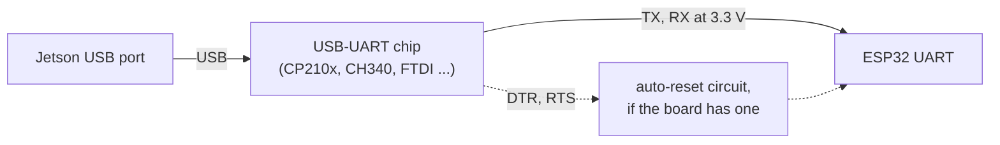

# The ESP32 as the body

The owner reports that the robot's body controller is an **ESP32** 📐. Its firmware is **not in
this repository**, and no ESP32 was attached when these pages were written, so **nothing here has
been checked against it**. This page is a checklist: what that firmware has to do to be a body
that the Jetson can use safely, where each requirement comes from, and how to check it.

> **Be careful with the first connection.** Send `PING`, `STATUS` and `FACE` first.
> `scripts/serial/protocol_test.py` sends `DRIVE`, `WHEEL` and `HAND`, so it moves things. Run any
> motion with the motors unpowered, or the robot on blocks.

## The link

| Link fact the Jetson assumes | Value | Source |
|---|---|---|
| Baud rate | **115200**. Over USB-CDC it is ignored; **over a USB-UART chip it must match** the ESP32's UART setting ❓ | `SerialLink(baud=115200)` |
| Framing | 8 data bits, no parity, 1 stop bit (pyserial's default). No flow control | `rtscts=False, dsrdtr=False` |
| Lines | ASCII, ended by `\n`. At most **255 bytes**, newline excluded | `MAX_LINE`, `PROTOCOL_MAX_LINE 256` |
| Port name | `STM32_PORT` is **empty** in `config/core.env` today, so `robot-core` finds the body at every start by sending `{PING_robot}` to **every** serial port | `_discover_microcontroller` |

### Opening the port may reset the ESP32

`robot-core` already assumes this. The probe's comment says: *"A board that resets when its port
is opened (most ESP32 dev boards) is still booting for the first second or so, and a single ping
written the instant the port opens lands in that gap and is lost"*, so it resends the ping every
0.4 s, and discovery makes up to three attempts waiting 0.8, 1.6 and 2.4 s.

What follows from that, and has to be **checked on the board** ❓:

* The body may **reboot** on every `robot-core` start, on every dashboard "Ping all ports", and
  when the link reconnects. After discovery the probe closes the port and the permanent link opens
  it again, so one start may reboot it twice.
* While it reboots, the Jetson's heartbeat goes nowhere, and **the link still reads UP**: nothing
  checks that the board is answering (Known issue #6). That is safe only if **the motors are off
  from the first instant of boot**, see the table below.
* `robot-core` opens **every** `ttyACM*`, `ttyUSB*` and `ttyTHS*` port and every
  `/dev/serial/by-id` entry. A lidar on a USB-UART adapter will be opened and sent
  `{PING_robot}` too (Known issue #5, a deliberate choice that a vendor allow-list would narrow).
  Nothing in the repository knows about the lidar yet ❓.

## The checklist

State is ❓ for every row, because no ESP32 firmware has been seen. Tick them as they are checked.

| # | The body must… | Where it comes from | How to check |
|---|---|---|---|
| 1 | Answer `{PING_robot}` with a JSON line containing `"status":"online"`. `device` is free text (the reference says `STM32`, the doc's example says `ESP32`) | `serial_link.py` `is_online_reply` | Config → Hardware → *Ping all ports*, or `grep 'robot-core: microcontroller' .cache/tmp/core.log` |
| 2 | Match `{PING_robot}` ignoring case and surrounding spaces, and answer **only that** with the JSON | `protocol_is_discovery_ping` | as above |
| 3 | Treat any line starting with `{` (a **reply line**, up to 255 bytes) as information: **no answer**, and never run anything inside it. An answer of `ERR {...` is tolerated and ignored | `protocol_is_reply_line`, `serial_link.py` | send a reply line, read nothing back |
| 4 | **Feed the watchdog on every line**, including bad ones, `STATUS`, the discovery ping and reply lines | [The watchdog](watchdog.md) | see row 8 |
| 5 | Answer **every other command with exactly one line**: `OK <verb>`, `ERR <verb> <reason>`, or `STAT …` for `STATUS`. The reasons in use are `unknown`, `badargs`, `range`, `toolong`, `empty`, `watchdog` | `protocol.c` | `protocol_test.py --port` |
| 6 | Accept verbs in any case, and refuse extra or missing arguments with `ERR <verb> badargs` | `protocol_parse` | by hand |
| 7 | Validate `DRIVE vx vy omega ms`: ±1.0, ±1.0, ±3.0, 1 to 10 000 ms, finite numbers only. Otherwise `ERR DRIVE range` or `badargs` | `protocol.h` limits | `protocol_test.py --port` |
| 8 | **Stop by itself 500 ms after the last line** and answer `ERR <verb> watchdog` once. **Do not resume** | [The watchdog](watchdog.md) | needs an observable on real hardware: Known issue #21 |
| 9 | End a timed move by itself and send `DONE DRIVE` (or `DONE WHEEL`) | `robot_tick` | `protocol_test.py --port` |
| 10 | Answer `STOP` with `OK STOP` and stop at once | `robot.c` | by hand, wheels off the ground |
| 11 | Accept **nine face names**: `happy neutral sad thinking listening speaking` and the three phase faces `blink talking random`. Unknown name: `ERR FACE unknown` | `tools.py` `FACES`, `core/face.py` | `FACE blink` by hand |
| 12 | Decide what `HAND wave|point|home|nod` does **if there are no servos** ❓ see below | `tools.py`, `protocol_test.py` | by hand |
| 13 | Answer `STATUS` with `STAT batt=<V> motors=<state> temp=<C> up=<ms>`, where `state` is `ok` or `stall` | `protocol_stat` | `STATUS` by hand |
| 14 | Number the wheels **0 front-left, 1 front-right, 2 rear-left, 3 rear-right** and have `direction[]` verified | [Motion](motion.md) | `verify_wheels.py`, robot on blocks |
| 15 | Drop an overlong line **whole**, including its tail, and not parse the tail as a command | `main.cpp` | send 300 bytes then a valid line |
| 16 | Have **motors off from the first instant of boot and reset**, including brown-outs and the reset caused by opening the port | `board_stm32_begin` sets standby low first | a scope or LEDs on the driver inputs while resetting |
| 17 | Keep the loop non-blocking: the watchdog check and the port read must run every pass, whatever Wi-Fi, Bluetooth, flash or the display are doing | `main.cpp` | measure the worst-case loop time |

### Two decisions the owner has to make

**Row 12: no servos.** The owner listed motors, a face display, battery and other sensors, a lidar
and a camera. Servos were not listed. The Jetson still sends `HAND` whenever the model's reply
has a `hand_movement`, and `protocol_test.py` expects `OK HAND` for `wave`. If the body answers
`ERR HAND unknown`, the Jetson reports *"gesture was refused"* to the conversation, which the
robot may then mention. The options are to accept every gesture, do nothing and answer
`OK HAND` then `DONE HAND`, or to teach the model not to gesture. The first is the least
surprising ❓.

**Row 11: what is a face?** The reference firmware draws 8×8 LED bitmaps. A "face display" on an
ESP32 may be an OLED or a TFT; whatever it is, it must understand those nine names, because
`CORE_FACE_MODE=phases` sends `blink`, `talking` and `random` itself.

### Rows 16 and 17 are about the ESP32, not the protocol

* **Boot state.** Some ESP32 pins are **strapping pins** read at reset, some are used by the
  flash, and pins float or pulse while the chip boots. The motor driver's direction and enable
  lines should not sit on those pins, or should have pull-downs so they default to off. The
  ESP32 datasheet lists them. The reference firmware's first act is to pull the driver's standby
  pin low.
* **Loop time.** The reference runs one non-blocking loop. An ESP32 usually runs an RTOS with
  other tasks. Whatever structure is chosen, the line-reading and the watchdog must not wait
  behind a slow task.

## `STATUS` and the stall flag

See [Interfaces: the serial protocol](../05-interfaces/serial-protocol.md#status-and-the-stall-flag).
`robot-core` does not ask for `STATUS` in normal running, so battery voltage and the stall flag
never reach the dashboard or the model. A body that implements `STATUS` correctly is still
invisible until the Jetson asks. Recorded as Known issue #20.

## The identity problem, in one paragraph

63 tracked files and hard constraints 6 and 7 say STM32, and `setup_udev.sh` matches only
STMicroelectronics' USB vendor id, so a CP2102 or CH340 board gets no `/dev/robot-stm32`
([Known issue #19](../../../dev-docs/ai/PROGRESS.md)). Discovery by ping does not care, and finds
it by `/dev/serial/by-id` instead. Renaming touches the hard constraints, so it needs the owner's
sign-off. See the [glossary](../01-overview/glossary.md#body-controller).

## Order of work when the board is in hand

1. **Motors unpowered.** Open the port with `scripts/serial/stm32_console.py --port …`, which
   keeps the heartbeat going underneath. Type `PING`, `STATUS`, `FACE happy`.
2. Check rows 1, 2, 3, 5, 6, 11, 13 and 15 by hand.
3. Find out whether opening the port resets the board, and how long it takes to answer.
4. **Prove the watchdog (row 8) on the board** with something you can see: a scope or LED on the
   driver's standby or PWM pin, then the wheels off the ground.
5. `verify_wheels.py` with the robot on blocks, then record `direction[]` and tick the table.
6. Encoders, then PID gains, then composite `DRIVE`, in the order of the
   [firmware README](../../../firmware/stm32/README.md).
7. Only now `protocol_test.py --port` and the 24-hour soak.
