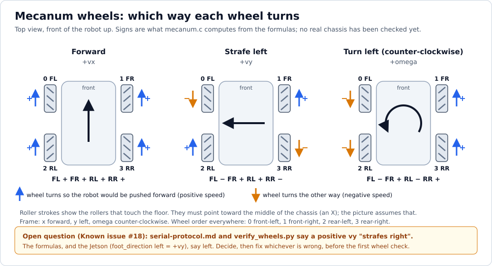
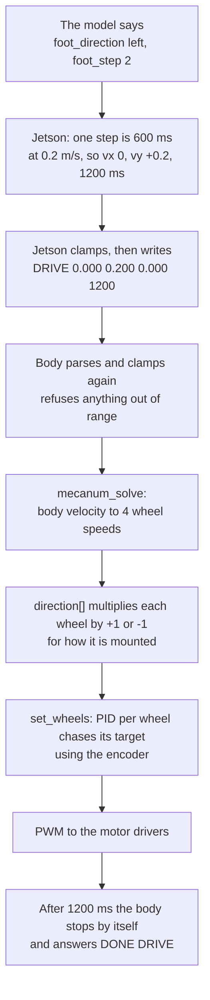

# Motion: from a sentence to four wheels

The robot drives on four **mecanum wheels**. Each wheel has small rollers set at 45°, so by
spinning the four wheels in different combinations the chassis can go forward, sideways, or
turn on the spot, without ever steering.



*How to read it: front is up. Blue arrows are wheels turning so the robot would be pushed
forward, amber arrows the opposite. Forward is all four blue. A positive sideways speed (`vy`)
turns the two diagonals the opposite way. A positive turn rate (`omega`) turns the left side
backward and the right side forward, which spins the robot to the left.*

## The path, end to end



The Jetson never computes a wheel speed ([constraint 6](../../../AGENTS.md)). It sends *what
the body should do* in metres per second and radians per second; the body decides how.

## Frame and units

| Quantity | Meaning | Unit |
|---|---|---|
| `vx` | forward (+) or backward (−) | m/s |
| `vy` | sideways: **+ is left** | m/s |
| `omega` | turning: **+ is counter-clockwise, a turn to the left** | rad/s |
| `ms` | how long to keep going, then stop | milliseconds, 1 to 10 000 |

## The formulas

With wheel radius `r` and `k = lx + ly` (the half-width plus the half-length), each wheel's
speed in rad/s is:

```
FL = (vx - vy - k*omega) / r        wheel 0, front left
FR = (vx + vy + k*omega) / r        wheel 1, front right
RL = (vx + vy - k*omega) / r        wheel 2, rear left
RR = (vx - vy + k*omega) / r        wheel 3, rear right
```

then each result is multiplied by that wheel's `direction[]` entry, +1 or −1.
[`mecanum.c`](../../../firmware/stm32/src/mecanum.c) says: *"Do not 'simplify' these: the sign
pattern is the whole content of mecanum kinematics."*

These are the standard formulas for **x forward, y left, omega counter-clockwise** and rollers
that form an X (the rollers touching the floor point toward the middle). Under that reading `+vy`
is a strafe **left** and `+omega` turns **left**, which is what the picture shows.

### The geometry in the firmware is a placeholder

| Constant | Value | Status |
|---|---|---|
| `wheel_radius_m` (r) | 0.048 | 📐 "Placeholder geometry: measure the actual chassis" |
| `half_width_m` (lx) | 0.085 | 📐 placeholder |
| `half_length_m` (ly) | 0.095 | 📐 placeholder |
| `direction[0..3]` | +1, +1, +1, +1 | ❓ an assumption, never measured. Left and right motors are usually mirror-mounted, so all +1 would be unusual |

Wrong radius or geometry means the robot **moves at the wrong speed**, not that it moves wrongly.
Wrong `direction[]` means it moves wrongly. Those are different bugs with different symptoms.

### What the numbers come to with the default geometry (derived, 📐)

| Command | Wheel speeds, rad/s (FL, FR, RL, RR) | Fastest wheel |
|---|---|---|
| `DRIVE 0.2 0 0 600` (one spoken step forward) | 4.17, 4.17, 4.17, 4.17 | about 40 rpm |
| `DRIVE 0 0 1.2 600` (one spoken turning step) | −4.50, +4.50, −4.50, +4.50 | about 43 rpm |
| `DRIVE 0 0.3 0 1000` | −6.25, +6.25, +6.25, −6.25 | about 60 rpm |
| `DRIVE 1.0 0 0 …` (the forward limit) | 20.83 on all four | about 199 rpm |
| `DRIVE 1.0 1.0 3.0 …` (every limit at once) | −11.25, +52.92, +30.42, +11.25 | **about 505 rpm** |

The last row matters. The limits are **per axis**, so a combination can ask a wheel for
**52.9 rad/s**, while the bring-up `WHEEL` command is capped at 30 rad/s. Whether the real
motors can do that, and whether it is safe, is a hardware question ❓. Today the voice path only
ever sends one axis at a time at 0.2 m/s or 1.2 rad/s.

## The limits, in two places

The same numbers live in the Jetson (`serial_link.py`) and the body (`protocol.h`), and a
comment in each says to change both together.

| Limit | Value | If exceeded |
|---|---|---|
| `|vx|` | 1.0 m/s | Jetson clamps; body answers `ERR DRIVE range` |
| `|vy|` | 1.0 m/s | same |
| `|omega|` | 3.0 rad/s | same |
| duration | 1 to 10 000 ms | `0` and over 10 000 are `ERR DRIVE range`; the Jetson clamps first |
| `WHEEL` speed | 30 rad/s | `ERR WHEEL range` |
| not a finite number | | `ERR DRIVE badargs` |

The Jetson clamps **before** writing, because the values start as model output; the body re-checks
as a second line of defence. A request for 99 m/s becomes 1.0 m/s on the Jetson and is **accepted**,
which is what `protocol_test.py` checks.

## Checking the wheel signs on a real chassis

> ⚠️ **Not done yet, for any robot** ❓. The table in `serial-protocol.md` is unticked.
> **Put the robot on blocks first.** Every wheel gets driven.

`python scripts/serial/verify_wheels.py --port <port>` spins one wheel at a time with the
bring-up command `WHEEL` and asks what you saw. The convention it establishes:

> With a **positive** command, a wheel must turn so that, **if all four were positive, the
> robot would drive forward.**

| Wheel | Index | Positive command should turn | Verified | `direction[]` today |
|---|---|---|---|---|
| Front left | 0 | forward | ☐ | +1 (assumed) |
| Front right | 1 | forward | ☐ | +1 (assumed) |
| Rear left | 2 | forward | ☐ | +1 (assumed) |
| Rear right | 3 | forward | ☐ | +1 (assumed) |

Then check the combinations. Each one fails in its own way:

| Command | Expected | If a sign is wrong |
|---|---|---|
| `DRIVE 0.3 0 0 1000` | straight forward | veers or spins |
| `DRIVE -0.3 0 0 1000` | straight back | veers or spins |
| `DRIVE 0 0.3 0 1000` | strafe left, **no rotation** | rotates, or crabs diagonally |
| `DRIVE 0 0 1.0 1000` | rotates in place, **no translation** | translates while turning |

A robot that goes forward correctly but crabs diagonally has a **roller orientation** problem,
not a sign problem.

Record the verified values in `mecanum_default_config()` **and** tick the table in
`serial-protocol.md` **in the same change**, so the doc and the firmware cannot drift apart.

## Settled: which way is `+vy`, and which way is `+omega`?

**Decided by the owner on 2026-11-16:** the frame is **x forward, y left, omega counter-clockwise**
seen from above. `+vy` strafes **left** and `+omega` turns **left**. This is **Known issue #18**
in [`PROGRESS.md`](../../../dev-docs/ai/PROGRESS.md).

The repository used to disagree with itself. The firmware formulas, `turn.py` and the firmware
test already used this frame. Six places said the opposite and were corrected to match it:

| Where | It said | Now |
|---|---|---|
| `serial-protocol.md`, the `DRIVE 0.0 0.3 0.0 1000` example and the composite-motion table | strafe right | strafe left, and the frame is stated beside the formulas |
| `scripts/serial/verify_wheels.py` | `-> strafes right` | `-> strafes left` |
| `scripts/serial/stm32_console.py` shorthands | `r` was `+vy`, `cw` was `+omega` | `l` is `+vy`, `ccw` is `+omega` |
| `tools.py`, the `drive` tool | accepted `right` as `vy` | accepts `left` |
| `prompt.py`, the markers-mode prompt | `vy=<right m/s>` | `vy=<left m/s>`, `omega=<turn-left rad/s>` |

No firmware changed and no behaviour of the default (JSON) reply path changed. `tests/test_conventions.py`
keeps the places in step.

**Still to be checked on a real chassis** ❓: the frame is a convention, but whether a real robot's
wheels and rollers match it is exactly what the per-wheel check above establishes.

## Where the encoders and the PID fit

The reference board layer reads each wheel's encoder at 100 Hz (`CONTROL_HZ`), turns counts into
rad/s using `ENCODER_COUNTS_PER_REV` (placeholder 1440), and runs a PID per wheel that chases the
target. Starting gains are `kp 0.020, ki 0.120, kd 0`, output limited to ±1.0 of full duty.
**Every one of those is a proposal** ❓: the firmware README says to tune on the bench, one wheel
at a time.

Two details worth knowing before reading the code:

* **Anti-windup.** The integral only grows when that does not push further into saturation, so a
  wheel jammed against furniture does not spin up the moment it comes free. 🧪 tested
  (`test_pid_integral_does_not_wind_up_against_a_stall`).
* **A zero setpoint means stop.** At target 0 and speed 0 the PID resets and returns 0, which is
  what the watchdog relies on when it commands all-zero. 🧪 tested (`test_pid_zero_setpoint_means_stop`).

### Stall detection, as written

A wheel counts as **stalled** when its target is above 1.0 rad/s and its measured speed is
below 0.2 rad/s. There is **no waiting time**: as written, the first control ticks after any
start, while the encoder is still near zero, already satisfy it ❓. Whether that is seen
depends on when the Jetson asks, and today it never asks: see
[Interfaces: the serial protocol](../05-interfaces/serial-protocol.md#status-and-the-stall-flag).
Worth adding a short debounce before an ESP32 build reports `motors=stall`.
