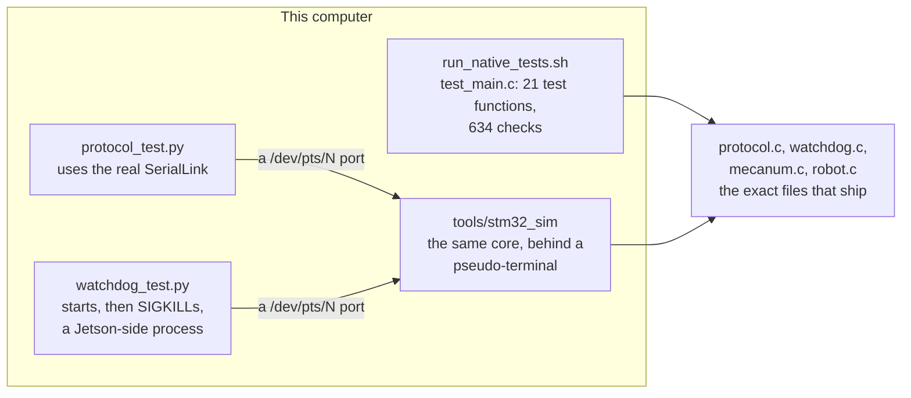

# Trying the body without a board

You can run the body's logic, and the Jetson's half of the conversation with it, on this
computer with no microcontroller attached. Nothing on this page needs a serial device, motors
or PlatformIO. It needs `gcc` and the project's Python.

## Three things to run

```bash
./firmware/stm32/run_native_tests.sh               # the core's checks, gcc only
python scripts/serial/protocol_test.py --sim       # every documented line, both sides
python scripts/serial/watchdog_test.py --sim       # kill the brain, watch the wheels stop
```

Results on **2026-11-16**, on the Jetson, 🧪:

| Command | Result |
|---|---|
| `run_native_tests.sh` | **634 checks, 0 failures** (0.75 s wall) |
| `protocol_test.py --sim` | **20 passed, 0 failed** |
| `watchdog_test.py --sim` | **PASS**: wheels turning after 152 ms, stopped 499 ms after `SIGKILL`, still stopped 1 s later |

## What each one is



* **`run_native_tests.sh`** compiles the portable core with `gcc` and runs
  [`test_main.c`](../../../firmware/stm32/test/test_native/test_main.c). The 21 test functions
  group as: 8 on the watchdog and timed motion, 4 on the protocol, 4 on the bring-up `WHEEL`
  command and its bookkeeping, 2 on the mecanum signs, 3 on the PID.
* **`tools/stm32_sim`** is **not a reimplementation**. It links the exact `protocol.c`,
  `mecanum.c`, `watchdog.c` and `robot.c` that go to the board, and supplies a board whose
  "motors" are variables. It prints a pseudo-terminal path that the Jetson side can open as if it
  were `/dev/ttyACM0`, and it writes the wheel state to a file so a test can read it.
* **`protocol_test.py`** drives the real Python `SerialLink` against the simulator: documented
  commands are accepted, rejections carry a reason, the Jetson clamps before the wire, `STATUS`
  returns the documented shape, a timed drive ends with `DONE`, and the heartbeat is flowing.
* **`watchdog_test.py`** is the safety test. It starts a separate process that sends the
  heartbeat and a long `DRIVE`, confirms the wheels turn, then kills it with `SIGKILL`, which
  cannot be caught, so **nothing on the Jetson side takes part in stopping the robot**. If the
  wheels stop, the firmware decided to stop them.

If you changed `protocol.h` rebuild the simulator first with `tools/stm32_sim/build.sh`. An old
simulator binary once cut the long reply line and parsed its tail as a command of its own,
because it had been built with `PROTOCOL_MAX_LINE 96`.

## What passing proves, and what it cannot

| It proves 🧪 | It cannot tell you ❓ |
|---|---|
| The command parser accepts and refuses what the document says | That any **pin** is the right pin: `robot_pins.h` is a proposal for a Black Pill |
| The watchdog logic trips at 500 ms, once, and does not resume | That the watchdog runs **on the board**, in its real loop, under real load |
| Responses are formed correctly and every command gets one | How a **USB-UART chip** or the ESP32's UART buffers and delays bytes |
| The Python link clamps, matches responses and survives a reconnect | Which way a **real wheel** turns, so the wheel signs are untested on metal |
| The mecanum formulas give the signs in the picture | Whether the **geometry** (radius, half-width, half-length) is the chassis' |
| The PID converges, saturates and does not wind up | Whether the **gains** suit these motors, and the **encoder counts per revolution** |

## Other Python tests that touch the body

The wider suite (`python -m pytest tests/ -q`, 1255 tests, run on 2026-11-16) includes
`tests/test_serial_reply.py` (reply JSON goes down the wire; `ping_ports` reaches every port),
`tests/test_tools.py` (tool calls and their clamping) and `tests/test_hardware.py` (picking the
serial port from the dashboard). `scripts/hardening/failure_drills.py` kills each service for real
and checks that the body stops when `robot-core` dies.

## When real hardware arrives

[The ESP32 as the body](esp32-conformance.md) gives the order. Two points belong here:

1. **`protocol_test.py` sends `DRIVE`, `WHEEL`, `HAND` and `FACE`.** Against a real port it moves
   things. Run it only with the motors unpowered or the robot on blocks.
2. **`watchdog_test.py --port` is guided, not automatic.** On a real board it cannot see the wheels, so it
   kills the Jetson-side process and asks you what a scope, an LED or your eyes show. See
   [the watchdog page](watchdog.md#proving-it-on-a-real-board).
