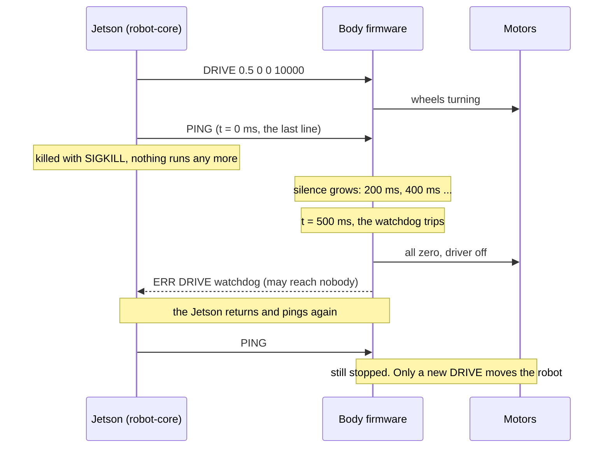

# The watchdog: how the robot stops when the brain dies

> **The single most important safety mechanism in the project.** The Jetson runs a full Linux
> on a board with a real out-of-memory risk. It *will* hang or be killed at a bad moment. A robot
> whose only brake is a `STOP` from a dead process drives into a wall, so **the body never relies
> on the Jetson to stop it.**

## The rule

| | |
|---|---|
| The Jetson sends | `PING` every **200 ms** while the link is up (`HEARTBEAT_PERIOD_S` in `serial_link.py`) |
| The body measures | the time since the last line **of any kind** |
| If it reaches | **500 ms** (`WATCHDOG_TIMEOUT_MS`), the body zeroes every motor on its own authority |
| Then | it reports `ERR <verb> watchdog` (if it was moving) and goes idle |
| Recovery | a **fresh command** is needed. Motion does not resume by itself, even when `PING` returns |

The numbers are in [`watchdog.h`](../../../firmware/stm32/include/watchdog.h), and the rule is
written in [`serial-protocol.md`](../../../dev-docs/architecture/serial-protocol.md) § Heartbeat
watchdog.



## How it is built, and why it is trustworthy

`watchdog.c` is 46 lines with no hardware dependency, so **the exact code that ships is the
code the tests run**.

| Property | What the code does | Checked by |
|---|---|---|
| **Armed by the first line** | Until any line has arrived, the watchdog does nothing: the motors were never commanded, so the robot is already safe | `test_watchdog_timing` 🧪 |
| **Any line feeds it** | A malformed line, `STATUS`, the discovery ping and a `{...}` reply line all count. The contract says "no line of any kind" | `test_watchdog_feeds_on_any_line`, `test_reply_lines_are_swallowed_and_feed_the_watchdog` 🧪 |
| **Trips at exactly 500 ms, once** | Not at 499 ms, yes at 500 ms. `watchdog_check` returns 1 on the transition only, so the body stops and reports once and does not repeat | `test_watchdog_timing` 🧪 |
| **Stops, cancels and reports** | The wheels are zeroed, the drive is cancelled and not merely paused, and `ERR DRIVE watchdog` is emitted | `test_silence_during_drive_zeroes_the_motors` 🧪 |
| **Does not resume** | A line clears the trip so a later silence can be detected again, but nothing restarts the drive | `test_motion_does_not_auto_resume` 🧪 |
| **Survives the counter wrapping** | Unsigned subtraction on a 32-bit millisecond counter, correct across the wrap at about 49.7 days | `test_watchdog_survives_counter_wrap` 🧪 |
| **Covers the bring-up command too** | `WHEEL` has the same bounded duration and the same watchdog as `DRIVE` | `test_wheel_obeys_the_watchdog_too` 🧪 |
| **Names the right verb** | `DONE`/`ERR` echo `DRIVE` or `WHEEL`, whichever started the motion | `test_expiry_names_the_right_verb` 🧪 |

Two more layers sit around it:

* **Every `DRIVE` has a duration.** Even with no watchdog, a drive ends by itself.
* **The reference board also pulls the driver's standby pin low** (`PIN_MOTOR_STBY`) whenever
  all targets are zero, "so a stuck timer cannot keep the robot moving" and "if the loop has
  wedged, STBY low still stops the robot". That is a hardware backstop, and it only works
  because the wedge-proof path does not depend on the PID loop. An ESP32 build needs its own
  equivalent ❓.

## How far it travels before it stops

Arithmetic from the limits, not a measurement (📐): 500 ms of silence at the speed of a spoken
step (0.2 m/s) is about **10 cm**; at the 1.0 m/s ceiling it is about **50 cm**, plus whatever
the motors need to stop. Anyone raising the speed limits is also lengthening this distance.

## What was measured today

On 2026-11-16 the test killed a Jetson-side process with `SIGKILL` (no cleanup, no `STOP`)
while the host simulator, running the real `protocol.c`, `watchdog.c` and `robot.c`, was driving:

```
[3] wheels TURNING after 152 ms: FL=10.42 FR=10.42 RL=10.42 RR=10.42
[4] SIGKILL -> pid 3660  (no cleanup, no STOP command)
[5] wheels STOPPED 499 ms after the kill
[6] still stopped 1 s later; motion did not auto-resume
PASS: the STM32 stopped the motors by itself.
```

That is **🧪, not ✅**: the wheels were variables in a simulator, not motors. The test itself
allows 400 ms of slack either side of 500 ms for a loaded Linux machine.

## What has not been proven

| Not proven | Why it matters |
|---|---|
| The watchdog **on any real board**, and on the **ESP32** in particular | The firmware README says nothing else should be trusted until this passes on real silicon |
| **A way to observe it on real hardware** | `watchdog_test.py --port` cannot see wheels: it waits for a file, `run/stm32_state.json`, that only the simulator writes. On a real port it stops with `FAIL: wheels never started turning` after 10 s. The script says so in a note, but the README's bring-up step 2 reads as though it were an automated check. A real check needs something visible: a scope or LED on the PWM or standby pin, or wheels off the ground and your eyes. Recorded as Known issue #21 |
| That the ESP32 main loop **never blocks** | If a Wi-Fi or Bluetooth stack, a flash write or a long display refresh delays the loop by more than the rest of the 500 ms, the stop is late. The check must be made on the ESP32 itself ❓ |
| That nothing else **moves the motors after a stop** | On a reset or brown-out the pins are in whatever state the chip leaves them in. See the boot-state row in [The ESP32 as the body](esp32-conformance.md) ❓ |
| The effect of **USB-UART buffering** | A USB-UART chip may deliver a few late bytes after the cable is pulled or the process dies. It cannot make the stop later than 500 ms, but it affects how the test is built ❓ |

## If you change it

* Keep `WATCHDOG_TIMEOUT_MS` at 500 and the heartbeat at 200. The ratio leaves room for two
  lost pings.
* Run `./firmware/stm32/run_native_tests.sh` and `python scripts/serial/watchdog_test.py --sim`.
* Never add a path in the Jetson that "makes the stop more reliable". The whole design is that
  nothing in the Jetson is relied on.
