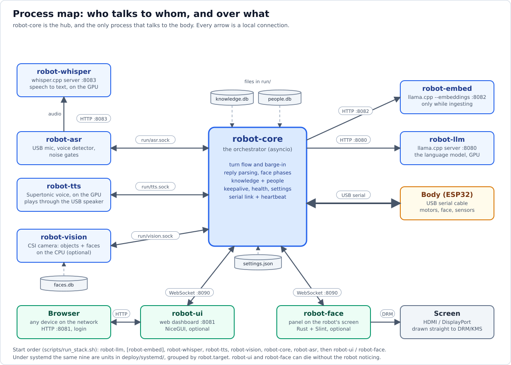
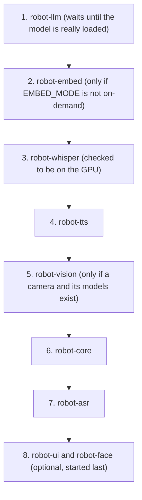

# The brain: nine programs on the Jetson

The Jetson does not run one big program. It runs **nine small ones**, each supervised and
restarted if it dies, so that one crash cannot take the robot down.



## Who does what

| Program | Does | Talks on | Runs on | Needed to talk? | Costs (measured) |
|---|---|---|---|---|---|
| **`robot-core`** | The orchestrator: turn flow, prompt, reply parsing, knowledge, people, keepalive, the serial link and the heartbeat to the body | local socket `run/core.sock` for command-line tools, WebSocket `:8090` (loopback only, token) | CPU | **yes** | ~36 MiB |
| **`robot-asr`** | The microphone, the voice detector and the noise gates. Sends closed utterances to `robot-whisper` | socket `run/asr.sock` | CPU | **yes** | the voice detector adds ~23 MiB |
| **`robot-whisper`** | whisper.cpp server: speech to text and language | HTTP `127.0.0.1:8083` | **GPU, required** | **yes** | depends on the model size (see the Memory page) |
| **`robot-llm`** | llama.cpp server: the language model | HTTP `127.0.0.1:8080` | **GPU** | **yes** | the largest line; depends on `LLM_MODEL` |
| **`robot-tts`** | The voice (Supertonic by default, Piper selectable) and playback through the USB speaker | socket `run/tts.sock` | **GPU** | **yes** | 472 MiB on CPU, 1738 MiB on GPU after a few utterances |
| `robot-embed` | llama.cpp with `--embeddings`, for searching documents | HTTP `127.0.0.1:8082` | CPU | no: search falls back to keywords | ~633 MiB, **only while ingesting** (`EMBED_MODE=on-demand`) |
| `robot-vision` | Camera to objects and faces | socket `run/vision.sock` | CPU | no | ~213 MiB |
| `robot-ui` | The web dashboard | HTTP `0.0.0.0:8081`, login | CPU | no | ~60 MiB |
| `robot-face` | The panel on the robot's own screen (Rust and Slint, straight to the display, no desktop) | client of WebSocket `:8090` | CPU | no | 11.0 MiB RSS, plus 8.4 MiB of display buffers |

Sources: [`system-overview.md`](../../../dev-docs/architecture/system-overview.md),
[`memory-budget.md`](../../../dev-docs/architecture/memory-budget.md),
[`face.md`](../../../dev-docs/modules/face.md), `config/*.env`. The model-dependent lines
(LLM, whisper, voice) change with the selection; the Memory page prices the live choice.

Three rules fall out of the picture:

* **Only `robot-core` talks to the body.** Everything else reaches hardware through it, so
  the heartbeat and the safety clamping live in exactly one place.
* **The two screens depend on nothing, and nothing depends on them.** They are visitors on
  the WebSocket. Killing `robot-ui` with `SIGKILL` was tested: the robot kept answering and
  the heartbeat to the body never stopped ✅.
* **Everything is local.** Every arrow is a connection on this machine, except the dashboard
  (your own network) and the USB cable to the body.

## The order they start in

The order is not cosmetic. Two engines starting together can both fail to get GPU memory,
because each needs one large contiguous block (whisper about 1.3 GB while the LLM wants about
2.8 GB). Starting the LLM first, waiting until it is really up, then whisper, is what makes a
cold start work.



This is `scripts/run_stack.sh`. Restarting one engine by hand beside the others can fail
where a cold start works: see [Models and memory](models-and-memory.md).

## Two ways to run it

| | Development: `./run.sh` | Production: systemd |
|---|---|---|
| Started by | `scripts/run_stack.sh` | the units in `deploy/systemd/`, grouped by `robot.target` |
| Restarts a crashed service? | Only the keepalive part of `robot-core`, for the four AI engines and the camera | systemd, `Restart=on-failure` on every unit |
| Sandboxed? | No | Yes |
| State | ✅ used every day | 📐 **never booted on this board**; four faults were found by reading it, and it still needs a real boot |

```
./run.sh all        everything + the browser dashboard on :8081
./run.sh headless   everything, no screens: how the robot ships
./run.sh slint      everything + the panel on the robot's own screen
./run.sh stop | status | info
./run.sh model      which model is chosen, configured and running
./run.sh <mode> --check     print the configuration it would use, start nothing
```

The three modes differ **only** in which screen is started. The voice pipeline is identical.

**A change to a service is not done until it has been read under both supervisors.** They
read the same environment files differently, and only systemd sandboxes. See
[`TROUBLESHOOTING.md`](../../../dev-docs/ai/TROUBLESHOOTING.md) § "Everything works under
run.sh and breaks under systemd".

## Where the data lives

| File | Written by | Holds |
|---|---|---|
| `run/knowledge.db` | `robot-core` | Document chunks, their embeddings and keyword index. See [Knowledge](knowledge.md) |
| `run/people.db` | `robot-core` | People, their conversations and summaries |
| `run/faces.db` | `robot-vision` | Face samples: 128 numbers each, no photographs |
| `run/settings.json` | `robot-core` | Dashboard pins that take effect without a restart |
| `config/*.env` | the dashboard, or you | Per-service choices that need a restart |
| `.cache/tmp/*.log` | each service | Logs under `./run.sh` (journald under systemd) |

`run/` is not in git. **`people.db` and `faces.db` are personal data and stay on the robot.**

## Next

* [Voice pipeline](voice-pipeline.md): listen, decide the language, think, speak, act.
* [Models and memory](models-and-memory.md): the 7620 MiB ceiling.
* [Knowledge](knowledge.md), [Vision and people](vision-and-people.md), [Reliability](reliability.md).
