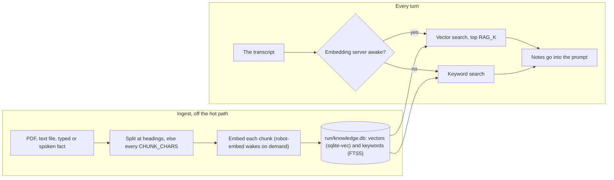

# Knowledge

The robot can answer from documents you give it, in any of its three languages. A document
in Indonesian can answer an English or an Arabic question: measured, 8 of 8 questions asked
in another language found the right passage.



## Putting documents in

```
./scripts/ingest.sh knowledge/Tazakka_Informasi_Ringkas.pdf    # a file or a folder
./scripts/ingest.sh --list                                    # what is in the store
./scripts/ingest.sh --rebuild                                 # forget everything, re-ingest knowledge/
./scripts/measure/knowledge_qa.py                             # does it know it, and how fast
./scripts/measure/knowledge_qa.py --retrieval                 # retrieval only, no LLM
```

Or drag a file onto the **Knowledge** page of the dashboard. Source documents live in
`knowledge/`; the store is `run/knowledge.db`.

* **Ingestion never blocks a conversation.** A queue and a worker take the file, and the call
  returns at once. Embedding a document takes seconds to minutes; a turn has about two.
* **Chunks follow the document's own structure.** A document with at least three headings
  (`## X`, `3. X`) is split at them. Otherwise it is cut every `CHUNK_CHARS`. Measured on a
  15-section document: size-based chunking made the prompt budget discard 51 of 72 retrieved
  chunks; heading-based discarded none, for a third less context and the same answers.
* **PDFs are read with poppler's `pdftotext`**, a C program already on the board. A scanned
  PDF has no text layer and is refused with a reason rather than stored empty.

## Two things learned the hard way

**Check which retrieval mode a turn used.** With `EMBED_MODE=on-demand` the embedding server
sleeps between ingests, and a sleeping server quietly downgrades retrieval to keyword search.
That still works for a question asked in the document's own language and returns **nothing**
for one asked in another: Arabic questions retrieved nothing and the model invented names.

```
grep 'robot-rag: retrieved' .cache/tmp/core.log      # says "by vector" or "by keyword" per turn
```

**Never leave test data in the store.** Chunks from a smoke test compete with real documents
for the top few places. `ui_smoke.py` now removes what it uploads.

## What the store holds

The schema is `chunks(id, text, source, lang, added_at)`. There is **no metadata column**, so
everything the Knowledge page shows beyond that is derived:

| View | What it is | Honest about |
|---|---|---|
| **Document** | The file itself when the source still names one on disk, otherwise the chunks joined back together | `raw_from` says which. A rebuilt document is not the file: the splitter dropped whatever lay between chunks |
| **Chunks (JSON)** | Exactly what retrieval searches, each embedded separately | |
| **About** | Key terms, and on request a summary and the entities | Key terms are a crude tf-idf. With fewer than three documents it falls back to raw frequency and is labelled `frequent` rather than `distinctive` |

The summary and the entities are written by **the language model that is already in memory**,
on request, under a JSON schema instead of a polite request. Asked politely, it produced valid
JSON and then ran out of budget halfway through the object.

## The persona lives here too

The **persona** is the standing instruction carried into every turn, ahead of anything
retrieved. It is on the Knowledge page because it is knowledge, not a tuning knob. The page
shows its cost: roughly a quarter of its character count in tokens, on every prompt, almost
entirely re-used from the cache.

## Numbers

* Retrieval takes about 140 to 220 ms, against a budget of under 100 ms (measured at M7).
* Embedding model: Qwen3-Embedding-0.6B, 8-bit, 1024 numbers per chunk. It is chosen over a
  small English-centric model because that would quietly degrade Arabic and Indonesian.
* The vector store is **sqlite-vec**: one file, no server.
* On a 15-chunk test document: 19 of 19 questions answered, 39 of 39 facts, including English
  and Arabic questions against an Indonesian document, and it refuses to invent a fee it was
  never told.

Design reasons and measurements: [`system-overview.md`](../../../dev-docs/architecture/system-overview.md)
§ Conversational turn flow, [`AGENTS.md`](../../../AGENTS.md) § Knowledge.
