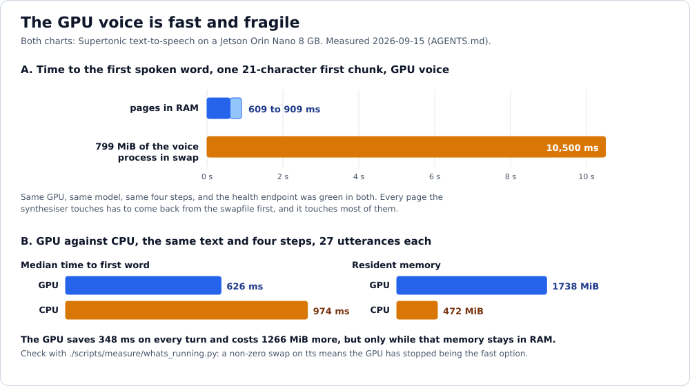

# Models and memory

**The hardest constraint in the project.** The Jetson's CPU and GPU share one pool of RAM, so
a model loaded on the GPU is taken from the same memory as everything else. Going over does
not slow the robot down. It kills a process, or, worse, starts swapping.

| | |
|---|---|
| Usable RAM | **7620 MiB**. Not 8192: the rest is reserved by the hardware |
| Target | steady state at or under about **7 GB**; treat anything above as a bug |
| Rule 1 | **One language model resident at a time.** Unload before you load |
| Rule 2 | No new dependency without pricing its memory first |

## What is chosen right now

Read from `config/*.env` on 2026-11-12. **This changes whenever someone picks a model on the
dashboard**: the live answer is `./run.sh model`, which prints *chosen*, *configured* and
*running* side by side.

| Job | Model | Where it runs | File |
|---|---|---|---|
| Think | LFM2.5-2.6B, 5-bit (Q5_K_M), 2048-token window | GPU | `config/llm.env` |
| Listen (decoder) | whisper large-v3-turbo, 8-bit (q8_0) | GPU, required | `config/whisper.env` |
| Listen (voice detector) | Silero VAD | CPU | `config/asr.env` |
| Speak | Supertonic, voice M1, 4 steps | GPU, required | `config/tts.env` |
| Search documents | Qwen3-Embedding-0.6B, 8-bit | CPU, only while ingesting | `config/embed.env` |
| See | YOLOX-Tiny (objects), YuNet (faces), SFace (who) | CPU | `config/vision.env` |

**`chosen`, `configured` and `running` should be identical.** A difference is a restart that
did not happen, never a normal state.

## What things cost (measured, with the date)

| Item | Cost | Measured |
|---|---|---|
| `robot-core` | ~36 MiB | M4 |
| `robot-ui` (dashboard) | ~60 MiB | M8 |
| `robot-face` (panel) | 11.0 MiB RSS + 8.4 MiB display buffers | M11, 2026-09-09 |
| `robot-vision` | ~213 MiB, about 0.27 of a core while the room is still | 2026-10-22 |
| `robot-embed` | ~633 MiB, **only while ingesting** | M7 |
| Supertonic on the CPU | 472 MiB | 2026-09-15 |
| Supertonic on the GPU | 1081 MiB just after loading, **1738 MiB after a few utterances** | 2026-09-15 |
| People memory | 0 MiB | 2026-10-29: a sqlite file and a few hundred characters of prompt |

Supertonic is a small model behind a large CUDA runtime: its weights are 383 MiB on disk and
it is resident at 1.1 to 1.7 GB, because cuDNN allocates its workspace lazily. **The GPU cost
grows with use.** Every figure above is a snapshot: the Memory page of the dashboard shows the
current measured number for every line, taken from `/proc` every 3 seconds, beside an
estimate for models that are not loaded.

The rule behind the estimate and the measurement: **where they disagree, the measurement is
right.** That is how the Supertonic line was found to be 884 MiB light.

## Fast and fragile: the GPU voice



The GPU voice saves **348 ms on every turn** (median 626 ms against 974 ms, over 27 utterances
each), and it does not slow down with use. But the cost is not gradual. With 799 MiB of the
voice process swapped out, the same sentence took **10.5 s**: about 17 times the GPU voice's
own median, and 11 times the CPU voice's, with the health endpoint green throughout.

So the GPU is the fast choice *and* the fragile one:

```
./scripts/measure/whats_running.py     # a non-zero swap on tts means the GPU has
                                       # STOPPED being the fast option
```

Keep the headroom and stay on the GPU. Lose the headroom and `TTS_USE_GPU=0` is the better
robot.

**Tuning the first-chunk length or the number of synthesis steps cannot fix this**: steps 4
→ 3 → 2 moved the median by less than the run-to-run noise (577 to 1726 ms), because none of
it was compute-bound. Check swap before believing any other latency number.

## What decides whether a selection fits

* **Quantise before you shrink.** A quantised model costs less than a smaller one, and
  costs little accuracy. Measured: whisper turbo q5_0 against fp16 was 656 MiB smaller and
  223 ms faster, with identical transcripts.
* **A development session is part of the budget.** VS Code's remote server plus an AI agent
  session is 1.0 to 1.8 GB. Measured on 2026-09-15, one selection was priced at 6529 MiB
  against about 5360 MiB left with a session attached, and the board swapped. Without one the
  same selection fitted with about 700 MiB to spare. **Do not run the full stack and a development
  session on the board at the same time**: measured at 97% use and 3.2 GB of swap.
* **A model that cannot get its allocation does not degrade. It aborts.** whisper
  large-v3-turbo needs 1548 MiB of *contiguous* GPU memory; started into a board with 997 MiB
  free it dies with `cudaMalloc failed: out of memory` and the robot is deaf. Load order
  decides this, which is why `./run.sh` can succeed where restarting one service by hand
  fails.
* **The LLM is the adjustable one.** It is the largest line and the one to shrink when the
  others cannot fit.

## Choosing and installing a model

```
./scripts/models/fetch_hf.sh <repo> <file-in-repo> [kind]   # or paste a huggingface.co URL
./scripts/models/fetch_hf.sh --dry-run ...                  # where would it go?
./scripts/models/list.sh                                    # what is installed, and what it costs
```

The destination is inferred from the filename, and it matters: a GGUF that lands in the
wrong folder is invisible to the catalogue.

| File | Goes to |
|---|---|
| `*.gguf` | `models/llm/` (pass `embed` for an embedding model) |
| `ggml-*.bin` | `models/asr/whisper/` |
| `*.onnx` | `models/tts/piper/` (the `.onnx.json` is fetched too) |

A new file appears on the **Memory** page within about 3 seconds, with no restart.
**Installing does not select.** The Memory page prices the model against the ceiling first;
choosing it there is what writes the config and restarts whatever has to reload.

**Switching the LLM is a reload, not a restart.** The swap stops whisper and the voice, loads
the LLM, and starts them again (about 30 s deaf and mute). Restarting the LLM beside resident
whisper and voice died with `cudaMalloc failed`, twice, which the keepalive read as "this
model will not run" and silently fell back to a smaller one.

## When the board is too full anyway

The keepalive part of `robot-core` can shrink the LLM by itself, and only the LLM. See
[Reliability](reliability.md).

Full numbers, dated, are in
[`memory-budget.md`](../../../dev-docs/architecture/memory-budget.md) and
[`AGENTS.md`](../../../AGENTS.md).
