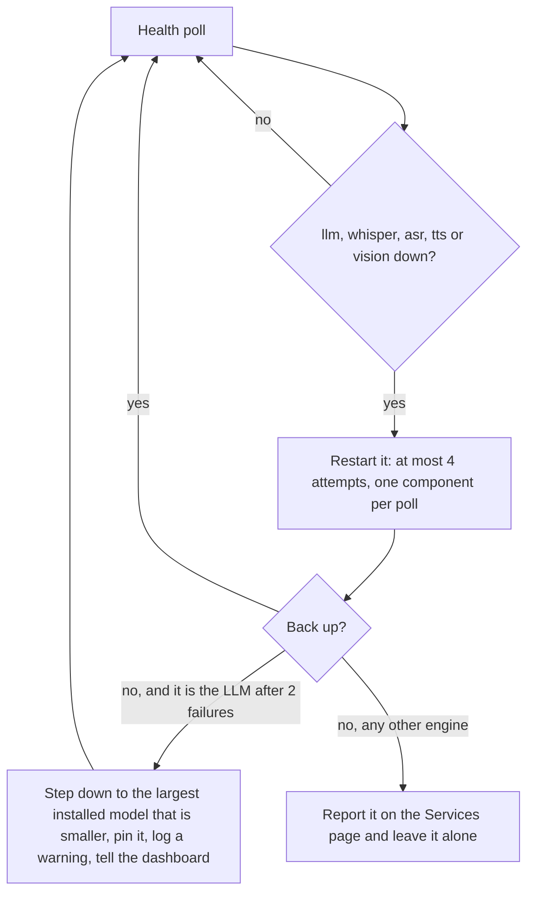

# Reliability: what happens when something dies

The design goal is **a robot that survives a component crash and never leaves a motor
running**. This page lists what each failure does, what keeps the robot up, and, just as
important, what has *not* been proven.

## What happens when each part dies

| What dies | What the robot does | Proven by |
|---|---|---|
| **`robot-core`** (the orchestrator, which holds the heartbeat) | The body sees no line for 500 ms and **zeroes the motors on its own authority** | 🧪 against the reference firmware core and the host simulator (`scripts/serial/watchdog_test.py --sim`: kill the brain with `kill -9`, watch the wheels stop). **Not yet checked on real silicon, and never on the ESP32** |
| **`robot-ui` or `robot-face`** | Nothing. The robot keeps listening, answering and driving; the heartbeat never stops | ✅ `SIGKILL` on `robot-ui` (M8) |
| **`robot-llm`** | The robot speaks a short canned line so a dead service is audible rather than silent. The keepalive restarts it, and shrinks the model if it will not come back | ✅ failure drills |
| **`robot-whisper`** (the decoder) | The robot is deaf. The keepalive restarts it. It is watched on its own row, because `robot-asr` stays connected and green when the decoder behind it has died: "a deaf robot with every light on" | ✅ drilled 2026-10-14: killed, marked down in 1 s, restarted at 4 s, healthy at 12 s |
| **`robot-tts`** or the speaker | The reply is not lost. The sentence is dropped, the Services page goes red, and the **next** utterance tries again, so freeing memory recovers it with no restart | ✅ failure drills |
| **`robot-asr`** (microphone) | The keepalive restarts it. A closed microphone gate can never stay shut longer than one turn timeout, so a missed "finished" message cannot leave the robot permanently deaf | ✅ fixed after it happened, with a regression test |
| **A turn that hangs** | A turn cannot hang: it has a timeout, and the robot goes back to idle | ✅ failure drills |
| **The USB cable to the body** | The link reconnects by itself. Meanwhile the body's own watchdog has already stopped the motors | 🧪 |

Sources: [`failure_drills.py`](../../../scripts/hardening/failure_drills.py) (24 of 24
pass), [`system-overview.md`](../../../dev-docs/architecture/system-overview.md),
[`PROGRESS.md`](../../../dev-docs/ai/PROGRESS.md).

## The keepalive

Under `./run.sh` nothing restarts a crashed service: the non-zero exit a service makes on its
way out is addressed to systemd. So `robot-core` runs a **keepalive** off its health poll.



Switches: `CORE_KEEPALIVE=1` restarts engines, `CORE_KEEPALIVE_LLM_FALLBACK=1` allows the LLM
to shrink.

**The engines are deliberately not treated alike.**

* `asr`, `whisper`, `tts` and `vision` are only restarted. Which model they load is the
  owner's decision, priced on the Memory page. A program that quietly swapped
  `large-v3-turbo` for `tiny` because a restart failed would be answering a memory problem
  by degrading transcription without saying so.
* The **LLM** is the exception, because it is the largest line in the budget and the only
  one with a strictly smaller alternative that still answers. After two failed restarts it
  steps down to the **largest** smaller installed model (so as little as possible is lost),
  logs a warning naming the swap, and **never steps back up**: that is a judgement about
  quality, and it belongs to the owner.

Measured on a real fault on 2026-10-06, with a 4B model selected on a full board:

```
19:11:31  llm is down; restarting it (attempt 1 of 4)
19:11:54  llm did not come back: exiting due to model loading error
19:11:57  llm is down; restarting it (attempt 2 of 4)
19:12:28  failed 2 restarts with Qwen3-4B; falling back to LFM2.5-2.6B-Q5_K_M
19:12:42  llm is back up
```

**Everything is bounded, and that is the point.** Four restarts then stop, two downgrades then
stop, one component per poll. A restart loop against a board that is simply full is *worse*
than a stopped service, because it burns the memory the next attempt needs. Two engines
starting together is the one case guaranteed to fail: whisper wants 1.3 GB contiguous while the
LLM wants 2.8 GB.

`UNKNOWN` is not `DOWN`: it is what the microphone and voice services are for the first
seconds after the core starts, before they connect. Treating it as a fault restarted services
that were coming up perfectly well.

## The heartbeat: the one safety mechanism that matters most

* The Jetson sends `PING` every **200 ms** while the link is up.
* If the body receives no line of any kind for **500 ms**, it zeroes all motor outputs
  itself and goes to a safe idle. Motion does not resume by itself: a new command is needed
  after `PING` resumes.
* Every `DRIVE` carries a **duration**, and the body stops when it expires. Motion is never
  open-ended, waiting for a `STOP` that might never come.

The Jetson runs a full Linux on a memory-constrained board. It *will* eventually hang or be
killed at a bad moment. A robot whose only brake is a `STOP` from a dead process drives into
a wall, so the body never relies on the Jetson to stop it.

## What has **not** been proven

Reading this list is more useful than reading the table above.

| Not yet proven | Why it matters |
|---|---|
| The watchdog on **real hardware**, and on the **ESP32** in particular | The protocol and the 500 ms rule are tested against the reference firmware core and a simulator only. The README for the firmware says nothing else should be trusted until the watchdog test passes on real silicon |
| Wheel directions on a real chassis | The firmware's signs are defaults, not measurements. There is also an [open question about the sign of `+vy`](voice-pipeline.md#5-acting) |
| The **systemd** path | The units have never been installed or booted on this board. Four faults were found by reading them against the development path |
| A **24-hour run** | 24 of 24 failure drills pass and a 45-minute soak (313 turns, no errors) is clean, but the 24-hour soak has not been run |
| The camera features with a live person | Tested with scripted cameras and photographs |

## Checking it yourself

```
python scripts/hardening/failure_drills.py     # kills each service for real and checks what the docs require
python scripts/hardening/soak.py --minutes 60  # RAM creep, thermals, stuck motors, OOM
./scripts/measure/whats_running.py             # state, GPU or CPU, RSS and swap per service
./run.sh status
```

The Services page of the dashboard shows the same thing live, and starts, stops or restarts a
service through whichever supervisor is actually in charge.
