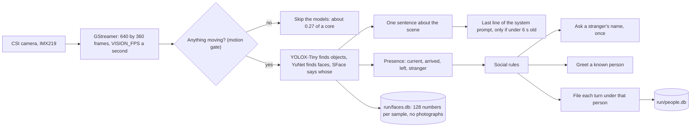

# Vision and people

The robot can **see** (objects and faces) and **know who it is talking to** (greet them by
name and pick the conversation up where it stopped). Both are optional. With
`VISION_ENABLED=0`, or no camera, the robot is exactly what it was before.

State: ✅ built and tested through the real orchestrator and against the real language model
with a scripted camera. **Not yet tried with a live person in front of it.**

## Seeing (`robot-vision`)

* **The camera** is an IMX219 on the Jetson's CSI connector. It is reached through NVIDIA's
  Argus and GStreamer, because the sensor sits behind the image processor and cannot be read
  like a USB camera. **Argus allows one program at a time**: stop `robot-vision` before
  running anything else that opens the sensor.
* **The models run on the CPU**, through the onnxruntime that is already installed. No
  OpenCV, no PyTorch. A fourth GPU context would have cost 0.6 to 1.3 GiB. Total cost: about
  **213 MiB**.
* **The motion gate is what keeps it cheap.** While the room is still, the models are
  skipped. Its threshold was measured against this sensor's noise (the first guess skipped
  nothing). Measure again if the camera, the lighting or `VISION_FPS` changes.
* **Models were chosen by licence as well as accuracy**: YOLOX (Apache-2.0), YuNet (MIT) and
  SFace (Apache-2.0), over YOLOv8 (AGPL-3.0) and InsightFace (non-commercial).
* **The model is told the scene as one sentence**, and only when the scene is under six
  seconds old and only for faces that were matched. The line goes **last** in the prompt so the
  cached start of the prompt survives. A "sharper" wording scored 0 of 3 against 3 of 3 on the
  same model: do not reword it without testing.
* If no frame arrives for 10 s the camera pipeline is stopped cleanly and restarted, backing
  off to 30 s. The service never exits because a camera is missing.

Details and measurements: [`vision.md`](../../../dev-docs/modules/vision.md).

## Knowing people (`robot-core`)

It adds **no process, no model and no dependency**: 0 MiB beyond a sqlite file. Recall works
by prompt, not by searching: the last turns come back as ordinary chat turns, plus a few lines
of notes the language model wrote when the person left.

The story, in six steps:

1. A face nobody knows stands alone in front of the camera for about 4 s. The robot says:
   "Hello! I don't think we've met. What's your name? I'll remember you, unless you'd rather I
   didn't."
2. The next thing said, by voice or typed, is read by plain rules (`parse_name`): a name, a
   refusal ("no thanks": stop asking for five minutes), or anything else (an ordinary turn,
   and the question stays open).
3. A name makes `robot-vision` learn the face (from 3 frames), files the person and welcomes
   them in the language they used.
4. From then on, every turn while that face is in view is filed under them, and the model is
   shown who it is talking to and what was said last time.
5. They leave: out of the picture for 2 minutes. The **visit**, meaning that conversation,
   ends. The language model writes a summary of it and updates a few lines of running notes
   about the person.
6. They come back: greeted by name in their own language, with the end of the last
   conversation already in context.

### What is stored, and what is not

| Table | Holds |
|---|---|
| `people` | Name (unique, case-blind), first and last seen, visits, last language, running notes |
| `turns` | Who said it, the text, the raw model reply, language, typed or spoken, which visit |
| `conversations` | One per person and visit: its summary, who wrote it (model or a plain fallback), when |

**Logs → Conversations** on the dashboard lists every conversation per person, newest first,
with its summary.

### Rules that make it safe to leave running in a room

| Rule | Why |
|---|---|
| **It is personal data and it never leaves the robot.** `run/people.db` and `run/faces.db`, gitignored, sent nowhere | These are faces and conversations. Do not copy them off |
| **Only turns attributed to a recognised face are stored** | A typed question with nobody in front of the camera is never written down |
| **Forget removes both** the face samples and the person with everything said to them | `CORE_PEOPLE=0` removes the whole feature |
| **The robot asks once**, and only when one close, clear, steady unknown face is alone in view | Two faces cannot be asked: it would not know who answered |
| **A stranger inherits nothing**: the previous person's conversation leaves the prompt the moment an unknown face is alone in view | One person's words must not reach the next |
| **A name that is already known is never given to a face that was not recognised as it** | No stealing an identity by saying a name |
| **The robot never interrupts a person.** Turns it starts itself are dropped if anything is running | |
| **There is no anti-spoofing.** A photograph of an enrolled person matches | **Never put anything that matters behind a face** |

Full design and rules: [`people.md`](../../../dev-docs/modules/people.md).

## Limits to know about

* The words the robot greets with are only as good as the model: on a 0.6B model the
  plumbing is right and the greeting is poor. Judge it on a 3B or larger.
* A **typed** line is filed under whoever the camera sees, not whoever typed it. The page
  names who it is filed under.
* The first question is asked in `CORE_DEFAULT_LANGUAGE`: the robot cannot know a stranger's
  language before they speak. The welcome follows what they say.
