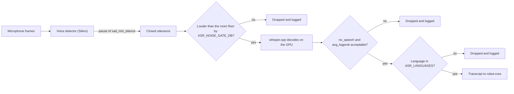
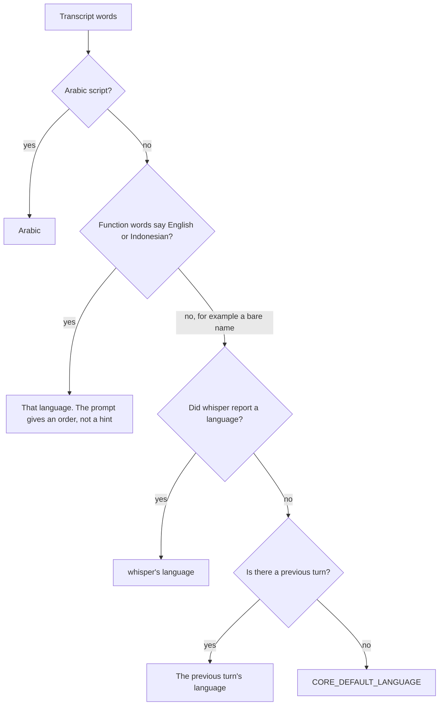
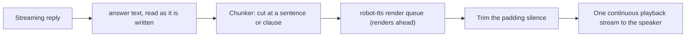

# The voice pipeline

The five stages of a turn in detail: [listening](#1-listening), [deciding the
language](#2-deciding-the-language), [thinking](#3-thinking), [speaking](#4-speaking) and
[acting](#5-acting). For the one-page version see [One turn, end to
end](../01-overview/one-turn.md).

Settings named here live in `config/*.env` (need a restart) or are *pins* on the dashboard
(live). A pin beats the file, and `./run.sh <mode> --check` lists the pins in force.

## 1. Listening

`robot-asr` owns the microphone. `robot-whisper` does the decoding. Between them, a sound has
to pass **three gates** before it becomes a turn.



| Gate | Setting | Why it exists |
|---|---|---|
| Level, before decoding | `ASR_NOISE_GATE_DB` (6.0 dB in the file) | A sound barely above the room floor is not worth a decode |
| Confidence, after decoding | `ASR_MAX_NO_SPEECH` (0.6), `ASR_MIN_LOGPROB` (-1.0) | whisper scores its own transcripts. Measured: real speech down to 0 dB signal-to-noise stays under 0.09, while noise with nothing in it sits at 0.82 to 0.91. Before this gate, twenty seconds of clatter was decoded as "(knocking)" and "(thud)" |
| Language | `ASR_LANGUAGES` (`id,en,ar`) | The robot only answers in the languages it speaks |

**Every drop is one log line with the numbers it was dropped on.** Read it before changing a
threshold:

```
grep 'robot-asr: dropped' .cache/tmp/asr.log
```

It answers both "why did it answer something nobody said" and "why has it gone deaf".

**Noise suppression exists and is off.** A denoiser (GTCRN) made whisper *worse* at every
signal-to-noise ratio tested (27% to 314% more word errors), because its artefacts are not
the noise whisper was trained on. That test used synthetic noise, so the deciding vote
belongs to the real room: `./scripts/measure/denoise_ab.py --noise <30 s recorded there>`.

### The decoder

* **whisper.cpp**, a ~30 MB C++ program, runs the **large-v3-turbo** weights converted to
  GGML (32 encoder layers and 4 decoder layers: four decoder layers is the turbo signature).
  The PyTorch version of the same model would need `transformers` and PyTorch in the runtime,
  which is forbidden here and could not be paid for in memory.
* **The model size is a choice in `config/whisper.env`** (`WHISPER_MODEL`), made on the
  Memory page. **Prefer a quantised model over a smaller one**: measured on 2026-09-15 over
  nine samples in three languages, turbo q5_0 against turbo fp16 was **656 MiB smaller, 223
  ms faster per decode, and gave character-for-character identical transcripts** ✅.
* **It must run on the GPU** (`WHISPER_REQUIRE_GPU=1`). A decoder that started on the CPU is
  stopped and reported, instead of carrying on at a real-time factor of about 8 (23.5 s
  against 0.5 s per utterance, measured on `small`) with nothing in the log at the moment it
  matters.
* The microphone is a named PulseAudio source (`PULSE_SOURCE`). Monitor sources, which record
  the robot's own speaker, are never offered as a microphone.

### What the microphone may do while the robot talks

See the [three listen modes](../01-overview/one-turn.md#can-it-be-interrupted). In the two
non-interrupt modes the microphone is **shut**, not ignored: `robot-core` sends `robot-asr` a
`gate` message and frames are dropped until `CORE_LISTEN_TAIL_MS` after the last sample.
Filtering the finished transcript would not be enough, because an utterance that began
during playback is still decoding when playback ends, and by then the room is quiet and the
echo looks like a question.

## 2. Deciding the language

The reply follows the language **you spoke**, decided from **your words**, not from what the
decoder guessed. On 2026-10-12 the logs showed English questions about a place name tagged
Indonesian by whisper and answered in the wrong language, so the rule changed.



* A **greeting follows its spelling**: "Hello?" is English, "Halo" is Indonesian. Only a
  greeting with nothing in its spelling, such as "assalamualaikum", goes to the default.
* **Every spoken chunk is spoken in the language it is written in**, because the model's own
  `language` field arrives after the audio has already started.
* The rule is `src/robot/core/language.py`. To see a correction:
  `grep 'recogniser said' .cache/tmp/core.log`.

## 3. Thinking

### What the model is shown

The system prompt is built from these parts, **in this order**. The order is deliberate.

| # | Part | Why it sits there |
|---|---|---|
| 1 | The **persona** | The standing instruction. It never changes between turns |
| 2 | **Notes from your documents**, when any matched, with a warning that their language means nothing | They go before the language rules: put after, an English note pulled an Arabic reply into Indonesian (measured) |
| 3 | The standing **language rule** | |
| 4 | What each **reply field means** | The grammar enforces the shape; this explains the meaning, or the model fills fields in validly and at random |
| 5 | This turn's **language line** ("The person just spoke English. Reply in English.") | |
| 6 | **Who it is talking to** and what was said last time | Changes when the person does |
| 7 | **What the camera sees** | **Last**, on purpose: llama.cpp reuses the longest unchanged start of the previous prompt, and this is the one line that changes constantly. Anywhere earlier it would throw away the persona's cached prefix every turn |

After the system prompt come the recent turns as ordinary chat messages and then the new
message.

Measured: over 12 turns, 3,014 prompt tokens were new and **11,574 were re-used from the
cache**, which is why the persona is cheap to keep long.

### What the model must answer

The answer is **one JSON object**, and its shape is enforced by a llama.cpp grammar, not
asked for in the prompt. It can never come back as prose, half-written JSON or an invented
field.

```json
{"answer": "Baik, saya maju sedikit.", "language": "id",
 "foot_direction": "forward", "foot_step": 2,
 "hand_movement": "none", "face": "happy", "style": "cheerful"}
```

| Field | Values | Used for |
|---|---|---|
| `answer` | text | **The only thing that is spoken.** First in the object, so it can be read out of the stream while the rest is still being written |
| `language` | `id`, `en`, `ar` | Recorded; the language actually used to speak is decided as in [step 2](#2-deciding-the-language) |
| `foot_direction` | `none`, `forward`, `backward`, `left`, `right`, `turn_left`, `turn_right` | A `DRIVE` command, see [step 5](#5-acting) |
| `foot_step` | 0 to 10 | How many short steps |
| `hand_movement` | `none`, `wave`, `point`, `home`, `nod` | A `HAND` command |
| `face` | `neutral`, `happy`, `thinking`, `listening`, `speaking`, `sad` | By default overwritten by the [phase's face](../01-overview/one-turn.md#what-the-face-does) |
| `style` | `neutral`, `cheerful`, `calm`, `excited`, `apologetic` | Carried along; the voice does not change with it today |

### The reply budget and the context window are one setting

`LLM_CTX` is the window. The reply may use what is left of it:
`CORE_MAX_TOKENS=auto` means *window − prompt budget (66%) − 128 margin*, capped at 1024. **To
get longer answers, raise `LLM_CTX` and leave `CORE_MAX_TOKENS` alone.** A fixed number is for
making answers deliberately shorter.

A reply that hits the cap is worse than short: the grammar is still inside the `answer`
string, so the object never closes and `language`, `foot_direction`, `foot_step`,
`hand_movement`, `face` and `style` are never produced. The robot speaks half a sentence and
does not move. It now says so, with a `truncated` warning in the log and a `truncated` event
on the dashboard. `./run.sh headless --check` prints the split.

## 4. Speaking



* **The first chunk is deliberately short** (`CORE_FIRST_MIN_CHARS` 24, `CORE_FIRST_MAX_CHARS`
  40, and it may break at a clause). Every character waited for before the first boundary is
  added directly to the first-word delay. Later chunks can be longer, because audio is
  already playing.
* **Rendering and playback are separate tasks.** They used to be one loop, and playing a
  sentence blocked the rendering of the next, which sounded like two seconds of silence
  between sentences. Now the voice renders ahead, so any real-time factor below 1 closes the
  gaps. Measured on a five-sentence reply: 15.05 s of audio in 15.74 s of wall time, first
  audio at 599 ms ✅.
* **The acknowledgement is pre-rendered.** There are 20 phrases per language (60 in all, 9.5
  MiB). Measured, a phrase from the cache starts in **123 ms**; the same phrase synthesised
  takes 420 to 620 ms ✅. The phrases acknowledge and promise nothing ("okay", "one moment"),
  because one is chosen before the model has produced a token and cannot know whether the
  next thing is a question or a hello.
* **Why the voice used to sound uneven, and what fixed it.** It was not the speaker and not
  the model. Every call was padded with a fixed slab of silence (74% of a four-letter word),
  and joining queued sentences made the same reply 12 to 19% different in length turn to turn.
  `TTS_TRIM_SILENCE` removes the padding (40 ms kept at the start, where every millisecond is
  latency; 280 ms at the end, because that is what a sentence boundary sounds like), and
  `TTS_BATCH_SENTENCES=1` makes the same words come out the same length, within 0.1%.
* **Time and pitch are exact.** The speaker accepts only 16 kHz mono, and the voice makes
  44.1 kHz, so PulseAudio resamples. That is real work on a loaded board, but it keeps perfect
  time and pitch.
* **Speech is on the GPU by requirement** (`TTS_REQUIRE_GPU=1`). If a GPU cannot be had, the
  sentence is dropped, the Services page goes red, and the next utterance tries again. See
  [Models and memory](models-and-memory.md) for why the GPU voice is fast and fragile.

## 5. Acting

The body fields of the reply become serial commands. They start **while the sentence is still
being spoken**: speech and motion overlap on purpose.

| Reply field | Becomes | Details |
|---|---|---|
| `foot_direction` and `foot_step` | `DRIVE vx vy omega ms` | One **step** is 600 ms. A straight step is 0.2 m/s, about **12 cm**. A turning step is 1.2 rad/s, about **41°**. Ten steps is the most that can be asked: 6 s |
| `hand_movement` | `HAND <gesture>` | `wave`, `point`, `home`, `nod` |
| `face` | `FACE <name>` | Under the default phase rules the face is set by the phase |
| each phase | one JSON line | The same object the dashboard shows, once per phase, for a body that reads it |

How a direction maps to `vx vy omega` (a unit step, before the 0.2 m/s scaling):

| `foot_direction` | vx | vy | omega |
|---|---|---|---|
| `forward` / `backward` | +1 / −1 | 0 | 0 |
| `left` / `right` | 0 | +1 / −1 | 0 |
| `turn_left` / `turn_right` | 0 | 0 | +1.2 / −1.2 |

> **Settled 2026-11-16:** `+vy` is a strafe to the **left** and `+omega` a turn to the left (x forward, y
> left, counter-clockwise). The protocol doc, the bring-up script, the hand console and a tool alias that
> said otherwise were corrected. Not yet checked on a real chassis; see [Motion](../03-firmware/motion.md#settled-which-way-is-vy-and-which-way-is-omega).

### Three layers keep a model from driving the robot into a wall

1. **The orchestrator clamps** every value before it is used.
2. **The serial link clamps again** before writing: speed at most ±1.0 m/s sideways and
   forwards, ±3.0 rad/s turning, and at most 10 s per command.
3. **The body checks again** with the same limits, and every `DRIVE` has a duration, so it
   stops by itself when the time is up.

An `ERR` or a stalled motor reported by the body is added as a note to the next turn's
prompt, so the robot can say "I'm stuck" instead of announcing it drove.

The command line protocol is in
[`serial-protocol.md`](../../../dev-docs/architecture/serial-protocol.md).
