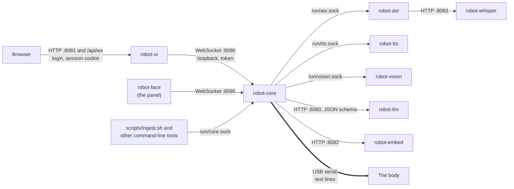

# Interfaces: every wire in one place

This chapter lists **every place two parts of the robot talk to each other**, in what format,
and who may reach it. If you are building something that plugs in (a new body, a new screen, a
script), start here.

*How to read it: every arrow is a connection on this computer, except the browser, which is on
your network, and the thick arrow, a USB cable. `robot-core` is in the middle of everything and
is the only program that talks to the body.*

## The interfaces

| # | Between | Transport | Format | Who can reach it | Page |
|---|---|---|---|---|---|
| 1 | `robot-core` and the **body** | USB serial, 115200 baud | newline-terminated **ASCII text lines** | the cable | [Serial protocol](serial-protocol.md) |
| 2 | `robot-core` and the **language model** | HTTP on `127.0.0.1:8080` | a chat request; the reply is constrained by a **JSON schema** | this computer | [Reply JSON](reply-json.md) |
| 3 | `robot-core` to the **body**, once per phase of a turn | the same serial line | one compact **JSON line** starting with `{` | the cable | [Reply JSON](reply-json.md#the-line-the-body-receives) |
| 4 | Everything that watches or steers `robot-core` | **WebSocket** `ws://127.0.0.1:8090` | JSON objects, one per message | loopback, plus a **token** when `CORE_WS_TOKEN` is set | [WebSocket](websocket.md) |
| 5 | A **browser** and `robot-ui` | HTTP `0.0.0.0:8081`, plus a WebSocket at `/api/ws` | pages, JSON, JSON | your network, behind a **login** | [WebSocket](websocket.md#through-the-dashboard) |
| 6 | Command-line tools and `robot-core` | Unix socket `run/core.sock` | newline-delimited JSON | the file's permissions | [WebSocket](websocket.md#the-local-socket) |
| 7 | `robot-core` and `robot-asr`, `robot-tts`, `robot-vision` | Unix sockets in `run/` | newline-delimited JSON (audio never crosses them) | the file's permissions | [WebSocket](websocket.md#the-local-socket) |
| 8 | `robot-asr` and `robot-whisper`; `robot-core` and `robot-embed` | HTTP on loopback | the engines' own APIs | this computer | |
| 9 | **People and files** with every program | `config/*.env`, `run/settings.json`, `.env` | `KEY=value` lines, JSON | the file system | [Configuration](configuration.md) |

Exposure, in one sentence: **only `robot-ui` listens on the network** (`UI_HOST=0.0.0.0`, port
8081, behind a login). The orchestrator's WebSocket is bound to `127.0.0.1` (`CORE_WS_HOST`),
and the engines bind to `127.0.0.1` too. It is a design rule that an open page that can drive a
robot is worse than no page, so `robot-ui` **refuses to start** without `ROBOT_UI_PASSWORD`.

## Why these choices

* **Plain text on the serial line, JSON everywhere else.** A person can open `screen` and read the
  body's traffic, or `nc -U run/core.sock` and read the services'. The command rate is low
  (voice-triggered, not a 100 Hz control loop), so the extra bytes cost nothing.
* **Unix sockets between services**: no port to allocate, no accidental exposure to the network,
  and file permissions do the access control.
* **One owner of the body.** Putting the serial port behind `robot-core` means the heartbeat
  and the clamping of model output live in exactly one place.

## The dashboard's own HTTP routes

All except `/` need a session; the others reject a request without one.

| Route | Does |
|---|---|
| `GET /` | the public landing page: what the robot is. **The only public page** |
| `GET /dashboard /talk /memory /logs /monitor /config /knowledge /services` | the pages |
| `GET /chat /headless /vision` | redirect (307) to `/talk`, the page that replaced them |
| `GET /api/logs?source=…&lines=…` | the tail of a service's log. Sources: `llm asr tts embed vision core ui body` (`body` is the simulator's log) |
| `POST /api/upload` | a document for the knowledge store. Text-like files and PDFs only |
| `GET /api/monitor` | one reading of the board, or the history with `?history=1` |
| `GET /api/services`, `POST /api/services/{key}/{action}`, `GET /api/services/{key}/log` | service state, start/stop/restart, a log tail. Keys and actions come from a fixed table and **never reach a shell** |
| `GET /api/camera.jpg` | the latest camera frame, `no-store` |
| `WS /api/ws` | the relay to the orchestrator, authenticated by the same cookie |

Source: [`src/robot/ui/app.py`](../../../src/robot/ui/app.py). Closing or crashing the dashboard
does not affect the robot: it reaches `robot-core` only over the WebSocket, and imports nothing from it.

## In this chapter

| Page | What |
|---|---|
| [Serial protocol](serial-protocol.md) | Every line between the brain and the body, with examples, error reasons and the discovery handshake |
| [Reply JSON](reply-json.md) | What the model must answer, and what is sent to the body |
| [WebSocket and sockets](websocket.md) | The messages a dashboard, a panel or a script can send and receive |
| [Configuration](configuration.md) | Where each setting lives, who wins, and all 32 live settings |
