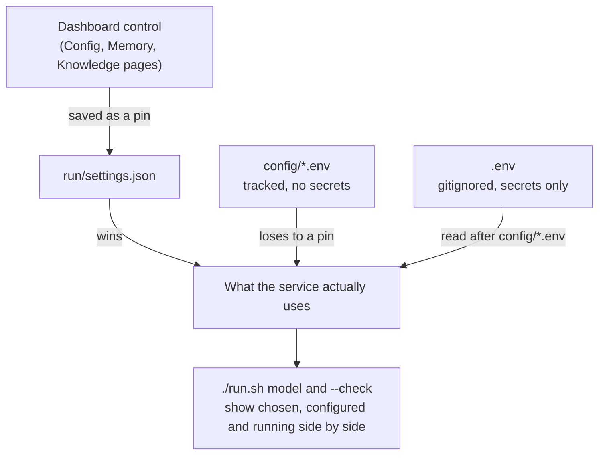

# Configuration: where each setting lives, and who wins

There are three places a setting can come from, and **a pin from the dashboard beats both
files**. Knowing that order is most of knowing why a setting "does nothing".

| Place | Holds | Tracked by git? | Changes apply |
|---|---|---|---|
| **`run/settings.json`** | Everything tuned from the dashboard: the pins. Merged **over** the env files at start | no (`run/` is gitignored) | live for most; see below |
| **`config/*.env`** | Per-service defaults: ports, model paths, thresholds. **No secrets** (hard constraint 8) | yes | at the next restart of that service |
| **`.env`** | Secrets: the dashboard password and its cookie-signing secret, and the WebSocket token | **never** (gitignored) | at the next restart |

Three things that bit people, all in [`TROUBLESHOOTING.md`](../../../dev-docs/ai/TROUBLESHOOTING.md):

* **Pins accumulate and are forgotten.** `CORE_MAX_TOKENS=260` once sat in `config/core.env`
  doing nothing because a registry default had been applied over it on every startup.
  `./run.sh <mode> --check` lists what the dashboard has pinned. Clearing a stale pin is how you
  get an env file back.
* **Startup applies only explicit choices.** Applying the registry's defaults would overwrite
  `config/core.env`, so startup applies `settings.saved()` and nothing else.
* **Order of start matters for pushing settings.** `run_stack.sh` starts `robot-core` before
  `robot-asr`, so the speech settings are pushed to `robot-asr` **when it connects**, not once
  at core start. Before that fix every one of them was lost, every boot.

### What the pins say on this robot, 2026-11-16

`./run.sh headless --check` lists the dashboard's pins. These are in force and **differ from the
env file or the registry default**, which is exactly how a value in a file "does nothing":

| Pin (`run/settings.json`) | In force | File or default says |
|---|---|---|
| `listen_tail_ms` | **100** | `CORE_LISTEN_TAIL_MS=700` |
| `asr_noise_gate_db` | **12** | `ASR_NOISE_GATE_DB=6.0` |
| `vad_min_silence` | **0.2** | `VAD_MIN_SILENCE=0.65` |
| `vad_threshold` | **0.6** | 0.5 |
| `mic_gain` | **52** | 100 |
| `tts_volume` | **11** | `TTS_VOLUME=100` |
| `people_greet` | **off** | on |

The model choices (`llm_model`, `asr_model`) and `persona` are pinned too, and agree with the
files. The persona text is not reproduced here.

## Live and restart-scoped

The registry in [`settings.py`](../../../src/robot/core/settings.py) is the single source of truth
for the split, so a control cannot appear under "live" while secretly needing a restart. **32
settings: 26 apply live, 6 restart only their own component.**

* **Live (hot):** applied immediately, saved to `run/settings.json`, and survive a restart.
* **Restart-scoped:** the model files, the microphone, the speaker, the GPU switch and the serial
  port. Each has its own button that restarts only that component, whose light goes amber while it
  recovers. Changing the LLM is a **reload**, not a restart: whisper and the voice are stopped
  first, the LLM loads, then they come back (about 30 s deaf and mute), because restarting the LLM
  beside the others died on `cudaMalloc failed: out of memory`.

Each control lives on the page that can tell you whether its value is right: **models are on
Memory**, which prices them against the ceiling; the persona is on **Knowledge**, beside the
documents it reasons over; everything that needs no such context is on **Config**.

Generated from the registry on 2026-11-16. If this table and `settings.py` disagree, `settings.py`
is right.

## The 32 live settings

#### Hardware

| Setting (`key`) | What it is | Applies | Range or options | Default | Page |
|---|---|---|---|---|---|
| `vad_threshold` | Speech threshold | live | 0.1 to 0.9 | `0.5` | config |
| `asr_noise_gate_db` | Must beat the room by (dB) | live | 0 to 30 | `6.0` | config |
| `auto_trigger` | Auto trigger (follow the room noise) | live | `off` / `on` | `off` | config |
| `mic_gain` | Microphone amplification (%) | live | 0 to 200 | `100` | config |
| `asr_denoise` | Noise cancelling | live | `off` / `on` | `off` | config |
| `mic_source` | Microphone | restarts asr |  | from the env file | config |
| `speaker_sink` | Speaker | restarts tts |  | from the env file | config |
| `tts_volume` | Speaker volume (%) | live | 0 to 200 | `100` | config |
| `serial_port` | Microcontroller port | restarts serial |  | from the env file | config |

#### Listening

| Setting (`key`) | What it is | Applies | Range or options | Default | Page |
|---|---|---|---|---|---|
| `barge_in_grace_ms` | Barge-in grace (ms) | live | 0 to 2000 | `0` | config |
| `listen_mode` | What the microphone may do while the robot talks | live | `interrupt` / `no_interrupt` / `wake_word` | `no_interrupt` | config |
| `listen_tail_ms` | Deaf for after speaking (ms) | live | 0 to 5000 | `700` | config |
| `wake_word` | Wake word | live |  | `robot` | config |
| `vad_min_silence` | End-of-speech silence (s) | live | 0.2 to 2 | `0.65` | config |
| `asr_max_no_speech` | Reject if whisper says no speech | live | 0 to 1 | `0.6` | config |
| `asr_model` | Listening model (whisper size) | restarts asr |  | from the env file | memory |

#### Thinking

| Setting (`key`) | What it is | Applies | Range or options | Default | Page |
|---|---|---|---|---|---|
| `temperature` | LLM temperature | live | 0 to 1.5 | `0.7` | config |
| `max_tokens` | Max reply tokens | live | 32 to 2048 | from the env file | config |
| `llm_model` | LLM model file | restarts llm |  | from the env file | memory |

#### Knowledge

| Setting (`key`) | What it is | Applies | Range or options | Default | Page |
|---|---|---|---|---|---|
| `persona` | Persona / system prompt | live |  | from the env file | knowledge |
| `rag_k` | Retrieved chunks | live | 0 to 10 | `4` | config |

#### Speaking

| Setting (`key`) | What it is | Applies | Range or options | Default | Page |
|---|---|---|---|---|---|
| `first_max_chars` | Start speaking after at most (characters) | live | 20 to 240 | from the env file | config |
| `filler` | Acknowledge before answering | live | `on` / `off` | `on` | config |
| `first_min_chars` | ...but never shorter than (characters) | live | 2 to 80 | from the env file | config |
| `voice_en` | Voice: English | live |  | `en_US-lessac-medium` | config |
| `voice_id` | Voice: Bahasa Indonesia | live |  | `id_ID-news_tts-medium` | config |
| `voice_ar` | Voice: Arabic | live |  | `ar_JO-kareem-medium` | config |
| `supertonic_voice` | Voice (Supertonic) | live |  | `M1` | config |
| `supertonic_steps` | Synthesis steps (Supertonic) | live | 1 to 16 | `4` | config |
| `tts_use_gpu` | Synthesise on the GPU | restarts tts | `0` / `1` | from the env file | config |

#### People

| Setting (`key`) | What it is | Applies | Range or options | Default | Page |
|---|---|---|---|---|---|
| `people_ask` | Ask strangers their name | live | `on` / `off` | `on` | config |
| `people_greet` | Greet people who come back | live | `on` / `off` | `on` | config |

## The env files

Values are what the **files** hold on 2026-11-16: a dashboard pin may override them (see the table
above), and models and ports change with the Memory page. `./run.sh <mode> --check` and
`./run.sh model` are the truthful answers to "what is it using now".

| File | Service | The settings that matter |
|---|---|---|
| `config/llm.env` | `robot-llm` | `LLM_MODEL` (`LFM2.5-2.6B-Q5_K_M`), `LLM_CTX` (2048), `LLM_NGL` 99 (all layers on the GPU), `LLM_PORT` 8080, bound to `127.0.0.1` |
| `config/whisper.env` | `robot-whisper` | `WHISPER_MODEL` (`ggml-large-v3-turbo-q8_0`), `WHISPER_USE_GPU=1`, **`WHISPER_REQUIRE_GPU=1`**, port 8083, `WHISPER_LANGUAGE=auto` |
| `config/asr.env` | `robot-asr` | `PULSE_SOURCE` (the microphone), `VAD_MIN_SILENCE` 0.65, `ASR_NOISE_GATE_DB` 6.0, `ASR_MAX_NO_SPEECH` 0.6, `ASR_DENOISE=off`, `ASR_LANGUAGES=id,en,ar` |
| `config/tts.env` | `robot-tts` | `TTS_ENGINE=supertonic`, `SUPERTONIC_VOICE=M1`, `SUPERTONIC_STEPS=4`, `TTS_USE_GPU=1`, **`TTS_REQUIRE_GPU=1`**, `TTS_BATCH_SENTENCES=1`, `TTS_TRIM_SILENCE=1` (`KEEP_MS` 40, `TAIL_MS` 280), `PULSE_SINK`, `TTS_VOLUME=100` |
| `config/embed.env` | `robot-embed` | `EMBED_MODE=on-demand`, `EMBED_IDLE_S=90`, `EMBED_EVICT=llm`, `EMBED_NGL=0` (CPU), port 8082 |
| `config/vision.env` | `robot-vision` | `VISION_ENABLED=1`, 640×360 at `VISION_FPS=2`, `VISION_MOTION=2.0`, `VISION_OBJECTS=1`, `VISION_FACES=1`, `VISION_USE_GPU=0`, `VISION_THREADS=3` |
| `config/core.env` | `robot-core` | the reply format and budget (`CORE_REPLY_FORMAT=json`, `CORE_MAX_TOKENS=auto`), listening (`CORE_LISTEN_MODE=no_interrupt`, `CORE_LISTEN_TAIL_MS=700`, `CORE_WAKE_WORD=robot`), speaking (`CORE_FILLER=1`, `CORE_FIRST_MAX_CHARS=40`, `MIN` 24, `CORE_FACE_MODE=phases`), `CORE_KEEPALIVE=1`, `CORE_KEEPALIVE_LLM_FALLBACK=1`, the **body port** `STM32_PORT` (empty: found by discovery), the WebSocket (`CORE_WS_HOST=127.0.0.1`, `CORE_WS_PORT=8090`) and `CORE_PEOPLE*` |
| `config/ui.env` | `robot-ui` | `UI_HOST=0.0.0.0`, `UI_PORT=8081`, `CORE_WS_URL` |
| `config/face.env` | `robot-face` | `FACE_WS_URL`, `FACE_CHAT_LINES=7`, `FACE_PING_S=20`, `FACE_DEAD_LINK_S=45`, `SLINT_BACKEND=linuxkms-software` |

Every file has comments that explain **why** the default is what it is, with the measurement. Read
the comment before changing the value.

### The two requirements that look like settings

`WHISPER_REQUIRE_GPU=1` and `TTS_REQUIRE_GPU=1` are not preferences. A speech engine that came up
on the CPU used to be silent about it: one log line, scrolled away, and a robot that had simply
got slower. Set either to 0 only deliberately.

## Secrets

| Name | In | What it protects |
|---|---|---|
| `ROBOT_UI_USER`, `ROBOT_UI_PASSWORD` | `.env` | the dashboard login. `robot-ui` **refuses to start** without a password |
| `ROBOT_UI_STORAGE_SECRET` | `.env` | the session cookie's signature. If it is missing a temporary one is generated and sessions do not survive a restart |
| `CORE_WS_TOKEN` | `.env` | the orchestrator's WebSocket, as the second lock. Listed (empty) in `.env.example` since 2026-11-16 |

Nothing secret belongs in a tracked file, including these pages. `cp .env.example .env` and fill
it in.

## How to change a setting, and check that it took

| You want to… | Do this | Check with |
|---|---|---|
| Try a value | the dashboard control; it applies live | the page itself; the `set_result` it shows |
| Make it the default for a service | edit the `config/*.env` line, **and clear the pin** if there is one | `./run.sh headless --check` |
| Change a model | the **Memory** page | `./run.sh model` (chosen, configured and running must agree) |
| See everything in force | | `./run.sh <mode> --check` prints the configuration it would use and starts nothing |
| Find which microcontroller port was chosen | | `grep 'robot-core: microcontroller' .cache/tmp/core.log` |
