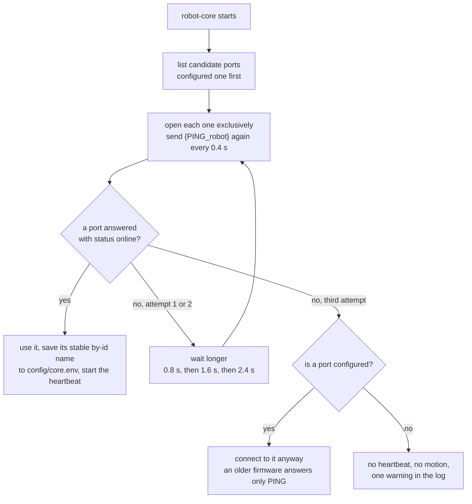

# The serial protocol: brain to body

This is the **only** interface between the brain and the body. Both sides implement it. The
contract is [`serial-protocol.md`](../../../dev-docs/architecture/serial-protocol.md); this page
explains it with examples, and notes where the code goes beyond the contract or disagrees with it.

## The link

| | |
|---|---|
| Transport | the reference body: USB-CDC. The robot's ESP32: a USB cable with a USB-UART chip 📐 |
| Device name | `STM32_PORT` in `config/core.env`. **Empty today**, so the port is found at start by [discovery](#discovery-which-port-is-the-body) |
| Baud | 115200 (`SerialLink`). It must match the body's UART when a USB-UART chip is used |
| Framing | **ASCII lines ended by `\n`**, at most **255 bytes** before the newline |
| Why text | A person can read the traffic with `screen`. The rate is low |

Use the stable name (`/dev/serial/by-id/…`) and not `ttyACM0`: on this board `ttyACM0` has been
the USB **soundcard**, and numbers swap with boot order.

## Jetson to body: the commands

| Line | Meaning | Answer |
|---|---|---|
| `DRIVE <vx> <vy> <omega> <ms>` | Move, then stop by itself. m/s, m/s, rad/s, 1 to 10 000 ms | `OK DRIVE`, later `DONE DRIVE` |
| `STOP` | Halt all motion now | `OK STOP` |
| `FACE <name>` | Show an expression | `OK FACE`, or `ERR FACE unknown` |
| `HAND <gesture>` | A preset servo sequence | `OK HAND`, later `DONE HAND` |
| `PING` | The heartbeat, every **200 ms** | `OK PING` |
| `STATUS` | Ask for a status line | `STAT …` (no separate `OK`) |
| `WHEEL <i> <rad/s> <ms>` | **Bring-up only**: spin wheel 0 to 3, bypassing the kinematics | `OK WHEEL`, later `DONE WHEEL` |
| `{PING_robot}` | Discovery: "who is the body?" | `{"device":"…","status":"online"}` |
| `{ … }` (anything starting with `{`) | A [reply line](reply-json.md#the-line-the-body-receives): information | **no answer** |

Verbs may be written in any case. `WHEEL` is deliberately **not** reachable from the model.

```
DRIVE 0.5 0.0 0.0 1500     # forward at 0.5 m/s for 1.5 s
DRIVE 0.0 0.0 1.2 800      # rotate in place
FACE happy
HAND wave
STOP
WHEEL 0 5.0 1000           # bring-up: front-left only, 5 rad/s for 1 s
```

> **Frame (settled 2026-11-16):** x forward, y left, omega counter-clockwise. `DRIVE 0.0 0.3 0.0 1000`
> strafes **left**. See [Motion](../03-firmware/motion.md#settled-which-way-is-vy-and-which-way-is-omega) (Known issue #18).

## Body to Jetson: the answers

| Line | Meaning |
|---|---|
| `OK <verb>` | Accepted and started |
| `ERR <verb> <reason>` | Refused. `reason` is one word: `unknown`, `badargs`, `range`, `toolong`, `empty`, or `watchdog` |
| `DONE <verb>` | A timed action finished (`DRIVE`, `WHEEL` or `HAND`) |
| `STAT batt=<V> motors=<state> temp=<C> up=<ms>` | The answer to `STATUS`. `state` is `ok` or `stall` |

**Every command gets exactly one response**, so the model cannot announce "driving forward" while
a wheel is stuck and never find out. `robot-core` matches responses to commands **by verb**,
first in first out, and waits **1 s** (`RESPONSE_TIMEOUT_S`) before reporting a `timeout`. While the link
is down, motion commands are refused at once with `disconnected`.

### What the Jetson does with a refusal

* `ERR` is logged as a warning (`STM32 rejected DRIVE: range`) and shown on the dashboard.
* It is added as a **hardware note** to the model's next prompt: *"the body refused DRIVE
  (range)"*. At most the last four notes are kept.
* The exception: an `ERR {"…` is a body that does not read reply lines yet. It is ignored, and
  the robot does not apologise for its own JSON.

## The heartbeat and the watchdog

`PING` every 200 ms. If the body sees **no line of any kind for 500 ms** it stops the motors on its
own and does not resume until a new command arrives. Everything about it is on
[The watchdog](../03-firmware/watchdog.md).

## Discovery: which port is the body?

At every start, in every run mode, `robot-core` sends the literal line `{PING_robot}` to **every**
serial port: each `/dev/serial/by-id/*`, `ttyACM*`, `ttyUSB*` and `ttyTHS*` that exists.



* **Any** reply whose JSON has `status` equal to `online` counts. `device` is only a label: the
  reference firmware says `STM32`, the contract's example says `ESP32`.
* Boot messages before the answer are skipped: the probe reads line by line until one is the answer.
* The same probe is behind **Config → Hardware → Ping all ports** and shows how fast each
  port answered.
* Look at the result with `grep 'robot-core: microcontroller' .cache/tmp/core.log`.
* A permission error means the service user is not in the `dialout` group.

## `STATUS` and the stall flag

The contract says the orchestrator should surface `motors=stall` "so the robot can say *I'm
stuck* instead of lying". A `STAT` line with a **confirmed** stall becomes the hardware note *"a
wheel is stalled -- you are not actually moving"*.

* **`robot-core` asks for `STATUS` every 2 s** (`STATUS_PERIOD_S`), beside the heartbeat. Before
  2026-11-16 nothing did, so battery, temperature and the stall flag never arrived (Known issue #20).
  The `serial_status` event carries them to the dashboard.
* **A stall is believed after two consecutive samples** (`STALL_CONFIRM_SAMPLES`, so about 2 to 4 s).
  The reference firmware's stall test has no waiting time, so the first control ticks of any start
  look like a stall. The event has `stall_confirmed`, and only a confirmed stall reaches the model.
* **A body that does not know `STATUS`** answers `ERR STATUS unknown`; the Jetson stops asking, once,
  without reporting a refusal, and asks again after a reconnect.
* `tests/test_status_poll.py` covers all three.

## Extending the protocol

1. Add the command to the contract document **first**.
2. Implement the parser branch in the body.
3. Implement the sender in `serial_link.py`.
4. Give it a tool definition for the model **only if the model should trigger it**.

Keep it one line, one action, one response. If a command needs sub-commands or nesting, the body
should own more of the behaviour; the protocol should not grow.

## Clamping, in two places

The model's numbers are clamped in the Jetson (`serial_link.py`) and re-checked in the body
(`protocol.h`). The two sets of limits are identical and a comment in each says to change both.
See [Motion](../03-firmware/motion.md#the-limits-in-two-places) for the values.
