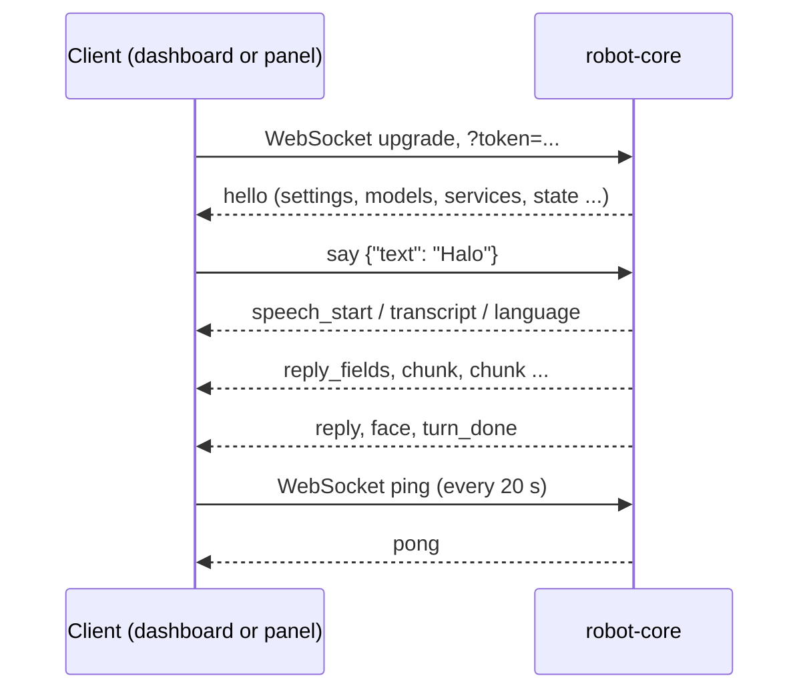

# The WebSocket and the local sockets

`robot-core` can be watched and steered by anything that speaks JSON over a WebSocket. The
dashboard (`robot-ui`) and the on-robot panel (`robot-face`) are two such clients, and both are
optional: **nothing depends on them**, and either can be killed while the robot keeps listening,
answering and driving.

## Connecting

| | |
|---|---|
| Address | `ws://127.0.0.1:8090/` (`CORE_WS_HOST`, `CORE_WS_PORT`). **Loopback only** by default |
| Token | When `CORE_WS_TOKEN` is set, the upgrade request must carry `?token=<it>`. Without it the server answers `401` and logs the rejected peer |
| Framing | one JSON **object** per message, in both directions |
| Reconnecting | The dashboard retries every 2 s, so starting it before the orchestrator, or bouncing the orchestrator under it, just works |
| Keepalive | `robot-core` **never sends** a WebSocket ping, though it answers one. Keeping the link alive is the client's job |

The token is a second lock behind the dashboard's own session login: something that merely
reaches the port cannot drive the robot. The token lives in `.env` (gitignored), never in a
tracked file. A reminder about a gap: `config/core.env` carries an **empty** `CORE_WS_TOKEN=`,
the systemd unit reads `.env` after it, and `.env.example` lists only the dashboard's three
settings, so **the token has to be added to `.env` by hand** ❓. With none set, the port accepts
any client that can reach it, which on loopback is anything running on the robot.

On connection the server sends one `hello` with everything a page needs to draw itself:
`settings`, `models`, `budget`, `selection` (with `llm_ctx`), `groups`, `values`, `services`,
`state`, `languages`, `overview` and `microcontroller`. A client that opens mid-session therefore
never has to special-case "connected late".

## Client to server

Every kind below is a message `{"type": "<kind>", ...}`. A handler that fails answers
`{"type": "error", "reason": "..."}` and **never takes the orchestrator down**.

### Talking

| Kind | Fields | Does | Answer |
|---|---|---|---|
| `say` | `text`, optional `speak` (true to answer aloud), `source` | Starts a turn with typed text, no microphone. Silent unless `speak` is set | turn events |
| `cancel` | | Cancels the turn in progress | turn events |
| `talk_state` | | Everything the Conversation page needs when it opens mid-conversation | `talk_state` |
| `metrics` | | The numbers of recent turns | `metrics` |
| `ping` | | Liveness and the service lights | `pong` |

### Configuring

| Kind | Fields | Does | Answer |
|---|---|---|---|
| `set` | `key`, `value` | Applies one setting. Live settings apply at once; restart-scoped ones restart only their component | `set_result`, and `budget` is re-broadcast |
| `apply` | `values` | Applies a model selection (the Memory page) | `apply_result` |
| `budget` | `preview` | Prices a **hypothetical** selection against the memory ceiling, changing nothing | `budget` |
| `models` | | The catalogue of installed models | `models` |
| `restart` | `component` | Restarts one service through the supervisor in charge | `restart_result` |
| `ping_ports` | | Pings every serial port with `{PING_robot}` | `ping_result`, then `microcontroller` |
| `preview_voice` | `lang`, `voice` | Plays a voice before it is adopted | `preview_result` |
| `logs` | `level`, `limit` | Recent records of the orchestrator | `logs` |
| `set_log_level` | `level` (`DEBUG`, `INFO`, `WARNING`, `ERROR`) | Changes the log level of core, asr and tts | `log_level` |

### Knowledge and people

| Kind | Fields | Does | Answer |
|---|---|---|---|
| `ingest` | `path` or `text` (with `source`) | Adds a document or a typed fact. A `path` must be under `run/uploads/` or `knowledge/`: a browser can send any JSON, and ingesting `.env` and reading it back would otherwise work | `ingesting` |
| `knowledge` | | Counts, sources, pending | `knowledge` |
| `forget` | `source` or `all` | Removes a document's chunks | `forgotten` |
| `document`, `describe` | `source` | The three views of a document: text, chunks, about | `document`, `described` |
| `people_history`, `conversations`, `conversation_turns` | `name`, `limit`, `visit` | What was said to whom | the same names |
| `people_forget_conversation` | `name` | Removes one person's conversations | `vision_result` |
| `vision_status`, `vision_people`, `vision_enroll`, `vision_forget`, `vision_configure` | | The camera service | `vision_result` |

## Server to client: events

These arrive on their own while something happens. A client shows what it understands and ignores
the rest.

| Event | Means |
|---|---|
| `speech_start`, `speech_end` | The microphone heard speech begin and end (`audio_s` on the end) |
| `ignored` | An utterance was dropped, with a `reason` and the `mode` that dropped it |
| `transcript` | What whisper heard. The turn's `turn_id` starts here |
| `initiated` | A turn the robot started by itself, with its `reason` |
| `language` | How the language of the turn was decided (`language_source`) |
| `reply_fields` | The reply's body fields for one phase: the object the dashboard calls *Reply JSON*, and what the body also receives |
| `chunk` | One piece of the answer as it goes to the voice, with a `seq` |
| `reply` | The whole answer text when it is complete |
| `face` | `{phase, face}` for every change of face |
| `tool_result` | A note from an action (a refusal from the body) |
| `truncated` | The reply hit the token limit: the body fields never arrived |
| `turn_timeout` | A turn was forced to end after `after_s` |
| `turn_done` | The turn is over, with its measured stage timings |
| `serial_tx` | **The exact line written to the body**, clamping and rounding included |
| `serial_up`, `serial_down`, `serial_error`, `serial_done`, `serial_status`, `serial_online` | The link and the body's answers |
| `health` | The service lights, about every 3 s |
| `keepalive` | The keepalive restarted something, gave up, or shrank the LLM |
| `budget`, `models` | Memory pricing and the model catalogue changed |
| `microcontroller` | What discovery found |
| `presence`, `people` | Who the camera sees, and who is known |

Each turn event carries a `turn_id`. Turn timing breakdowns and the durations that sum exactly
to the total are described in [One turn, end to end](../01-overview/one-turn.md).

## Through the dashboard

A browser never connects to port 8090. It opens `WS /api/ws` on `robot-ui` (port 8081), which is
authenticated by **the same signed session cookie as the pages**, so no side-channel token is
needed and a socket cannot be opened without having logged in. `robot-ui` relays between the
browser and `robot-core`:

* A browser that opens mid-session gets a `hello` built from the last known state at once.
* Events queue per browser, up to 512. **A browser that cannot keep up drops events, never the
  robot.**
* If the orchestrator is not connected, the browser's message is answered with
  `error: orchestrator not connected`.

## The local socket

`run/core.sock` carries **newline-delimited JSON** (one JSON object per line, up to 1 MiB). You
can read it with `nc -U run/core.sock`. It is what `scripts/ingest.sh` and the smoke tests use. It
understands a smaller set: `say`, `cancel`, `ping` (answered by `pong` with `state`, `turns`,
`last_language`, `llm_ok`, `serial_ok`, `motors`), `ingest`, `forget`, `knowledge` and `metrics`.
Unlike the dashboard, the local socket's `ingest` is not limited to two folders: it is protected
by the file's permissions.

The same framing connects `robot-core` to `robot-asr`, `robot-tts` and `robot-vision`. **Audio
never crosses these sockets.** The voice service owns the speaker and the microphone service owns
the microphone; what travels is text and control events. For example `robot-asr` sends
`speech_start`, `speech_end`, `final`, `noise_reject` and `level`; `robot-tts` answers `started`,
`finished` and `cancelled`; and `robot-core` sends the voice `speak`, `speak_end`, `cancel`,
`configure` and `prerender`.

## Writing a new client

1. Open the WebSocket (with the token if one is set) and read `hello`.
2. Render from `hello`, then update from events. Do not poll.
3. Send a WebSocket ping every 20 s or so, and treat silence beyond about 45 s as a dead link and
   reconnect, whatever TCP still believes (the panel's `FACE_PING_S=20` and `FACE_DEAD_LINK_S=45`;
   20 s is also what the browser dashboard uses).
4. Never assume the connection survives: reconnect, and expect a fresh `hello`.
