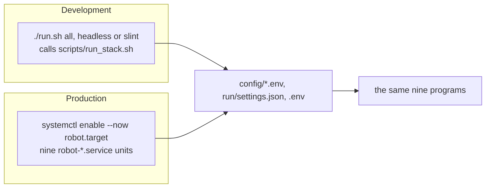

# Operations: installing, running and fixing it

This chapter is for the person who has to **make the robot run** and **keep it running**: set up
a board, start the stack, leave it alone, and work out what is wrong when it misbehaves.

## Two ways to run it

The same services run under either supervisor, reading the same `config/*.env`. They are **not
equally proven**.

| | `./run.sh` (the development stack) | systemd (`deploy/systemd/`, how it should ship) |
|---|---|---|
| Starts | the services, in order, as your user | nine units under `robot.target` |
| Restarts a crashed service | **no**: `robot-core`'s keepalive does it | yes: `Restart=on-failure` |
| Sandboxing | none | `ProtectSystem=strict`, `PrivateTmp`, memory limits |
| State | ✅ used every day | ❓ **never installed or booted on this board**; read, linted with `systemd-analyze verify`, and four faults found and fixed by reading, 2026-10-22 |

**A change to a service is not done until it has been read under both.** They read the same env
files differently (a unit keeps a trailing `# comment` in a value; bash does not), and only systemd
sandboxes. See [systemd](systemd.md).

## The pages

| Page | Read it when |
|---|---|
| [Installing on a fresh board](install.md) | You have a Jetson and a checkout and nothing runs yet |
| [Running it day to day](running.md) | You want to start, stop, look at, or measure the robot |
| [Production with systemd](systemd.md) | The robot is to be left running unattended |
| [Something is wrong: a symptom index](troubleshooting-index.md) | The robot is deaf, mute, slow, stuck, or the dashboard is blank |

## The state of this board on 2026-11-16 ✅

From `./scripts/bringup/check_board.sh` (read-only; it changes nothing), run today:

| Check | Result |
|---|---|
| JetPack | 6.2.1 (L4T 36.4.7), power mode **MAXN_SUPER**, headless (`multi-user.target`, no desktop) |
| `jtop` | installed and active |
| Storage | repo and models on NVMe, **225 GB free**; **the root filesystem is at 96%, 4 GB free** |
| Units | all nine declare `Restart=on-failure` |
| Memory | 7619 MiB total, 969 MiB used with **the stack stopped** |
| Overall | **11 passed, 0 failed** |
| Warnings | no USB microphone and no USB speaker visible *right now*; no `/dev/ttyACM*` (no body attached); the journal is volatile |

`./run.sh model` agrees across the three columns: chosen, configured and running models are all
`LFM2.5-2.6B-Q5_K_M`, `ggml-large-v3-turbo-q8_0` and Supertonic `M1`, with a 2048-token window,
and **none is running** (the stack is stopped).

## Two things that will bite you

1. **The root filesystem is nearly full** (96% today; the README says 94%). Models, build trees,
   the pip cache and Docker images belong on the DATA partition. Always
   `source scripts/bringup/env.sh` before any `pip install` or download: it points
   `PIP_CACHE_DIR`, `TMPDIR` and `HF_HOME` at `.cache/` on DATA.
2. **The board's memory is the ceiling.** Usable RAM is **7620 MiB, not 8192**: the rest is Tegra
   carve-out. The full stack peaks near 6.5 GB. **Do not run the full stack and a development
   session at once**: a VS Code Remote server plus an agent session is another 1 to 1.8 GB, and
   the two together measured **97% use and 3.2 GB of swap**. Swap is what turns a 0.6 s voice
   into a 10 s one ([Models and memory](../04-brain/models-and-memory.md)).

A third, for the body: **`/dev/ttyACM0` on this board has been the USB soundcard**, not the
microcontroller. Never address the body by `ttyACM` number.
