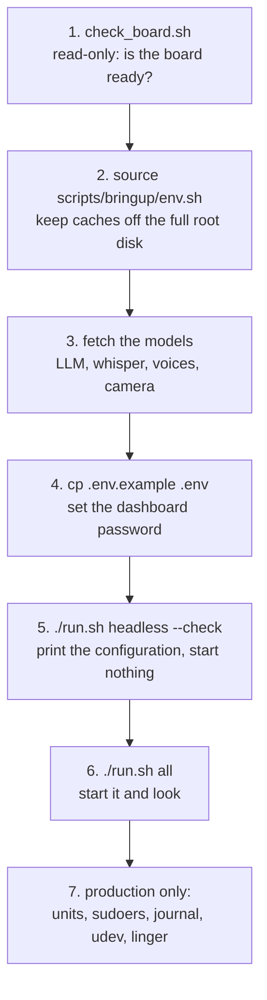

# Installing on a fresh board

The order matters, and most steps are safe to repeat. Commands that change the system say
`sudo`. Nothing here is run by the handbook.



## 1. Check the board (read-only)

```bash
./scripts/bringup/check_board.sh
```

Exit code 0 means the preconditions are met. What it checks:

| Check | Why |
|---|---|
| JetPack **6.x** | `TECH_STACK.md` pins the 6.x line (JetPack 7 is deferred) |
| Power mode **`MAXN_SUPER`** | fix with `sudo nvpmodel -m 2` |
| Default target `multi-user.target`, **no desktop** | a desktop costs about 600 MB of the budget (hard constraint 5) |
| `jetson-stats` and `jtop` importable | the Monitor page and the memory measurements read it |
| 20 GB or more free for models; root disk 10 GB or more (a warning below that) | models are several GB; root is nearly full |
| A USB microphone and speaker, and that `PULSE_SOURCE` and `PULSE_SINK` are **pinned** | `pulse` and `default` follow PulseAudio's default, which here is an unconnected onboard codec: capture returns silence and playback goes nowhere, **both reporting success**. This cost two debugging sessions |
| A body: any `ttyACM*` whose USB vendor is `0483`, `2341` or `2e8a` | see the note below |
| Every unit declares `Restart=on-failure`; the journal is persistent | an OOM kill on 8 GB is a "when", not an "if" |

> **The body check does not know an ESP32.** It looks only at `ttyACM*`, and only for those three
> vendors. A body behind a CP2102 (`10c4`) or CH340 (`1a86`) USB-UART chip appears as `ttyUSB*` and
> will be reported as "no STM32". That is a limit of the check, not a fault in the robot:
> discovery by `{PING_robot}` still finds the body. Known issue #19.

## 2. Keep everything off the root disk

```bash
source scripts/bringup/env.sh
```

Pins `PIP_CACHE_DIR`, `TMPDIR`, `HF_HOME` and `ROBOT_MODELS` under the repo, adds NVIDIA's Jetson
package index (`https://pypi.jetson-ai-lab.io/jp6/cu126`, because ARM64 wheels are often missing
from PyPI) and activates `.venv`. **Source it in every new shell before installing or downloading.**

## 3. Fetch the models

```bash
./scripts/models/fetch_llm.sh          # about 2.4 GB
./scripts/models/fetch_whisper.sh      # about 470 MB, the speech decoder
./scripts/models/fetch_tts.sh          # the voices
./scripts/models/fetch_vision.sh       # about 57 MiB, only if there is a camera
```

Adding another model later:

```bash
./scripts/models/fetch_hf.sh <repo> <file>    # or paste a huggingface.co URL
./scripts/models/fetch_hf.sh --dry-run ...    # where would it go?
./scripts/models/list.sh                      # what is installed, and what it costs
```

The destination is inferred from the filename, and it is the destination that decides whether the
robot can see the file at all: a `.gguf` goes to `models/llm/`, a `ggml-*.bin` to
`models/asr/whisper/`, an `.onnx` to `models/tts/piper/`. **It appears on the Memory page within
about 3 s, with no restart.** Installing does not select it: the Memory page prices it against the
7620 MiB ceiling first.

## 4. Set the secrets

```bash
cp .env.example .env
```

Then set `ROBOT_UI_PASSWORD` (the dashboard **will not start** without it) and
`ROBOT_UI_STORAGE_SECRET`, generated with
`python3 -c "import secrets; print(secrets.token_urlsafe(32))"`. Also set `CORE_WS_TOKEN` in `.env`
(`.env.example` lists it since 2026-11-16): it is read by `robot-core`, `robot-ui` and `robot-face`. `.env` is gitignored. Nothing secret goes in a tracked file.

## 5. Look before you start

```bash
./run.sh headless --check
```

Prints the configuration this run would use, **including what the dashboard has pinned**, and
starts nothing. Pins beat the env files, so this is where a stale pin shows up.

## 6. Start it

```bash
./run.sh all                 # everything and the dashboard on :8081
```

See [Running it day to day](running.md). Starting reads the models into memory, and the **order**
is what makes a cold start work: the LLM first, waited for until it is really up, then whisper.

## 7. For a robot that is left running (production)

```bash
sudo ./scripts/install_services.sh         # symlinks the units into /etc/systemd/system
sudo ./scripts/bringup/setup_sudoers.sh    # scoped start/stop/restart of the robot units
sudo ./scripts/bringup/setup_logging.sh    # a persistent journal, capped at 200 MB
sudo ./scripts/bringup/setup_udev.sh       # /dev/robot-stm32 (matches STMicroelectronics only)
sudo loginctl enable-linger jetson         # so /run/user/1000 (PulseAudio) exists at boot
sudo systemctl enable --now robot.target
python scripts/hardening/failure_drills.py
```

| Step | What it does and why |
|---|---|
| `install_services.sh` | **Links** (not copies) the nine units and `robot.target`, so editing the repo copy only needs `daemon-reload`. It tells you which to enable. `robot-embed` is **deliberately not** in the list: `robot-core` starts it on demand |
| `setup_sudoers.sh` | Grants `start`, `stop` and `restart` on exactly six units (`llm`, `asr`, `tts`, `embed`, `whisper`, `vision`) and nothing else. **`robot-core` is deliberately absent**: the orchestrator must not be able to restart the process it runs in. Required for the Services page and for on-demand embeddings. Re-run it after adding a unit |
| `setup_logging.sh` | The journal is volatile on this image, so an overnight failure left no evidence. This makes it persistent and bounded (`SystemMaxUse=200M`, two weeks) |
| `setup_udev.sh` | A stable `/dev/robot-stm32` for a **USB device with vendor `0483`**. Not for an ESP32 behind a CP2102 or CH340 ❓ |
| `enable-linger` | The units use the user's PulseAudio at `/run/user/1000`, which does not exist at boot without it |
| `failure_drills.py` | Kills each service for real and checks what the docs require: 24 of 24 pass on the development stack |

The user must be in the `dialout` group to open the body's serial port
(`sudo usermod -aG dialout jetson`, then log in again).

> **Never booted.** No step of section 7 has been run on this board; the units were checked by
> reading and `systemd-analyze verify`. Expect to meet something. When you do, add it to
> [`TROUBLESHOOTING.md`](../../../dev-docs/ai/TROUBLESHOOTING.md) with a regression test.
