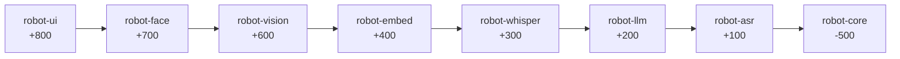

# Production: the systemd units

> **Never booted on this board** ❓. The nine units and `robot.target` in
> [`deploy/systemd/`](../../../deploy/systemd/) have been read, linted with
> `systemd-analyze verify`, and four faults were found and fixed by reading them against the
> development path (2026-10-22). Nobody has run `install_services.sh` and rebooted. Treat this
> page as the design, and Known issue #2 as the to-do.

A robot that is left running needs something to restart a crashed service, to sandbox it, and to
say which process the kernel should kill **last** when memory runs out. systemd does all three.

## The units

All units belong to `robot.target` (`PartOf=`), restart on failure, and stop trying after **5
failures in 300 s** (`StartLimitBurst=5`, `StartLimitIntervalSec=300`) so a board that is simply
full does not loop.

| Unit | Starts after | Restart wait | Dies at OOM | Limits | Notes |
|---|---|---|---|---|---|
| `robot-core` | wants `llm`, `asr`, `tts` | 3 s | **−500: last** | | Holds the heartbeat. Group `dialout` for the serial port |
| `robot-asr` | `sound.target` | 3 s | +100 | | Group `audio` |
| `robot-llm` | `network-online.target` | 5 s | +200 | | Drops the model's page cache before starting |
| `robot-whisper` | `network.target` | 5 s | +300 | | Same cache drop |
| `robot-embed` | `network.target` | 5 s | +400 | | **Not enabled at boot**: core starts it on demand |
| `robot-vision` | `nvargus-daemon.service` | 5 s | +600 | `MemoryHigh` 450 M, `MemoryMax` 600 M | **No `PrivateTmp`**: the camera daemon's socket is in `/tmp` |
| `robot-face` | `robot-core` | 5 s | +700 | `MemoryMax` 200 M | Groups `video render input` |
| `robot-ui` | `robot-core` | 5 s | +800: first | | |
| `robot-tts` | `sound.target` | 3 s | default | `MemoryHigh` 1000 M, `MemoryMax` 1200 M | Group `audio`. The cap bounds its growth, which was 342 to 889 MiB in 45 minutes and has not been shown to plateau |

*Reading the OOM column: a higher number is killed sooner. The order is deliberate: the dashboard
goes first, then the panel, the camera, the optional embeddings, the speech decoder and the LLM,
and **`robot-core` last**, because losing it means losing the heartbeat, and then the robot's
safety depends entirely on the body's watchdog.*

*Left to right: first killed to last killed.*

### Dependencies: `Wants`, not `Requires`

`robot-core` **wants** the LLM, microphone and voice but does not **require** them. That is the
design: the orchestrator reconnects to the others on its own and speaks a canned line when the LLM
is unreachable. A hard dependency would turn one crash into a cascade.

## Sandboxing, and the decisions behind it

| Setting | Where | Why |
|---|---|---|
| `ProtectSystem=strict`, `PrivateTmp=true` | all | the services cannot write outside what they are given |
| `ReadWritePaths=` `run` and `config` | core | Apply, the Hardware tab and microcontroller discovery write `config/*.env` |
| **No** `NoNewPrivileges` | core, ui, tts | `robot-core` supervises the others with `sudo -n systemctl start|stop|restart robot-<x>`, and `sudo` refuses to run under that flag. **The sudoers rule is the privilege boundary** (six units, three verbs). Proposed 2026-10-22, **awaiting the owner's confirmation** |
| `Environment=XDG_RUNTIME_DIR`, `PULSE_SERVER` | asr, tts, core | a system unit gets neither, and PulseAudio then answers "Connection refused". Needs `enable-linger` |
| `EnvironmentFile=` order | core | `vision.env`, then `core.env`, then `.env`: the token in `.env` must be read **after** `core.env` carries its empty `CORE_WS_TOKEN=` |
| `OOMScoreAdjust=-500` | core | see above |

## Why "works under `run.sh`" does not mean "works under systemd"

Four differences were found and each reproduced on 2026-10-22:

| Difference | What it broke |
|---|---|
| `NoNewPrivileges=true` | `sudo -n systemctl …` refused, so Restart, keepalive and the on-demand embedding server all failed |
| No `XDG_RUNTIME_DIR` | `pactl`, `arecord` and `aplay` could not find the user's audio server |
| `EnvironmentFile=` **keeps trailing `# comments`** | a comment became part of the value: `robot-tts` died on `could not convert string to float: '40        # ...'` |
| `ProtectSystem=strict` | `config/*.env` was read-only for the process that writes it |

and a fifth: `robot-core` never read `.env`, so `CORE_WS_TOKEN` was empty and the WebSocket accepted
anyone. `tests/test_config_files.py` now reads the files **the way systemd does**.

## Before leaving it unattended

1. Run the steps in [Installing, section 7](install.md#7-for-a-robot-that-is-left-running-production).
2. Reboot and confirm `systemctl status robot-core` and `./scripts/measure/whats_running.py`.
3. `python scripts/hardening/failure_drills.py` against the **systemd** stack, not just `run.sh`.
4. Run the **24-hour soak**: it has never been run, and the success criterion for version 1 says
   "runs 24 h without an OOM kill or a stuck motor".
5. **Prove the body's watchdog on the real board**, not only the simulator
   ([The watchdog](../03-firmware/watchdog.md)).
