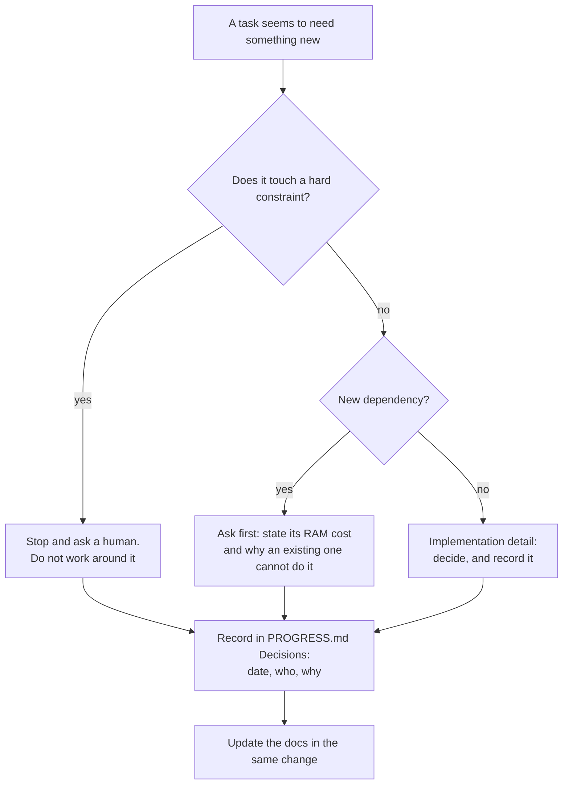

# Decisions: why it is built this way

A robot that runs in 8 GB of shared memory is the sum of many "no". This chapter records **what
was decided, why, what was rejected, and what is still waiting for a person to decide**, so that
nobody has to rediscover it or re-argue it without new information.

| Page | What it holds |
|---|---|
| [The hard constraints](hard-constraints.md) | The eight rules that need a human's sign-off to break, with the reason and the evidence behind each |
| [Rejected and deferred alternatives](rejected-alternatives.md) | What was considered and not chosen, with the numbers, and the condition under which to look again |
| [Waiting for the owner](open-decisions.md) | Open questions, including the two that block the first real wheel test |

## Where the full record lives

The handbook summarises; these are the sources, and they win if they disagree with a page here.

| Record | Holds |
|---|---|
| [`AGENTS.md`](../../../AGENTS.md) | The contract: hard constraints, working rules, and the measured reasoning behind the most important ones |
| [`planning/PROJECT_BRIEF.md`](../../../planning/PROJECT_BRIEF.md) | What is being built, non-goals, **Rejected alternatives**, success criteria |
| [`planning/TECH_STACK.md`](../../../planning/TECH_STACK.md) | Every dependency, with why it was chosen and what it costs |
| [`dev-docs/ai/PROGRESS.md`](../../../dev-docs/ai/PROGRESS.md) § 4 | The **decision log**: a dated row for each decision, by whom, with notes |
| [`dev-docs/ai/TROUBLESHOOTING.md`](../../../dev-docs/ai/TROUBLESHOOTING.md) | Decisions that came out of a failure: symptom, cause, fix |

## How a decision is made here

Four habits show up again and again in the record:

* **Measure, do not assume.** The CPU voice against the GPU voice, noise suppression, the
  embedding model's real size (about 250 MB estimated, 630 MB measured): each decision carries the
  measurement that made it, and a decision that rests on an estimate says so.
* **Fail loudly, not quietly.** `WHISPER_REQUIRE_GPU` and `TTS_REQUIRE_GPU` exist because a speech
  engine that came up on the CPU said nothing and the robot "had simply got slower".
* **The default is the safe mode, and the risky one is a setting.** Listening defaults to
  `no_interrupt` because barge-in made the robot answer itself; noise suppression is off because it
  lost the test.
* **Plain text and one owner.** The serial protocol is text, the services' sockets are text, and
  only `robot-core` talks to the body.

## A decision recorded in the handbook

| Date | Decision | By |
|---|---|---|
| 2026-11-12 | Documentation is a layered handbook in `docs/`, English master plus Indonesian, for team and students. `dev-docs/` and `planning/` are not moved. Diagrams are SVG and Mermaid; no docs-site generator, because a new tool needs approval under working rule 1 | owner |
| 2026-11-12 | The body controller is an **ESP32**, reported by the owner and not verified. The handbook says "body controller" and explains the name in the [glossary](../01-overview/glossary.md#body-controller) | owner |
