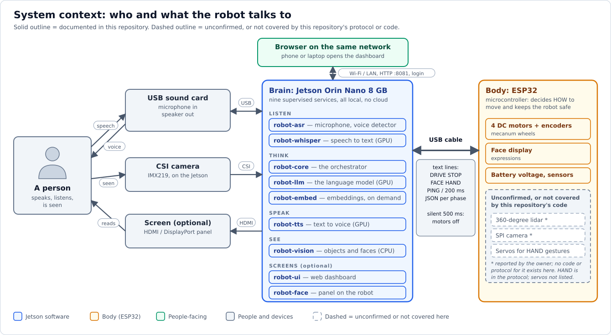

# Robot handbook

A robot you can talk to in **English, Bahasa Indonesia or Arabic**. It listens, thinks,
answers out loud, looks at who is in front of it, and moves. Everything runs **on the robot
itself, with no cloud**: a Jetson Orin Nano is the brain and a microcontroller is the body.

*How to read it: the person talks to the robot through a microphone and speaker and is seen
by a camera. Inside, the Jetson runs nine small programs ("services"). One of them,
`robot-core`, sends plain text commands down a USB cable to the microcontroller, which turns
them into motion. A browser on the same network can open a dashboard.*

## How sure are we? The four badges

The body has not been run together with this Jetson yet, so these pages say how far each
claim is proven. You will see these badges next to hardware and behaviour:

| Badge | Meaning |
|---|---|
| ✅ **Measured** | Run on this robot and checked: there is a number or a log line |
| 🧪 **Tested without hardware** | Covered by unit tests or the host simulator only |
| 📐 **Designed or reported** | In the design, or told to us by the owner, never checked here |
| ❓ **Unknown** | Needs an owner decision, or a look at the robot |

## Read this if you are…

| You are… | Read |
|---|---|
| New, and want to know what this is | [What the robot is](01-overview/what-it-is.md) |
| Curious how a conversation works | [One turn, end to end](01-overview/one-turn.md) |
| Looking up a word | [Glossary](01-overview/glossary.md) |
| Wondering which program does what | [The brain: processes and ports](04-brain/README.md) |
| Debugging a slow or deaf robot | [Voice pipeline](04-brain/voice-pipeline.md), then [Reliability](04-brain/reliability.md) |
| Choosing or swapping a model | [Models and memory](04-brain/models-and-memory.md) |
| Teaching it from documents | [Knowledge](04-brain/knowledge.md) |
| Writing or checking the body's firmware | [The body: firmware](03-firmware/README.md), then [The ESP32 as the body](03-firmware/esp32-conformance.md) |
| Making sure the robot stops when the brain dies | [The watchdog](03-firmware/watchdog.md) |
| Checking which way the wheels turn | [Motion: from a sentence to four wheels](03-firmware/motion.md) |
| Wiring the body | [Hardware: what is known](02-hardware/README.md) and the [reference wiring](02-hardware/reference-wiring.md), a proposal never checked against a board. The real ESP32 wiring needs the owner |
| Using the dashboard, or the screen on the robot | [Dashboard and panel](06-dashboard/README.md) |
| Plugging in a new screen, script or body | [Interfaces](05-interfaces/README.md) |
| Changing a setting, and wondering why it did nothing | [Configuration](05-interfaces/configuration.md) |
| Setting up a board, or starting the robot | [Installing](07-operations/install.md), then [Running it day to day](07-operations/running.md) |
| The robot is deaf, mute, slow or stuck | [A symptom index](07-operations/troubleshooting-index.md) |
| Asking "why not ROS 2?" or "why that model?" | [Decisions](08-decisions/README.md) |
| Looking for what is waiting on the owner | [Waiting for the owner](08-decisions/open-decisions.md) |
| About to change code (human or AI) | [`AGENTS.md`](../../AGENTS.md) first |
| Facing an error message | [`TROUBLESHOOTING.md`](../../dev-docs/ai/TROUBLESHOOTING.md), searchable by symptom |

## The handbook map

| Chapter | State | Until it is written, read |
|---|---|---|
| **01 Overview**: what it is, one turn, glossary | ✍️ written | |
| **02 Hardware**: what is known and what is not, the Jetson side, the reference wiring | ◐ **partial**: the real body's parts, power and wiring need the owner (see [what is needed](08-decisions/open-decisions.md#e-what-the-handbook-still-needs-from-you)) | |
| **03 Firmware**: the reference body, the watchdog, motion and mecanum signs, the simulator, what the ESP32 must do | ✍️ written. It documents the **reference** firmware: the ESP32's is not in the repo | |
| **04 Brain**: processes, voice pipeline, models and memory, knowledge, vision and people, reliability | ✍️ written | |
| **05 Interfaces**: serial protocol, reply JSON, WebSocket, configuration reference | ✍️ written | |
| **06 Dashboard and panel**: every page, and the panel on the robot | ✍️ written from the source. **No screenshots yet** | |
| **07 Operations**: install, run modes, systemd, a symptom index | ✍️ written | |
| **08 Decisions**: the hard constraints, rejected alternatives, what is waiting for the owner | ✍️ written | |

## Quick facts (as of 2026-11-12)

| | |
|---|---|
| Brain | Jetson Orin Nano 8 GB (Super), JetPack 6.2.1, headless. **7620 MiB** of RAM is usable and is shared by CPU and GPU |
| Body | A microcontroller on USB serial: an **ESP32** (reported by the owner, see the [glossary](01-overview/glossary.md#body-controller)) |
| Languages | English, Bahasa Indonesia, Arabic, chosen per sentence from the words spoken |
| Network | Nothing leaves the robot. The dashboard is on your own network only |
| Speed ✅ | From the end of your speech to the first spoken word: **median 2181 ms, best 1554 ms** (target 1500 ms). A short "okay, one moment" can start in about **123 ms** |
| Tests | 1255 Python tests (including 99 about the handbook, conventions and status polling), 634 firmware-core checks, all passing on 2026-11-16 |
| Processes | 9: `robot-llm`, `robot-whisper`, `robot-asr`, `robot-tts`, `robot-core`, `robot-embed`, `robot-vision`, `robot-ui`, `robot-face` |

Numbers come from [`PROGRESS.md`](../../dev-docs/ai/PROGRESS.md) and
[`AGENTS.md`](../../AGENTS.md). Those are the live trackers: this table is a snapshot.

## Conventions used in these pages

* **English is the master copy.** The Indonesian pages follow it and say which date they
  were translated from.
* **Pages state their sources.** A number is followed by where it was measured. A claim
  with no badge and no source is a bug in the page.
* **Pictures are text.** SVG diagrams are hand-editable; flow charts are Mermaid.
* **Names of files, commands and settings are never translated.**
