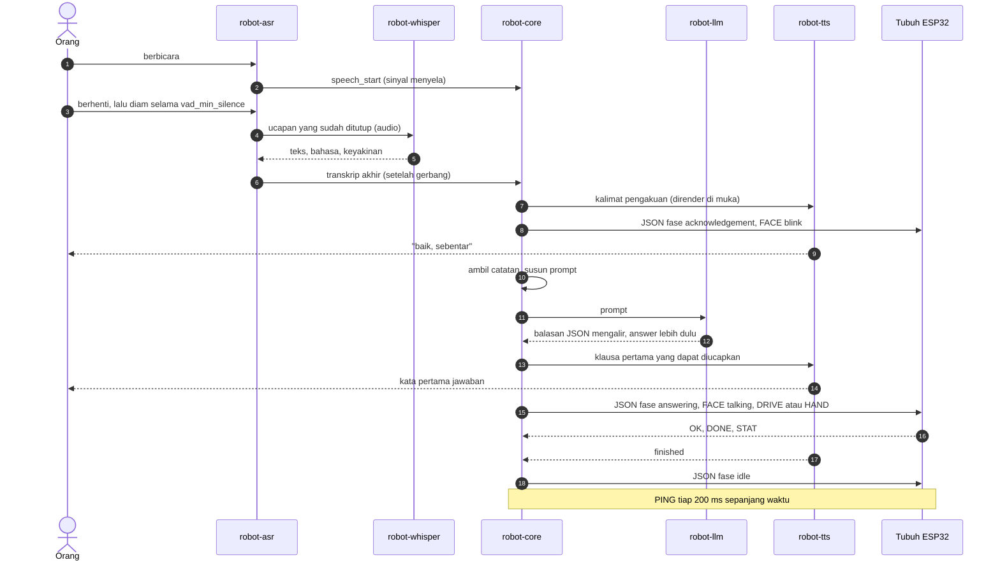
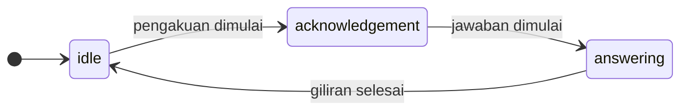

# Satu giliran, dari awal sampai akhir

> **Bahasa Indonesia.** Diterjemahkan dari [versi Inggris](../../en/01-overview/one-turn.md) pada
> **2026-11-16**. Versi Inggris adalah naskah utama.

Satu **giliran** adalah satu pertukaran: Anda mengatakan sesuatu, robot menjawab. Halaman ini mengikuti satu giliran melewati
sembilan program. Tiap langkah punya halaman lebih panjang di [alur suara](../04-brain/voice-pipeline.md).

## Langkah demi langkah

| # | Langkah | Di mana | Yang terjadi | Yang mengaturnya |
|---|---|---|---|---|
| 1 | **Mendengar** | `robot-asr` | Mikrofon selalu terbuka. Pendeteksi suara (Silero) menyadari ucapan dimulai dan memberi tahu core seketika, agar robot berhenti bicara menimpa Anda. Ia menutup ucapan setelah jeda | `vad_min_silence`: berapa lama jeda mengakhiri kalimat |
| 2 | **Gerbang dan dekode** | `robot-asr`, `robot-whisper` | Pemeriksaan level membuang bunyi yang hampir tak melampaui derau ruangan. whisper.cpp mengubah audio menjadi teks di GPU dan melaporkan keyakinannya sendiri. Hasil berkeyakinan rendah atau berbahasa salah dibuang, dan pembuangan dicatat | `ASR_NOISE_GATE_DB`, `ASR_MAX_NO_SPEECH`, `ASR_LANGUAGES`, dan ukuran model whisper |
| 3 | **Mengakui** | `robot-core`, `robot-tts` | "Baik, sebentar" pendek diputar dari cache frasa yang dirender di muka, sehingga kesenyapan terisi selagi jawaban dikerjakan | `CORE_FILLER` |
| 4 | **Mengambil** | `robot-core` | Catatan dari dokumen Anda yang cocok dengan pertanyaan dicari | `RAG_K` (berapa banyak) |
| 5 | **Berpikir** | `robot-llm` | Prompt disusun dan model mengalirkan kembali objek JSON dengan `answer` lebih dulu | model, `LLM_CTX`, `CORE_MAX_TOKENS` |
| 6 | **Berbicara** | `robot-core`, `robot-tts` | Klausa pertama jawaban dikirim ke suara begitu dapat diucapkan. Sisanya menyusul selagi diputar | `CORE_FIRST_MAX_CHARS`, `CORE_FIRST_MIN_CHARS` |
| 7 | **Bertindak** | `robot-core`, tubuh | Bidang lain balasan (gerak, gestur) menjadi perintah serial yang dimulai selagi kalimat masih diucapkan | JSON balasan, dijepit di tiga tempat |
| 8 | **Kembali diam** | semua | Wajah kembali ke diam, mikrofon terbuka lagi setelah ekor singkat | `CORE_LISTEN_TAIL_MS` |

## Berapa lama tiap langkah, dan apa yang disetel

Angka di bawah adalah yang didaftar [`AGENTS.md`](../../../AGENTS.md) bagian How fast it answers di samping tiap pengaturan.
**Jumlahnya tidak sama dengan median ujung ke ujung**, jadi bacalah sebagai "pengaturan mana mengatur tahap mana", bukan anggaran.

| Tahap | Angka | Diatur oleh |
|---|---|---|
| Penentuan akhir: menunggu sampai yakin Anda selesai | 200 ms | `vad_min_silence` |
| Dekode ASR | 510 ms | ukuran model whisper (`WHISPER_MODEL`) |
| Token pertama dari model | +92 ms | ukuran prompt: `rag_k`, persona |
| Klausa pertama yang dapat diucapkan | +926 ms | model menulis sesuatu yang dapat diucapkan |
| Sintesis potongan pertama | +963 ms | `CORE_FIRST_MAX_CHARS` |

Ujung ke ujung, dari akhir ucapan yang sebenarnya sampai kata pertama: **median 2181 ms, terbaik 1554 ms** (target 1500 ms) ✅.

**Untuk melihat giliran nyata, bukan tabel**, buka halaman **Conversation** dashboard dan perluas **Timing** di bawah balasan lisan mana
pun. Ia memecah giliran itu menjadi tahap, menandai yang paling lambat, dan menyebut pengaturan yang mengaturnya. Durasi tahap berjumlah
persis total giliran, dan itu diuji.

**Satu hal melampaui setiap pengaturan: swap.** Jika papan kehabisan memori dan sebuah layanan didorong ke disk, kata pertama dapat
memakan sepuluh detik, bukan satu. Lihat [Model dan memori](../04-brain/models-and-memory.md).

## Dapatkah dipotong?

`CORE_LISTEN_MODE` memutuskan apa yang boleh dilakukan mikrofon selagi robot berbicara:

| Mode | Perilaku | Imbal balik |
|---|---|---|
| `interrupt` | Berbicara menimpa robot menghentikannya seketika (barge-in) | Responsif, tetapi robot dapat mendengar dirinya lewat speakernya sendiri |
| `no_interrupt` | Mikrofon **ditutup** selagi robot bicara, dan selama `CORE_LISTEN_TAIL_MS` sesudahnya | Tak pernah mendengar dirinya. Ini mode yang dikonfigurasi |
| `wake_word` | Seperti `no_interrupt`, dan tak ada yang memulai giliran kecuali transkrip memuat kata bangun (`CORE_WAKE_WORD`, `robot`) | Untuk ruangan bising. Tak butuh model pencari kata kunci: kata dicocokkan di teks |

## Yang dilakukan wajah

Wajah mengikuti giliran menurut aturan, bukan pilihan model (`CORE_FACE_MODE=phases`):

| Fase | Wajah | Kapan |
|---|---|---|
| `acknowledgement` | `blink` | "Baik, sebentar" sedang diputar |
| `answering` | `talking` | Balasan sedang diucapkan |
| `idle` | `random` | Tidak ada kejadian |

Dengan `CORE_FILLER=0` tak ada fase pengakuan dan giliran langsung dari `idle` ke `answering`. Tiga fase yang sama pergi ke dashboard,
panel di robot, dan tubuh, jadi ketiganya selalu sepakat.

## Menjawab dalam bahasa apa?

Bahasa dari **kata-kata yang Anda ucapkan** yang memutuskan, bukan tebakan pengurai. Inggris masuk, Inggris keluar. Lihat
[Memutuskan bahasa](../04-brain/voice-pipeline.md#2-memutuskan-bahasa).

## Ke mana melihat bila giliran terasa salah

| Gejala | Lihat |
|---|---|
| Menjawab sesuatu yang tak diucapkan siapa pun | `grep 'robot-asr: dropped' .cache/tmp/asr.log`, yang mendaftar setiap bunyi yang ditolak beserta angkanya |
| Menjawab lambat | Rincian **Timing**, lalu `./scripts/measure/whats_running.py` untuk swap |
| Menjawab dalam bahasa yang salah | `grep 'recogniser said' .cache/tmp/core.log` |
| Jawabannya terpotong | Peringatan `truncated` di `core.log`; lihat [Alur suara](../04-brain/voice-pipeline.md#3-berpikir) |
| Tak pernah menjawab | [Keandalan](../04-brain/reliability.md) dan [`TROUBLESHOOTING.md`](../../../dev-docs/ai/TROUBLESHOOTING.md) |
