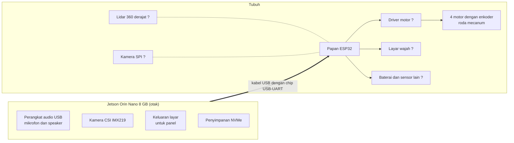

# Perangkat keras: apa yang diketahui dan apa yang belum

> **Bahasa Indonesia.** Diterjemahkan dari [versi Inggris](../../en/02-hardware/README.md) pada
> **2026-11-16**. Versi Inggris adalah naskah utama.

Bab ini **sengaja belum lengkap**. Sisi Jetson dapat diperiksa di mesin ini; tubuh tidak, karena tidak ada tubuh
yang terpasang saat halaman ini ditulis dan firmware-nya tidak ada di repositori. Setiap baris menyebut jenis
pengetahuannya: ✅ terukur di sini, 🧪 hanya simulasi, 📐 dilaporkan pemilik atau dirancang, ❓ belum diketahui.

*Garis tegas dilaporkan pemilik; garis putus-putus adalah hal yang disebut pemilik tetapi sambungannya belum
diketahui; "?" menandai bagian yang jenisnya belum diketahui. Tidak ada di sisi tubuh yang diperiksa di sini.*

## Sisi Jetson

| Bagian | Yang diketahui | Lencana |
|---|---|---|
| Papan | Jetson Orin Nano **8 GB (Super)**, JetPack **6.2.1** (L4T 36.4.7), mode daya **MAXN_SUPER**, tanpa desktop | ✅ `check_board.sh`, 2026-11-16 |
| Memori | **7619 MiB** terlihat, **7620 MiB** anggaran. Dibagi CPU dan GPU. Sisanya carve-out Tegra | ✅ |
| Penyimpanan | Sistem berkas root 99 GB, **terpakai 96%, sisa 3,9 GB**. Repo dan model di partisi NVMe terpisah dengan **225 GB kosong** | ✅ 2026-11-16 |
| Mikrofon dan speaker | **Satu perangkat audio USB** untuk keduanya. Speaker hanya menerima **16 kHz mono**, jadi PulseAudio mengubah 44,1 kHz dari suara | ✅ untuk perangkat di konfigurasi; ❓ tidak ada yang terpasang pada 2026-11-16 |
| Kamera | **IMX219 di CSI**, sensor 0, dipakai pada 640×360 dan 2 fps. Hanya Argus yang menjangkaunya, dan hanya **satu proses** per sensor | ✅ (ruangan kosong; belum dengan orang sungguhan) |
| Layar | Panel butuh layar di keluaran DisplayPort/HDMI, terlihat sebagai `card1-DP-1` | ✅ terukur sekali; ❓ belum ada panel sungguhan |
| Hubungan ke tubuh | Perangkat serial. Jetson membuka `ttyACM*`, `ttyUSB*`, dan `ttyTHS*` dan mencari tubuh dengan ping | 📐 |

Dua jebakan dari log proyek sendiri:

* **Di papan ini `/dev/ttyACM0` pernah menjadi kartu suara USB**, karena perangkat itu komposit dengan antarmuka
  serial. Jangan pernah memanggil tubuh dengan nomor `ttyACM`.
* **Mikrofon atau speaker baru mengubah nama PulseAudio-nya**, dan nama terkonfigurasi yang tak cocok membuat
  robot tuli tanpa galat. Pilih perangkat di Config → Hardware, tempat perangkat yang hilang ditampilkan.

## Tubuh, seperti dilaporkan

Dari pemilik pada 2026-11-12, **belum diverifikasi** karena papan tidak ada di tangan:

| Bagian | Kata pemilik | Yang belum ada |
|---|---|---|
| Pengendali | **ESP32** | modulnya, sumber firmware |
| Hubungan | kabel USB, dengan **chip USB-UART**, berbicara protokol baris repositori ini | chipnya, baud |
| Penggerak | **4 motor dengan enkoder**, roda mecanum | driver, rasio gigi, hitungan enkoder per putaran, diameter roda, jarak sumbu dan lebar |
| Wajah | **layar wajah** | jenis dan pemasangannya |
| Sensor | **baterai** dan sensor lain | yang mana, dan cara membacanya |
| Lidar | **lidar 360°** | modelnya dan cara tersambung. **Tidak ada kode atau protokol untuknya** |
| Kamera | **kamera SPI** | modelnya, dan prosesor yang membacanya. **Tidak ada kodenya** |
| Servo | **tidak disebut** | apakah ada (perintah `HAND` mengandaikannya) |
| Daya | tidak dijelaskan | baterai, regulator, apa memberi daya ke apa |

**Rancangan acuan** tubuh (STM32 Black Pill dan dua TB6612FNG) ada di [Kabel acuan](reference-wiring.md). Itu usulan,
bukan yang dibangun.

## Isi bab ini setelah selesai

Masing-masing butuh pemilik dan robotnya:

* daftar komponen dengan modul sebenarnya,
* **diagram daya**: baterai ke setiap pemakai, dengan tegangan dan sekering,
* **daftar kabel** dan tabel pin ESP32, dibangkitkan dari header pin firmware,
* dimensi **sasis mecanum** yang memberi makan [konstanta kinematika](../03-firmware/motion.md),
* **halaman sensor** (sensor baterai, lidar, kamera SPI) dan keputusan lingkup soal lidar,
* **foto** sasis dan kabel, dan catatan uji awal.

Daftar yang perlu dikirim ada di [Menunggu pemilik proyek](../08-decisions/open-decisions.md).

## Keselamatan, sampai terukur

* **Letakkan robot di atas balok** untuk uji roda apa pun. Setiap roda akan digerakkan.
* **Buktikan watchdog di papan sungguhan sebelum menyambung motor**: [Watchdog](../03-firmware/watchdog.md).
* Sambungkan catu motor **terakhir**, dan periksa apa yang dilakukan masukan driver motor saat ESP32 boot dan
  reset ([daftar periksa ESP32, baris 16](../03-firmware/esp32-conformance.md)).
