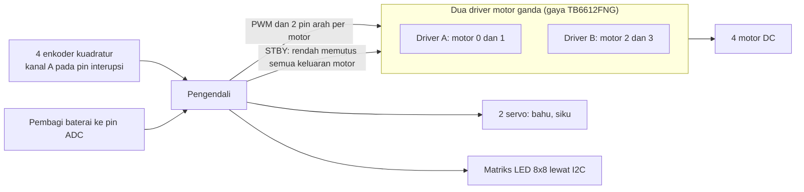

# Kabel acuan: usulan di `robot_pins.h`

> **Bahasa Indonesia.** Diterjemahkan dari [versi Inggris](../../en/02-hardware/reference-wiring.md) pada
> **2026-11-16**. Versi Inggris adalah naskah utama.

> ⚠️ **Belum diverifikasi.** [`robot_pins.h`](../../../firmware/stm32/include/robot_pins.h) menyatakannya di baris
> pertama: *tidak ada di sini yang diperiksa terhadap perangkat keras nyata*. Setiap pin adalah "bawaan yang masuk
> akal untuk WeAct Black Pill (STM32F411CE) yang menggerakkan dua driver motor TB6612FNG". Ini rancangan yang dipakai
> firmware acuan, **bukan kabel robot**, yang memakai ESP32. Pakai sebagai peta *apa yang harus disambung*, dan buat
> tabel pin ESP32 Anda sendiri.

## Yang harus disambung

## Peta pin di berkas

Urutan roda di mana-mana: **0 depan kiri, 1 depan kanan, 2 belakang kiri, 3 belakang kanan**.

| Fungsi | Pin (nama STM32) | Catatan |
|---|---|---|
| Motor 0 | PWM `PB0`, IN1 `PB1`, IN2 `PB2` | satu PWM dan dua jalur arah per roda |
| Motor 1 | PWM `PB3`, IN1 `PB4`, IN2 `PB5` | |
| Motor 2 | PWM `PB6`, IN1 `PB7`, IN2 `PB8` | |
| Motor 3 | PWM `PB9`, IN1 `PB12`, IN2 `PB13` | |
| Standby driver | `PB14` | ditarik **rendah untuk memutus semua keluaran motor lewat perangkat keras**; watchdog menggerakkannya selain menolkan PWM |
| Enkoder | A/B: `PA0`/`PA1`, `PA2`/`PA3`, `PA4`/`PA5`, `PA6`/`PA7` | A pada pin yang mampu interupsi, B dibaca langsung |
| Servo | bahu `PA8`, siku `PA9` | untuk gestur bawaan |
| Matriks LED | SDA `PB11`, SCL `PB10`, alamat `0x70` | I²C, mis. HT16K33 8×8 |
| Sensor baterai | `PA10`, rasio pembagi **11** | 10 kΩ di atas 1 kΩ: 0 sampai 36 V menjadi 0 sampai 3,3 V |

## Konstanta yang bergantung pada build

| Konstanta | Nilai | Arti | Lencana |
|---|---|---|---|
| `ENCODER_COUNTS_PER_REV` | 1440 | hitungan per putaran roda setelah gir dan dekode 4×. **Salah berarti setiap kecepatan salah dengan faktor tetap.** Ukur: putar satu roda tepat satu putaran dengan tangan dan baca hitungannya | ❓ pengisi |
| `CONTROL_HZ` | 100 | laju loop PID | 📐 |
| `VBAT_DIVIDER_RATIO` | 11 | pembagi baterai | 📐 |
| Penguatan PID | `kp 0,020, ki 0,120, kd 0` | hanya titik awal | ❓ setel di meja uji |
| Geometri | r 0,048 m, setengah lebar 0,085 m, setengah panjang 0,095 m | kinematika | ❓ pengisi, [lihat Gerak](../03-firmware/motion.md) |

## Dua hal yang dibawa ke build ESP32

* **Jalur standby adalah pengaman perangkat keras.** Jika loop PID macet, menarik standby driver ke rendah tetap
  menghentikan robot. Rancangan ESP32 sebaiknya mempertahankan padanan yang tidak bergantung pada kode kendali.
* **Jangan taruh masukan driver motor pada pin yang bergerak saat chip boot.** ESP32 punya pin strapping dan pin flash;
  lihat datasheet, dan periksa masukan dengan osiloskop atau LED saat reset.
