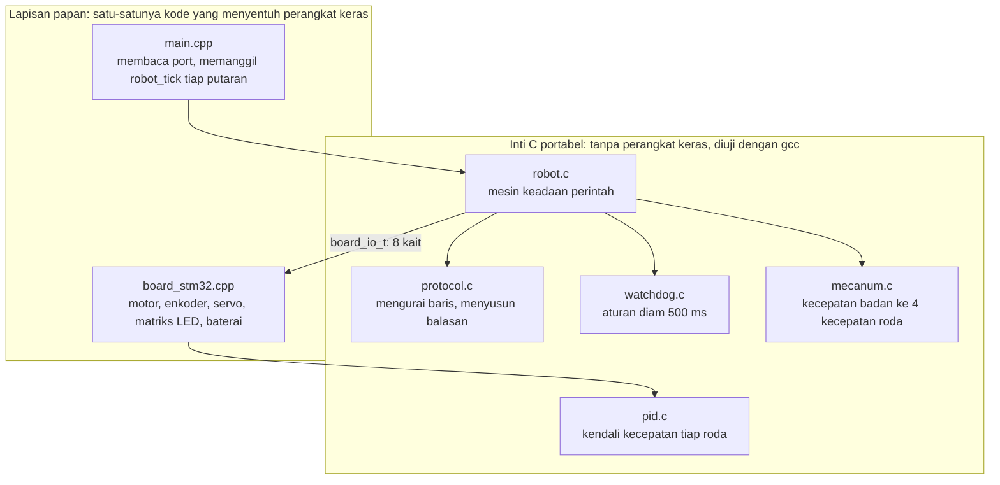
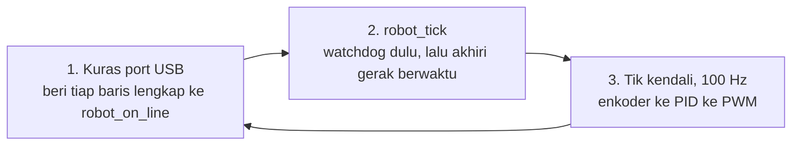

# Tubuh: firmware

> **Bahasa Indonesia.** Diterjemahkan dari [versi Inggris](../../en/03-firmware/README.md) pada
> **2026-11-16**. Versi Inggris adalah naskah utama: jika berbeda, ikuti versi Inggris.

Tubuh adalah bagian robot yang **bergerak dan menampilkan wajah**. Dari sisi otak, tugasnya satu:
membaca sebaris teks, melakukan yang diminta, menjawab dengan satu baris, dan **berhenti sendiri jika
otak diam**.

> **Keadaan saat ini (2026-11-16)**
>
> * Firmware di repositori ini, `firmware/stm32/`, ditulis untuk **STM32F411 "Black Pill"** dengan dua
>   driver motor TB6612FNG. Ini adalah **implementasi acuan** protokol tubuh. Inti portabelnya lulus
>   **634 pemeriksaan, 0 gagal** 🧪 (dijalankan hari ini hanya dengan `gcc`), dan dijalankan lewat
>   pseudo-terminal oleh simulator host 🧪. Firmware ini **belum pernah berjalan di papan** ❓.
> * Tubuh robot yang sebenarnya adalah **ESP32** (dilaporkan pemilik proyek 📐). **Firmware-nya tidak
>   ada di repositori ini**, jadi tidak ada yang di sini yang diperiksa terhadapnya. Apa yang harus
>   dilakukan firmware ESP32 ada di [ESP32 sebagai tubuh](../03-firmware/esp32-conformance.md).

## Dua tubuh, satu kontrak

| | Tubuh acuan (di repo ini) | Tubuh robot yang sebenarnya |
|---|---|---|
| Pengendali | STM32F411CE "Black Pill" | **ESP32** 📐, modul pastinya belum diketahui ❓ |
| Hubungan ke Jetson | USB-CDC, port serial virtual (vendor id `0483`) | kabel USB dengan **chip USB-UART** 📐 |
| Firmware | `firmware/stm32/`: inti C portabel plus lapisan papan berbasis Arduino | **tidak ada di repo** ❓ |
| Motor | 4 motor DC, 2× TB6612FNG, 4 enkoder kuadratur | 4 motor dengan enkoder 📐, driver belum diketahui ❓ |
| Wajah | matriks LED 8×8 lewat I²C | "layar wajah" 📐, jenisnya belum diketahui ❓ |
| Lainnya | 2 servo untuk gestur, pembagi tegangan baterai | baterai dan sensor lain 📐; **servo tidak disebut** ❓; lidar 360° dan kamera SPI 📐 |

**Kontraknya** sama untuk keduanya: [`serial-protocol.md`](../../../dev-docs/architecture/serial-protocol.md).
Tubuh adalah program apa pun yang menepati kontrak itu.

## Rancangan: keputusan di C portabel, perangkat keras di tepi

Semua yang *memutuskan* sesuatu adalah C biasa tanpa pustaka perangkat keras. Perangkat keras berada di
balik **satu struct berisi delapan penunjuk fungsi**. Itulah sebabnya aturan keselamatan dapat diuji di
komputer biasa.

| Berkas | Perangkat keras? | Apa |
|---|---|---|
| `src/protocol.c` | tidak | Mengurai baris, batas, menyusun respons |
| `src/watchdog.c` | tidak | **Batas waktu detak 500 ms** |
| `src/mecanum.c` | tidak | Kecepatan badan ke empat kecepatan roda |
| `src/pid.c` | tidak | Kendali kecepatan tiap roda dengan anti-windup |
| `src/robot.c` | tidak | Mesin keadaan yang menyatukan semuanya |
| `src/board_stm32.cpp` | **ya** | Motor, enkoder, servo, matriks LED, baterai |
| `src/main.cpp` | **ya** | Putaran baca USB; memanggil `robot_tick` tiap putaran |

Papan baru (misalnya ESP32) cukup mengimplementasikan delapan kait `board_io_t` dan memakai inti yang sama
tanpa perubahan. Rinciannya ada di [versi Inggris](../../en/03-firmware/README.md#the-eight-hooks-board_io_t).

## Satu putaran loop utama

Urutannya disengaja. **Membaca didahulukan** dan tidak ada yang lambat boleh mendahuluinya, karena baris
yang terlambat diterima berarti makanan watchdog yang terlambat. **Pemeriksaan watchdog berjalan di setiap
putaran, tanpa syarat**: jika loop berhenti memanggilnya, robot tidak bisa menghentikan dirinya sendiri.
Baris yang tidak muat di penyangga 256 byte **dibuang seluruhnya**, termasuk ekornya.

## Yang dijanjikan inti

Masing-masing dicakup oleh salah satu dari 21 fungsi uji di `test_main.c` 🧪.

* **Setiap perintah mendapat tepat satu respons**: `OK`, `ERR <kata kerja> <alasan>`, atau `STAT`.
* **Baris apa pun memberi makan watchdog**, termasuk yang rusak, `STATUS`, ping penemuan, dan baris balasan.
* **Gerak selalu dibatasi.** `DRIVE` membawa durasi 1 sampai 10 000 ms dan tubuh berhenti saat habis.
* **Tubuh memeriksa ulang setiap batas** yang sudah dijepit Jetson: ±1,0 m/s, ±1,0 m/s, ±3,0 rad/s, 10 detik.
* **Kata kerja tidak peka huruf besar-kecil**, sehingga bisa dikendalikan manual dari `screen` atau `minicom`.
* **Tidak ada yang dilihat pengurai yang dapat membuatnya mogok**: tanpa alokasi, tanpa mengubah masukan,
  dan menolak `NaN`, tak hingga, dan angka di atas ±1 000 000.

## Halaman di bab ini

| Halaman | Baca jika |
|---|---|
| [Watchdog](watchdog.md) | Anda ingin tahu bagaimana robot berhenti saat otak mati |
| [Gerak: dari kalimat ke empat roda](motion.md) | Anda memasang motor, memeriksa arah roda, atau mengubah geometri |
| [Mencoba tubuh tanpa papan](../03-firmware/try-it-without-a-board.md) | Anda ingin menjalankan uji dan simulator |
| [ESP32 sebagai tubuh](../03-firmware/esp32-conformance.md) | Anda menulis atau memeriksa firmware sebenarnya |
