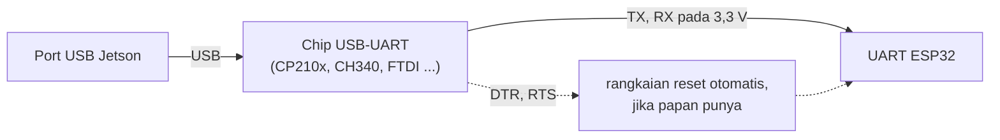

# ESP32 sebagai tubuh

> **Bahasa Indonesia.** Diterjemahkan dari [versi Inggris](../../en/03-firmware/esp32-conformance.md) pada
> **2026-11-16**. Versi Inggris adalah naskah utama.

Pemilik melaporkan bahwa pengendali tubuh robot adalah **ESP32** 📐. Firmware-nya **tidak ada di repositori ini**, dan
tidak ada ESP32 yang terpasang saat halaman ini ditulis, jadi **tidak ada yang di sini diperiksa terhadapnya**. Halaman ini
daftar periksa: apa yang harus dilakukan firmware itu agar menjadi tubuh yang aman dipakai Jetson, dari mana tiap syarat
berasal, dan cara memeriksanya.

> **Hati-hati pada sambungan pertama.** Kirim `PING`, `STATUS`, dan `FACE` dulu. `scripts/serial/protocol_test.py` mengirim
> `DRIVE`, `WHEEL`, dan `HAND`, jadi ia menggerakkan benda. Jalankan gerak apa pun dengan motor tanpa daya, atau robot di
> atas balok.

## Hubungannya

| Fakta hubungan yang diandaikan Jetson | Nilai | Sumber |
|---|---|---|
| Baud | **115200**. Lewat USB-CDC diabaikan; **lewat chip USB-UART harus sama** dengan pengaturan UART ESP32 ❓ | `SerialLink(baud=115200)` |
| Pembingkaian | 8 bit data, tanpa paritas, 1 bit henti (bawaan pyserial). Tanpa kendali aliran | `rtscts=False, dsrdtr=False` |
| Baris | ASCII, diakhiri `\n`. Paling banyak **255 byte**, baris baru tidak dihitung | `MAX_LINE`, `PROTOCOL_MAX_LINE 256` |
| Nama port | `STM32_PORT` **kosong** di `config/core.env` saat ini, jadi `robot-core` menemukan tubuh tiap menyala dengan mengirim `{PING_robot}` ke **setiap** port serial | `_discover_microcontroller` |

### Membuka port dapat mereset ESP32

`robot-core` sudah mengandaikan ini. Komentar probe berkata: *"Papan yang reset saat portnya dibuka (kebanyakan papan dev
ESP32) masih booting selama sekitar satu detik pertama, dan satu ping yang ditulis saat port terbuka jatuh di celah itu dan
hilang"*, jadi ping dikirim ulang tiap 0,4 detik, dan penemuan mencoba hingga tiga kali dengan menunggu 0,8, 1,6, dan 2,4 detik.

Akibatnya, yang harus **diperiksa di papan** ❓:

* Tubuh dapat **reboot** pada setiap `robot-core` menyala, setiap "Ping all ports" di dashboard, dan saat hubungan tersambung
  ulang. Setelah penemuan, probe menutup port dan hubungan tetap membukanya lagi, jadi satu kali nyala dapat mereboot dua kali.
* Selagi reboot, detak Jetson tak sampai ke mana-mana, dan **hubungan tetap terbaca UP**: tak ada yang memeriksa apakah papan
  menjawab (Masalah Diketahui #6). Itu aman hanya jika **motor mati sejak saat pertama boot**, lihat tabel di bawah.
* `robot-core` membuka **setiap** port `ttyACM*`, `ttyUSB*`, `ttyTHS*` dan setiap entri `/dev/serial/by-id`. Lidar pada
  adaptor USB-UART akan dibuka dan dikirimi `{PING_robot}` juga (Masalah Diketahui #5, pilihan yang disengaja yang dapat
  dipersempit dengan daftar vendor). Belum ada di repositori yang mengenal lidar ❓.

## Daftar periksa

Keadaannya ❓ untuk setiap baris, karena belum ada firmware ESP32 yang terlihat. Centang saat diperiksa.

| # | Tubuh harus… | Asalnya | Cara memeriksa |
|---|---|---|---|
| 1 | Menjawab `{PING_robot}` dengan baris JSON berisi `"status":"online"`. `device` teks bebas (acuan berkata `STM32`, contoh dokumen `ESP32`) | `serial_link.py` `is_online_reply` | Config → Hardware → *Ping all ports*, atau `grep 'robot-core: microcontroller' .cache/tmp/core.log` |
| 2 | Mencocokkan `{PING_robot}` tanpa peduli huruf besar-kecil dan spasi sekitar, dan menjawab **hanya itu** dengan JSON | `protocol_is_discovery_ping` | seperti di atas |
| 3 | Memperlakukan baris berawalan `{` (**baris balasan**, sampai 255 byte) sebagai informasi: **tanpa jawaban**, dan jangan pernah menjalankan isinya. Jawaban `ERR {...` ditoleransi dan diabaikan | `protocol_is_reply_line`, `serial_link.py` | kirim baris balasan, jangan baca apa-apa |
| 4 | **Memberi makan watchdog pada setiap baris**, termasuk yang buruk, `STATUS`, ping penemuan, dan baris balasan | [Watchdog](watchdog.md) | lihat baris 8 |
| 5 | Menjawab **setiap perintah lain dengan tepat satu baris**: `OK <kata kerja>`, `ERR <kata kerja> <alasan>`, atau `STAT …` untuk `STATUS`. Alasan yang dipakai: `unknown`, `badargs`, `range`, `toolong`, `empty`, `watchdog` | `protocol.c` | `protocol_test.py --port` |
| 6 | Menerima kata kerja dalam huruf apa pun, dan menolak argumen berlebih atau kurang dengan `ERR <kata kerja> badargs` | `protocol_parse` | manual |
| 7 | Memvalidasi `DRIVE vx vy omega ms`: ±1,0, ±1,0, ±3,0, 1 sampai 10 000 ms, hanya angka terhingga. Selain itu `ERR DRIVE range` atau `badargs` | batas `protocol.h` | `protocol_test.py --port` |
| 8 | **Berhenti sendiri 500 ms setelah baris terakhir** dan menjawab `ERR <kata kerja> watchdog` sekali. **Jangan lanjut** | [Watchdog](watchdog.md) | `watchdog_test.py --port`, terpandu: [Membuktikannya di papan sungguhan](watchdog.md#membuktikannya-di-papan-sungguhan) |
| 9 | Mengakhiri gerak berwaktu sendiri dan mengirim `DONE DRIVE` (atau `DONE WHEEL`) | `robot_tick` | `protocol_test.py --port` |
| 10 | Menjawab `STOP` dengan `OK STOP` dan berhenti seketika | `robot.c` | manual, roda terangkat |
| 11 | Menerima **sembilan nama wajah**: `happy neutral sad thinking listening speaking` dan tiga wajah fase `blink talking random`. Nama asing: `ERR FACE unknown` | `tools.py` `FACES`, `core/face.py` | `FACE blink` manual |
| 12 | Memutuskan apa yang dilakukan `HAND` (`wave`, `point`, `home`, `nod`) **jika tak ada servo** ❓ lihat di bawah | `tools.py`, `protocol_test.py` | manual |
| 13 | Menjawab `STATUS` dengan `STAT batt=<V> motors=<state> temp=<C> up=<ms>`, `state` adalah `ok` atau `stall` | `protocol_stat` | `STATUS` manual |
| 14 | Menomori roda **0 depan kiri, 1 depan kanan, 2 belakang kiri, 3 belakang kanan** dan `direction[]` terverifikasi | [Gerak](motion.md) | `verify_wheels.py`, robot di atas balok |
| 15 | Membuang baris terlalu panjang **seluruhnya**, termasuk ekornya, dan tidak mengurai ekor itu sebagai perintah | `main.cpp` | kirim 300 byte lalu baris sah |
| 16 | **Motor mati sejak saat pertama boot dan reset**, termasuk brown-out dan reset akibat membuka port | `board_stm32_begin` menurunkan standby lebih dulu | osiloskop atau LED pada masukan driver saat reset |
| 17 | Menjaga loop tak memblokir: pemeriksaan watchdog dan pembacaan port harus berjalan tiap putaran, apa pun yang dikerjakan Wi-Fi, Bluetooth, flash, atau layar | `main.cpp` | ukur waktu loop terburuk |

### Dua keputusan yang harus diambil pemilik

**Baris 12: tanpa servo.** Pemilik mendaftar motor, layar wajah, baterai dan sensor lain, lidar, dan kamera. Servo tidak
disebut. Jetson tetap mengirim `HAND` setiap balasan model memuat `hand_movement`, dan `protocol_test.py` mengharapkan
`OK HAND` untuk `wave`. Jika tubuh menjawab `ERR HAND unknown`, Jetson melaporkan *"gesture was refused"* ke percakapan, yang
mungkin lalu disebut robot. Pilihannya: menerima semua gestur, tidak melakukan apa-apa dan menjawab `OK HAND` lalu
`DONE HAND`, atau mengajari model agar tidak bergestur. Yang pertama paling tidak mengejutkan ❓.

**Baris 11: apa itu wajah?** Firmware acuan menggambar bitmap LED 8×8. "Layar wajah" di ESP32 bisa OLED atau TFT; apa pun
itu, ia harus memahami sembilan nama tadi, karena `CORE_FACE_MODE=phases` mengirim `blink`, `talking`, dan `random` sendiri.

### Baris 16 dan 17 tentang ESP32, bukan protokol

* **Keadaan boot.** Sebagian pin ESP32 adalah **pin strapping** yang dibaca saat reset, sebagian dipakai flash, dan pin
  mengambang atau berdenyut saat chip boot. Jalur arah dan enable driver motor tidak boleh di pin itu, atau diberi pull-down
  agar bawaannya mati. Datasheet ESP32 mendaftarnya. Tindakan pertama firmware acuan adalah menarik pin standby driver ke rendah.
* **Waktu loop.** Acuan menjalankan satu loop tak memblokir. ESP32 biasanya menjalankan RTOS dengan tugas lain. Apa pun
  strukturnya, pembacaan baris dan watchdog tidak boleh menunggu di belakang tugas lambat.

## `STATUS` dan penanda macet

Lihat [Antarmuka: protokol serial](../05-interfaces/serial-protocol.md#status-dan-penanda-macet). Sejak 2026-11-16
`robot-core` menanyakan `STATUS` tiap 2 detik, jadi tubuh yang menjawabnya (baris 13) menyampaikan baterai, suhu, dan
penanda macet ke dashboard. Tubuh yang menjawab `ERR STATUS unknown` dibiarkan setelah penolakan pertama. Macet dipercaya
hanya setelah **dua** sampel `STAT` berturut-turut.

## Masalah identitas, dalam satu paragraf

63 berkas dan batasan keras 6 dan 7 menyebut STM32, dan `setup_udev.sh` hanya cocok dengan vendor id USB STMicroelectronics,
jadi papan CP2102 atau CH340 tidak mendapat `/dev/robot-stm32` ([Masalah Diketahui #19](../../../dev-docs/ai/PROGRESS.md)).
Penemuan dengan ping tidak peduli, dan menemukannya lewat `/dev/serial/by-id`. Mengganti nama menyentuh batasan keras, jadi
butuh persetujuan pemilik. Lihat [daftar istilah](../01-overview/glossary.md#pengendali-tubuh-body-controller).

## Urutan kerja saat papan di tangan

1. **Motor tanpa daya.** Buka port dengan `scripts/serial/stm32_console.py --port …`, yang menjaga detak tetap jalan di
   bawahnya. Ketik `PING`, `STATUS`, `FACE happy`.
2. Periksa baris 1, 2, 3, 5, 6, 11, 13, dan 15 secara manual.
3. Cari tahu apakah membuka port mereset papan, dan berapa lama ia menjawab.
4. **Buktikan watchdog (baris 8) di papan** dengan sesuatu yang bisa dilihat: osiloskop atau LED pada pin standby atau PWM
   driver, lalu roda terangkat.
5. `verify_wheels.py` dengan robot di atas balok, lalu catat `direction[]` dan centang tabel.
6. Enkoder, lalu penguatan PID, lalu `DRIVE` gabungan, sesuai urutan [README firmware](../../../firmware/stm32/README.md).
7. Baru sekarang `protocol_test.py --port` dan soak 24 jam.
