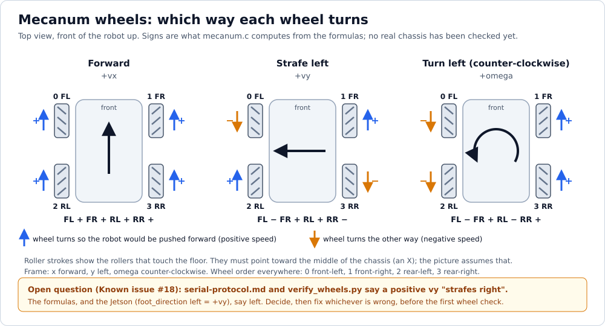
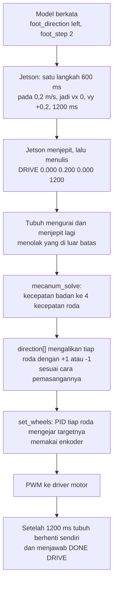

# Gerak: dari kalimat ke empat roda

> **Bahasa Indonesia.** Diterjemahkan dari [versi Inggris](../../en/03-firmware/motion.md) pada
> **2026-11-16**. Versi Inggris adalah naskah utama.

Robot berjalan dengan **empat roda mecanum**. Tiap roda punya rol kecil bersudut 45°, sehingga dengan
memutar keempat roda dalam kombinasi berbeda, sasis dapat maju, ke samping, atau berputar di tempat tanpa
pernah membelok.



*Cara membaca: depan di atas. Panah biru adalah roda yang berputar sehingga robot terdorong ke depan, panah
oranye sebaliknya. Maju adalah keempatnya biru. `vy` positif membalik kedua diagonal. `omega` positif memutar
sisi kiri ke belakang dan sisi kanan ke depan, sehingga robot berputar ke kiri.*

## Jalurnya, dari ujung ke ujung



Jetson tidak pernah menghitung kecepatan roda ([batasan 6](../../../AGENTS.md)). Ia mengirim *apa yang harus
dilakukan tubuh* dalam meter per detik dan radian per detik; tubuh yang memutuskan caranya.

## Kerangka dan satuan

| Besaran | Arti | Satuan |
|---|---|---|
| `vx` | maju (+) atau mundur (−) | m/s |
| `vy` | ke samping: **+ adalah kiri** | m/s |
| `omega` | berputar: **+ adalah berlawanan arah jarum jam, belok ke kiri** | rad/s |
| `ms` | berapa lama, lalu berhenti | milidetik, 1 sampai 10 000 |

**Ditetapkan pemilik proyek pada 2026-11-16** (Masalah Diketahui #18): kerangka **x ke depan, y ke kiri,
omega berlawanan arah jarum jam**, dilihat dari atas. Rol yang menyentuh lantai harus menunjuk ke tengah sasis
(membentuk X). Dokumen protokol, skrip uji roda, konsol manual, alias alat `drive`, dan prompt mode penanda
yang sebelumnya mengatakan sebaliknya sudah diperbaiki; `tests/test_conventions.py` menjaganya tetap selaras.
**Masih perlu diperiksa pada sasis sungguhan** ❓.

## Rumusnya

Dengan jari-jari roda `r` dan `k = lx + ly` (setengah lebar ditambah setengah panjang), kecepatan tiap roda
dalam rad/s:

```
FL = (vx - vy - k*omega) / r        roda 0, depan kiri
FR = (vx + vy + k*omega) / r        roda 1, depan kanan
RL = (vx + vy - k*omega) / r        roda 2, belakang kiri
RR = (vx - vy + k*omega) / r        roda 3, belakang kanan
```

lalu tiap hasil dikalikan entri `direction[]` rodanya, +1 atau −1. Pola tandanya adalah seluruh isi kinematika
mecanum: jangan "disederhanakan".

### Geometri di firmware hanyalah pengisi sementara

| Konstanta | Nilai | Keadaan |
|---|---|---|
| `wheel_radius_m` (r) | 0,048 | 📐 pengisi: ukur sasis sebenarnya |
| `half_width_m` (lx) | 0,085 | 📐 pengisi |
| `half_length_m` (ly) | 0,095 | 📐 pengisi |
| `direction[0..3]` | +1, +1, +1, +1 | ❓ asumsi, belum pernah diukur. Motor kiri dan kanan biasanya dipasang cermin, jadi semua +1 akan janggal |

Jari-jari atau geometri yang salah berarti robot **bergerak dengan kecepatan salah**. `direction[]` yang
salah berarti ia bergerak salah arah. Itu dua kesalahan berbeda dengan gejala berbeda.

### Besaran dengan geometri bawaan (turunan, 📐)

| Perintah | Kecepatan roda, rad/s (FL, FR, RL, RR) | Roda tercepat |
|---|---|---|
| `DRIVE 0.2 0 0 600` (satu langkah maju) | 4,17, 4,17, 4,17, 4,17 | sekitar 40 rpm |
| `DRIVE 0 0 1.2 600` (satu langkah belok) | −4,50, +4,50, −4,50, +4,50 | sekitar 43 rpm |
| `DRIVE 0 0.3 0 1000` | −6,25, +6,25, +6,25, −6,25 | sekitar 60 rpm |
| `DRIVE 1.0 0 0 …` (batas maju) | 20,83 pada keempatnya | sekitar 199 rpm |
| `DRIVE 1.0 1.0 3.0 …` (semua batas sekaligus) | −11,25, +52,92, +30,42, +11,25 | **sekitar 505 rpm** |

Baris terakhir penting. Batasnya **per sumbu**, jadi kombinasi dapat meminta satu roda **52,9 rad/s**, sedangkan
perintah uji `WHEEL` dibatasi 30 rad/s. Apakah motor nyata sanggup, dan aman, adalah pertanyaan perangkat
keras ❓. Saat ini jalur suara hanya mengirim satu sumbu sekaligus pada 0,2 m/s atau 1,2 rad/s.

## Batas, di dua tempat

Angka yang sama ada di Jetson (`serial_link.py`) dan tubuh (`protocol.h`), dan komentar di masing-masing
meminta keduanya diubah bersamaan.

| Batas | Nilai | Jika terlampaui |
|---|---|---|
| `|vx|` | 1,0 m/s | Jetson menjepit; tubuh menjawab `ERR DRIVE range` |
| `|vy|` | 1,0 m/s | sama |
| `|omega|` | 3,0 rad/s | sama |
| durasi | 1 sampai 10 000 ms | `0` dan di atas 10 000 adalah `ERR DRIVE range`; Jetson menjepit dulu |
| kecepatan `WHEEL` | 30 rad/s | `ERR WHEEL range` |
| bukan angka terhingga | | `ERR DRIVE badargs` |

## Memeriksa tanda roda pada sasis sungguhan

> ⚠️ **Belum dilakukan, untuk robot mana pun** ❓. **Letakkan robot di atas balok dulu.** Setiap roda akan digerakkan.

`python scripts/serial/verify_wheels.py --port <port>` memutar satu roda sekali jalan dengan perintah uji
`WHEEL` dan menanyakan apa yang Anda lihat. Kesepakatannya:

> Dengan perintah **positif**, roda harus berputar sehingga **jika keempatnya positif, robot maju.**

| Roda | Indeks | Perintah positif harus memutar | Terverifikasi | `direction[]` sekarang |
|---|---|---|---|---|
| Depan kiri | 0 | ke depan | ☐ | +1 (asumsi) |
| Depan kanan | 1 | ke depan | ☐ | +1 (asumsi) |
| Belakang kiri | 2 | ke depan | ☐ | +1 (asumsi) |
| Belakang kanan | 3 | ke depan | ☐ | +1 (asumsi) |

Lalu periksa kombinasinya. Tiap kegagalan punya ciri sendiri:

| Perintah | Seharusnya | Jika tanda salah |
|---|---|---|
| `DRIVE 0.3 0 0 1000` | lurus ke depan | menyimpang atau berputar |
| `DRIVE -0.3 0 0 1000` | lurus ke belakang | menyimpang atau berputar |
| `DRIVE 0 0.3 0 1000` | geser ke kiri, **tanpa berputar** | berputar, atau berjalan miring |
| `DRIVE 0 0 1.0 1000` | berputar di tempat, **tanpa bergeser** | bergeser saat berputar |

Robot yang maju dengan benar tetapi berjalan miring punya masalah **orientasi rol**, bukan masalah tanda.
Catat nilai terverifikasi di `mecanum_default_config()` **dan** centang tabel di `serial-protocol.md`
**dalam perubahan yang sama**.

## Enkoder dan PID

Lapisan papan acuan membaca enkoder tiap roda pada 100 Hz, mengubah hitungan menjadi rad/s dengan
`ENCODER_COUNTS_PER_REV` (pengisi 1440), dan menjalankan PID per roda. Penguatan awal `kp 0,020, ki 0,120,
kd 0`, keluaran dibatasi ±1,0 dari daya penuh. **Semuanya usulan** ❓: setel di meja uji, satu roda sekali jalan.

* **Anti-windup:** integral hanya bertambah jika tidak mendorong lebih jauh ke kejenuhan. 🧪 teruji.
* **Setpoint nol berarti berhenti:** PID di-reset dan mengeluarkan 0. 🧪 teruji.
* **Deteksi macet seperti tertulis:** roda dianggap macet jika target di atas 1,0 rad/s dan kecepatan terukur di
  bawah 0,2 rad/s, **tanpa waktu tunggu** ❓, jadi tik-tik awal setiap gerak bisa terbaca macet. Sejak 2026-11-16 Jetson
  menanyakan `STATUS` tiap 2 detik dan baru percaya macet setelah **dua sampel berturut-turut** (Masalah Diketahui #20);
  jeda singkat di firmware ESP32 tetap berguna.
