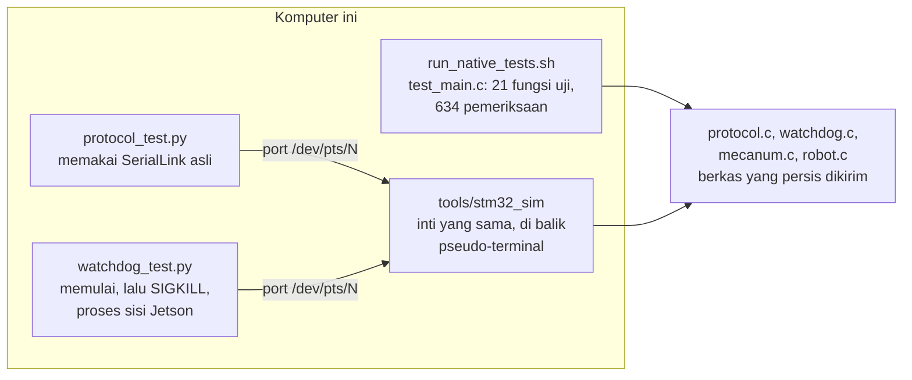

# Mencoba tubuh tanpa papan

> **Bahasa Indonesia.** Diterjemahkan dari [versi Inggris](../../en/03-firmware/try-it-without-a-board.md) pada
> **2026-11-16**. Versi Inggris adalah naskah utama.

Anda dapat menjalankan logika tubuh, dan separuh percakapan di sisi Jetson dengannya, di komputer ini tanpa mikrokontroler
terpasang. Tidak ada di halaman ini yang butuh perangkat serial, motor, atau PlatformIO. Hanya `gcc` dan Python proyek.

## Tiga hal untuk dijalankan

```bash
./firmware/stm32/run_native_tests.sh               # pemeriksaan inti, hanya gcc
python scripts/serial/protocol_test.py --sim       # setiap baris terdokumentasi, kedua sisi
python scripts/serial/watchdog_test.py --sim       # matikan otak, lihat roda berhenti
```

Hasil pada **2026-11-16**, di Jetson, 🧪:

| Perintah | Hasil |
|---|---|
| `run_native_tests.sh` | **634 pemeriksaan, 0 gagal** (0,75 detik) |
| `protocol_test.py --sim` | **20 lulus, 0 gagal** |
| `watchdog_test.py --sim` | **LULUS**: roda berputar setelah 152 ms, berhenti 499 ms setelah `SIGKILL`, tetap berhenti 1 detik kemudian |

## Masing-masing itu apa



* **`run_native_tests.sh`** mengompilasi inti portabel dengan `gcc` dan menjalankan
  [`test_main.c`](../../../firmware/stm32/test/test_native/test_main.c). 21 fungsi uji berkelompok: 8 tentang watchdog dan gerak
  berwaktu, 4 tentang protokol, 4 tentang perintah uji `WHEEL`, 2 tentang tanda mecanum, 3 tentang PID.
* **`tools/stm32_sim`** **bukan implementasi ulang**. Ia menautkan `protocol.c`, `mecanum.c`, `watchdog.c`, dan `robot.c` yang
  persis dikirim ke papan, dan menyediakan papan yang "motor"-nya variabel. Ia mencetak jalur pseudo-terminal yang dapat dibuka
  sisi Jetson seolah `/dev/ttyACM0`, dan menulis keadaan roda ke berkas agar uji dapat membacanya.
* **`protocol_test.py`** menggerakkan `SerialLink` Python asli terhadap simulator: perintah terdokumentasi diterima, penolakan
  membawa alasan, Jetson menjepit sebelum kabel, `STATUS` mengembalikan bentuk terdokumentasi, gerak berwaktu berakhir dengan
  `DONE`, dan detak mengalir.
* **`watchdog_test.py`** adalah uji keselamatan. Ia memulai proses terpisah yang mengirim detak dan `DRIVE` panjang,
  memastikan roda berputar, lalu membunuhnya dengan `SIGKILL`, yang tak dapat ditangkap, jadi **tidak ada di sisi Jetson yang
  ikut menghentikan robot**. Jika roda berhenti, firmware yang memutuskan menghentikannya.

Jika Anda mengubah `protocol.h`, bangun ulang simulator dulu dengan `tools/stm32_sim/build.sh`. Biner simulator lama pernah
memotong baris balasan panjang dan mengurai ekornya sebagai perintah sendiri, karena dibangun dengan `PROTOCOL_MAX_LINE 96`.

## Yang dibuktikan kelulusan, dan yang tidak

| Ia membuktikan 🧪 | Ia tidak dapat memberi tahu ❓ |
|---|---|
| Pengurai perintah menerima dan menolak sesuai dokumen | Bahwa pin mana pun adalah pin yang benar: `robot_pins.h` adalah usulan untuk Black Pill |
| Logika watchdog terpicu pada 500 ms, sekali, dan tidak lanjut | Bahwa watchdog berjalan **di papan**, di loop aslinya, di bawah beban nyata |
| Respons terbentuk benar dan setiap perintah mendapat satu | Bagaimana **chip USB-UART** atau UART ESP32 menyangga dan menunda byte |
| Hubungan Python menjepit, mencocokkan respons, dan bertahan saat tersambung ulang | Ke mana **roda nyata** berputar, jadi tanda roda belum teruji di logam |
| Rumus mecanum memberi tanda seperti di gambar | Apakah **geometri** (jari-jari, setengah lebar, setengah panjang) sesuai sasis |
| PID konvergen, jenuh, dan tidak windup | Apakah **penguatan** cocok untuk motor ini, dan **hitungan enkoder per putaran** |

## Uji Python lain yang menyentuh tubuh

Rangkaian yang lebih luas (`python -m pytest tests/ -q`, 1255 uji, dijalankan 2026-11-16) mencakup
`tests/test_serial_reply.py` (JSON balasan lewat kabel; `ping_ports` menjangkau setiap port), `tests/test_tools.py` (panggilan
alat dan penjepitannya), `tests/test_status_poll.py` (polling `STATUS` dan penyaring macet), dan `tests/test_hardware.py`
(memilih port serial dari dashboard). `scripts/hardening/failure_drills.py` mematikan tiap layanan sungguhan dan memeriksa
bahwa tubuh berhenti saat `robot-core` mati.

## Saat perangkat keras nyata tiba

[ESP32 sebagai tubuh](esp32-conformance.md) memberi urutannya. Dua hal milik di sini:

1. **`protocol_test.py` mengirim `DRIVE`, `WHEEL`, `HAND`, dan `FACE`.** Pada port nyata ia menggerakkan benda. Jalankan hanya
   dengan motor tanpa daya atau robot di atas balok.
2. **`watchdog_test.py --port` terpandu, bukan otomatis.** Pada papan nyata ia tak dapat melihat roda, jadi ia membunuh proses
   sisi Jetson dan menanyakan apa yang ditunjukkan osiloskop, LED, atau mata Anda. Lihat
   [halaman watchdog](watchdog.md#membuktikannya-di-papan-sungguhan).
