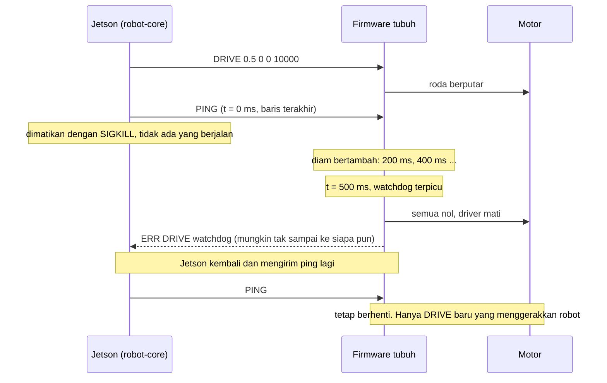

# Watchdog: bagaimana robot berhenti saat otak mati

> **Bahasa Indonesia.** Diterjemahkan dari [versi Inggris](../../en/03-firmware/watchdog.md) pada
> **2026-11-16**. Versi Inggris adalah naskah utama.

> **Mekanisme keselamatan terpenting di proyek ini.** Jetson menjalankan Linux penuh di papan dengan risiko
> kehabisan memori yang nyata. Ia *pasti* suatu saat macet atau dimatikan pada saat yang buruk. Robot yang
> satu-satunya remnya adalah `STOP` dari proses yang sudah mati akan menabrak tembok, maka **tubuh tidak
> pernah bergantung pada Jetson untuk berhenti.**

## Aturannya

| | |
|---|---|
| Jetson mengirim | `PING` tiap **200 ms** selama hubungan aktif (`HEARTBEAT_PERIOD_S` di `serial_link.py`) |
| Tubuh mengukur | waktu sejak baris terakhir **jenis apa pun** |
| Jika mencapai | **500 ms** (`WATCHDOG_TIMEOUT_MS`), tubuh menolkan semua motor atas wewenangnya sendiri |
| Lalu | melaporkan `ERR <kata kerja> watchdog` (jika sedang bergerak) dan diam |
| Pemulihan | butuh **perintah baru**. Gerak tidak lanjut sendiri, bahkan saat `PING` kembali |



## Cara ia dibangun, dan mengapa dapat dipercaya

`watchdog.c` hanya 46 baris tanpa ketergantungan perangkat keras, jadi **kode yang dikirim persis kode
yang diuji**.

| Sifat | Yang dilakukan kode | Diperiksa oleh |
|---|---|---|
| **Aktif sejak baris pertama** | Sebelum ada baris yang tiba, watchdog diam: motor belum pernah diperintah, jadi robot sudah aman | `test_watchdog_timing` 🧪 |
| **Baris apa pun memberi makan** | Baris rusak, `STATUS`, ping penemuan, dan baris balasan `{...}` semuanya dihitung | `test_watchdog_feeds_on_any_line` 🧪 |
| **Terpicu tepat di 500 ms, sekali** | Tidak di 499 ms, ya di 500 ms; hanya sekali | `test_watchdog_timing` 🧪 |
| **Menghentikan, membatalkan, melapor** | Roda dinolkan, gerak dibatalkan (bukan dijeda), `ERR DRIVE watchdog` dikirim | `test_silence_during_drive_zeroes_the_motors` 🧪 |
| **Tidak lanjut sendiri** | Baris menghapus pemicu, tetapi tak ada yang memulai ulang gerak | `test_motion_does_not_auto_resume` 🧪 |
| **Tahan pembalikan pencacah** | Pengurangan tak bertanda 32-bit, benar melewati batas sekitar 49,7 hari | `test_watchdog_survives_counter_wrap` 🧪 |
| **Mencakup perintah uji juga** | `WHEEL` punya durasi terbatas dan watchdog yang sama | `test_wheel_obeys_the_watchdog_too` 🧪 |

Dua lapis lain di sekelilingnya: **setiap `DRIVE` punya durasi**, dan **papan acuan menarik pin standby driver
ke rendah** setiap kali semua target nol, sebagai pengaman perangkat keras. Build ESP32 butuh padanannya ❓.

## Seberapa jauh ia meluncur sebelum berhenti

Hitungan dari batas, bukan pengukuran (📐): diam 500 ms pada kecepatan satu langkah ucapan (0,2 m/s) sekitar
**10 cm**; pada batas 1,0 m/s sekitar **50 cm**, ditambah waktu motor berhenti.

## Yang terukur hari ini

Pada 2026-11-16 uji membunuh proses di sisi Jetson dengan `SIGKILL` sementara simulator host menggerakkan roda:

```
[3] wheels TURNING after 152 ms: FL=10.42 FR=10.42 RL=10.42 RR=10.42
[4] SIGKILL -> pid 3660  (no cleanup, no STOP command)
[5] wheels STOPPED 499 ms after the kill
[6] still stopped 1 s later; motion did not auto-resume
PASS: the STM32 stopped the motors by itself.
```

Itu **🧪, bukan ✅**: rodanya variabel di simulator, bukan motor.

## Yang belum terbukti

| Belum terbukti | Mengapa penting |
|---|---|
| Watchdog **di papan sungguhan**, terutama **ESP32** | README firmware menyatakan tidak ada hal lain yang boleh dipercaya sebelum ini lulus di silikon nyata |
| **Pernah dijalankan di perangkat keras nyata** | Prosedur terpandu di bawah ada sejak 2026-11-16 dan **belum pernah dijalankan** ❓ |
| Loop utama ESP32 **tidak pernah memblokir** | Jika Wi-Fi, Bluetooth, tulis flash, atau penyegaran layar menunda loop, penghentian terlambat ❓ |
| Tidak ada yang **menggerakkan motor setelah berhenti** | Saat reset atau brown-out, pin berada pada keadaan apa pun yang ditinggalkan chip ❓ |

## Membuktikannya di papan sungguhan

`python scripts/serial/watchdog_test.py --port <port>` adalah pemeriksaan **terpandu** (Masalah Diketahui #21, selesai
2026-11-16). Papan nyata tidak menulis berkas status seperti simulator, jadi skrip tidak dapat melihat roda. Ia
mengerjakan bagian yang penting, dan Andalah sensornya:

1. Amati **satu hal**: osiloskop atau LED pada pin **PWM** atau **standby driver** motor, atau roda dengan robot **di
   atas balok**. Dengan motor tidak diberi daya, mengamati pin sudah cukup.
2. Skrip memulai proses di sisi Jetson yang mengirim detak dan `DRIVE` panjang, lalu bertanya apakah yang diamati aktif.
3. Ia `SIGKILL` proses itu: tanpa pembersihan, tanpa `STOP`.
4. Anda menjawab apakah ia **berhenti sendiri dalam sekitar setengah detik**, dan satu detik kemudian apakah ia **masih
   berhenti**. Waktu antara kill dan jawaban Anda mencakup reaksi Anda, jadi itu batas atas, bukan pengukuran.

Butuh terminal interaktif; jawaban salah atau tanpa pengamatan berarti GAGAL.

## Jika Anda mengubahnya

* Pertahankan `WATCHDOG_TIMEOUT_MS` di 500 dan detak di 200.
* Jalankan `./firmware/stm32/run_native_tests.sh` dan `python scripts/serial/watchdog_test.py --sim`.
* Jangan menambah jalur di Jetson yang "membuat penghentian lebih andal". Seluruh rancangannya adalah bahwa
  tidak ada yang di Jetson diandalkan.
