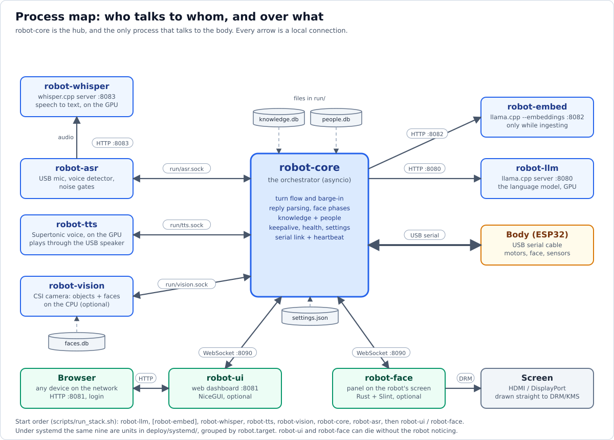
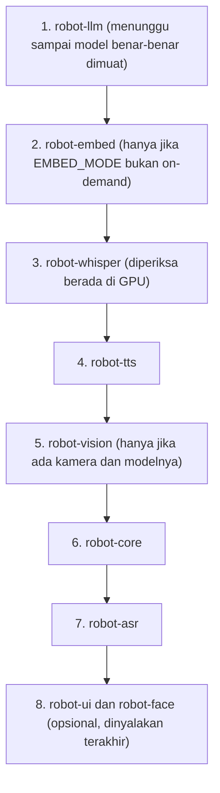

# Otak: sembilan program di Jetson

> **Bahasa Indonesia.** Diterjemahkan dari [versi Inggris](../../en/04-brain/README.md) pada
> **2026-11-16**. Versi Inggris adalah naskah utama.

Jetson tidak menjalankan satu program besar. Ia menjalankan **sembilan program kecil**, masing-masing diawasi dan dinyalakan ulang jika mati,
agar satu kerusakan tidak menjatuhkan robot.



## Siapa mengerjakan apa

| Program | Mengerjakan | Berbicara lewat | Berjalan di | Perlu untuk bicara? | Biaya (terukur) |
|---|---|---|---|---|---|
| **`robot-core`** | Orkestrator: alur giliran, prompt, penguraian balasan, pengetahuan, orang, keepalive, hubungan serial dan detak ke tubuh | soket lokal `run/core.sock` untuk alat baris perintah, WebSocket `:8090` (hanya loopback, token) | CPU | **ya** | ~36 MiB |
| **`robot-asr`** | Mikrofon, pendeteksi suara, dan gerbang derau. Mengirim ucapan tertutup ke `robot-whisper` | soket `run/asr.sock` | CPU | **ya** | pendeteksi suara menambah ~23 MiB |
| **`robot-whisper`** | Server whisper.cpp: ucapan ke teks dan bahasa | HTTP `127.0.0.1:8083` | **GPU, wajib** | **ya** | tergantung ukuran model (lihat halaman Memory) |
| **`robot-llm`** | Server llama.cpp: model bahasa | HTTP `127.0.0.1:8080` | **GPU** | **ya** | baris terbesar; tergantung `LLM_MODEL` |
| **`robot-tts`** | Suara (Supertonic bawaan, Piper dapat dipilih) dan pemutaran lewat speaker USB | soket `run/tts.sock` | **GPU** | **ya** | 472 MiB di CPU, 1738 MiB di GPU setelah beberapa ucapan |
| `robot-embed` | llama.cpp dengan `--embeddings`, untuk mencari dokumen | HTTP `127.0.0.1:8082` | CPU | tidak: pencarian beralih ke kata kunci | ~633 MiB, **hanya saat memasukkan dokumen** (`EMBED_MODE=on-demand`) |
| `robot-vision` | Kamera ke objek dan wajah | soket `run/vision.sock` | CPU | tidak | ~213 MiB |
| `robot-ui` | Dashboard web | HTTP `0.0.0.0:8081`, login | CPU | tidak | ~60 MiB |
| `robot-face` | Panel di layar robot sendiri (Rust dan Slint, langsung ke layar, tanpa desktop) | klien WebSocket `:8090` | CPU | tidak | 11,0 MiB RSS, plus 8,4 MiB buffer layar |

Sumber: [`system-overview.md`](../../../dev-docs/architecture/system-overview.md), [`memory-budget.md`](../../../dev-docs/architecture/memory-budget.md),
[`face.md`](../../../dev-docs/modules/face.md), `config/*.env`. Baris yang bergantung model berubah menurut pilihan; halaman Memory menghitung
pilihan yang berlaku.

Tiga aturan muncul dari gambar:

* **Hanya `robot-core` yang berbicara dengan tubuh.** Yang lain menjangkau perangkat keras lewatnya, jadi detak dan penjepitan keselamatan ada di
  satu tempat.
* **Kedua layar tidak bergantung pada apa pun, dan tidak ada yang bergantung padanya.** Mereka tamu di WebSocket. Mematikan `robot-ui` dengan
  `SIGKILL` sudah diuji: robot tetap menjawab dan detak ke tubuh tak pernah berhenti ✅.
* **Semuanya lokal.** Setiap panah adalah sambungan di mesin ini, kecuali dashboard (jaringan Anda sendiri) dan kabel USB ke tubuh.

## Urutan menyala

Urutannya bukan kosmetik. Dua mesin yang menyala bersamaan bisa sama-sama gagal mendapat memori GPU, karena masing-masing butuh satu blok berurutan
besar (whisper sekitar 1,3 GB sedangkan LLM butuh sekitar 2,8 GB). Menyalakan LLM dulu, menunggu sampai benar-benar siap, lalu whisper, itulah yang
membuat *cold start* berhasil.



Ini `scripts/run_stack.sh`. Menyalakan ulang satu mesin dengan tangan di samping yang lain bisa gagal padahal *cold start* berhasil: lihat
[Model dan memori](models-and-memory.md).

## Dua cara menjalankan

| | Pengembangan: `./run.sh` | Produksi: systemd |
|---|---|---|
| Dinyalakan oleh | `scripts/run_stack.sh` | unit di `deploy/systemd/`, dikelompokkan `robot.target` |
| Menyalakan ulang layanan mogok? | Hanya bagian keepalive `robot-core`, untuk empat mesin AI dan kamera | systemd, `Restart=on-failure` di setiap unit |
| Terisolasi? | Tidak | Ya |
| Keadaan | ✅ dipakai setiap hari | 📐 **belum pernah di-boot di papan ini**; empat kesalahan ditemukan dengan membacanya, dan masih butuh boot sungguhan |

```
./run.sh all        semuanya + dashboard di browser :8081
./run.sh headless   semuanya, tanpa layar: cara robot dikirim
./run.sh slint      semuanya + panel di layar robot sendiri
./run.sh stop | status | info
./run.sh model      model mana yang dipilih, dikonfigurasi, dan berjalan
./run.sh <mode> --check     cetak konfigurasi yang akan dipakai, jangan nyalakan apa pun
```

Ketiga mode berbeda **hanya** pada layar yang dinyalakan. Alur suaranya identik.

**Perubahan pada sebuah layanan belum selesai sebelum dibaca di bawah kedua pengawas.** Keduanya membaca berkas lingkungan dengan cara berbeda, dan
hanya systemd yang mengisolasi. Lihat [`TROUBLESHOOTING.md`](../../../dev-docs/ai/TROUBLESHOOTING.md) bagian "Everything works under run.sh and breaks under systemd".

## Di mana data berada

| Berkas | Ditulis oleh | Isi |
|---|---|---|
| `run/knowledge.db` | `robot-core` | Potongan dokumen, embedding-nya, dan indeks kata kunci. Lihat [Pengetahuan](knowledge.md) |
| `run/people.db` | `robot-core` | Orang, percakapan, dan ringkasannya |
| `run/faces.db` | `robot-vision` | Sampel wajah: masing-masing 128 angka, tanpa foto |
| `run/settings.json` | `robot-core` | Pin dashboard yang berlaku tanpa nyala ulang |
| `config/*.env` | dashboard, atau Anda | Pilihan per layanan yang butuh nyala ulang |
| `.cache/tmp/*.log` | tiap layanan | Log di bawah `./run.sh` (journald di bawah systemd) |

`run/` tidak ada di git. **`people.db` dan `faces.db` adalah data pribadi dan tetap di robot.**

## Berikutnya

* [Alur suara](voice-pipeline.md): mendengar, memutuskan bahasa, berpikir, berbicara, bertindak.
* [Model dan memori](models-and-memory.md): batas 7620 MiB.
* [Pengetahuan](knowledge.md), [Penglihatan dan orang](vision-and-people.md), [Keandalan](reliability.md).
