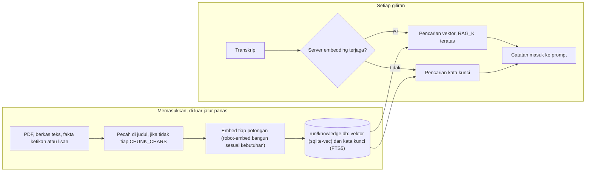

# Pengetahuan

> **Bahasa Indonesia.** Diterjemahkan dari [versi Inggris](../../en/04-brain/knowledge.md) pada
> **2026-11-16**. Versi Inggris adalah naskah utama.

Robot dapat menjawab dari dokumen yang Anda berikan, dalam salah satu dari tiga bahasanya. Dokumen berbahasa Indonesia dapat menjawab pertanyaan
berbahasa Inggris atau Arab: terukur, 8 dari 8 pertanyaan dalam bahasa lain menemukan bagian yang benar.



## Memasukkan dokumen

```
./scripts/ingest.sh knowledge/Tazakka_Informasi_Ringkas.pdf    # berkas atau folder
./scripts/ingest.sh --list                                    # isi penyimpanan
./scripts/ingest.sh --rebuild                                 # lupakan semua, masukkan ulang knowledge/
./scripts/measure/knowledge_qa.py                             # apakah ia tahu, dan seberapa cepat
./scripts/measure/knowledge_qa.py --retrieval                 # hanya pencarian, tanpa LLM
```

Atau seret berkas ke halaman **Knowledge** dashboard. Dokumen sumber ada di `knowledge/`; penyimpanannya `run/knowledge.db`.

* **Memasukkan tidak pernah memblokir percakapan.** Antrean dan pekerja mengambil berkas, dan pemanggilan kembali seketika. Meng-embed dokumen
  butuh detik sampai menit; satu giliran sekitar dua.
* **Potongan mengikuti struktur dokumen sendiri.** Dokumen dengan setidaknya tiga judul (`## X`, `3. X`) dipecah di situ. Selain itu dipotong tiap
  `CHUNK_CHARS`. Terukur pada dokumen 15 bagian: pemotongan berdasar ukuran membuat anggaran prompt membuang 51 dari 72 potongan yang diambil;
  berdasar judul tidak membuang satu pun, dengan konteks sepertiga lebih sedikit dan jawaban yang sama.
* **PDF dibaca dengan `pdftotext` milik poppler**, program C yang sudah ada di papan. PDF hasil pindai tak punya lapisan teks dan ditolak dengan
  alasan, bukan disimpan kosong.

## Dua hal yang dipelajari dengan susah payah

**Periksa mode pencarian yang dipakai sebuah giliran.** Dengan `EMBED_MODE=on-demand` server embedding tidur di antara pemasukan, dan server yang
tidur diam-diam menurunkan pencarian ke kata kunci. Itu tetap bekerja untuk pertanyaan dalam bahasa dokumen itu sendiri dan mengembalikan
**tidak ada** untuk pertanyaan dalam bahasa lain: pertanyaan Arab tidak mengambil apa-apa dan model mengarang nama.

```
grep 'robot-rag: retrieved' .cache/tmp/core.log      # berkata "by vector" atau "by keyword" tiap giliran
```

**Jangan pernah meninggalkan data uji di penyimpanan.** Potongan dari uji asap bersaing dengan dokumen asli untuk beberapa tempat teratas.
`ui_smoke.py` kini menghapus yang diunggahnya.

## Isi penyimpanan

Skemanya `chunks(id, text, source, lang, added_at)`. **Tidak ada kolom metadata**, jadi semua yang ditampilkan halaman Knowledge di luar itu diturunkan:

| Tampilan | Apa itu | Jujur tentang |
|---|---|---|
| **Document** | Berkas itu sendiri bila sumber masih menyebut satu di disk, jika tidak potongan yang digabung kembali | `raw_from` menyatakan yang mana. Dokumen yang dibangun ulang bukan berkasnya: pemecah membuang apa pun di antara potongan |
| **Chunks (JSON)** | Persis yang dicari pencarian, tiap potongan di-embed terpisah | |
| **About** | Istilah kunci, dan atas permintaan ringkasan dan entitas | Istilah kunci tf-idf kasar. Dengan kurang dari tiga dokumen ia jatuh ke frekuensi mentah dan diberi label `frequent`, bukan `distinctive` |

Ringkasan dan entitas ditulis oleh **model bahasa yang sudah ada di memori**, atas permintaan, di bawah skema JSON, bukan permintaan sopan. Saat
diminta sopan, ia menghasilkan JSON valid lalu kehabisan anggaran di tengah objek.

## Persona juga ada di sini

**Persona** adalah instruksi tetap yang dibawa ke setiap giliran, mendahului apa pun yang diambil. Ia ada di halaman Knowledge karena ia pengetahuan,
bukan kenop penyetel. Halaman menunjukkan biayanya: kira-kira seperempat jumlah karakternya dalam token, di setiap prompt, hampir seluruhnya
dipakai ulang dari cache.

## Angka

* Pencarian memakan sekitar 140 sampai 220 ms, melawan anggaran di bawah 100 ms (terukur pada M7).
* Model embedding: Qwen3-Embedding-0.6B, 8-bit, 1024 angka per potongan. Dipilih ketimbang model kecil berpusat Inggris karena itu diam-diam
  menurunkan bahasa Arab dan Indonesia.
* Penyimpanan vektor **sqlite-vec**: satu berkas, tanpa server.
* Pada dokumen uji 15 potongan: 19 dari 19 pertanyaan terjawab, 39 dari 39 fakta, termasuk pertanyaan Inggris dan Arab terhadap dokumen Indonesia,
  dan ia menolak mengarang biaya yang tak pernah diberitahukan kepadanya.

Alasan rancangan dan pengukuran: [`system-overview.md`](../../../dev-docs/architecture/system-overview.md) bagian Conversational turn flow,
[`AGENTS.md`](../../../AGENTS.md) bagian Knowledge.
