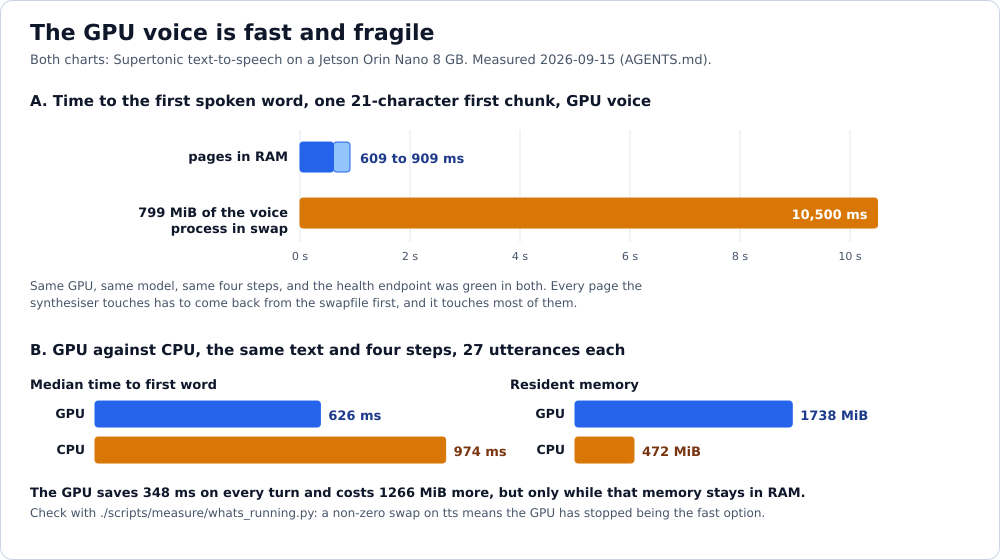

# Model dan memori

> **Bahasa Indonesia.** Diterjemahkan dari [versi Inggris](../../en/04-brain/models-and-memory.md) pada
> **2026-11-16**. Versi Inggris adalah naskah utama.

**Batasan tersulit di proyek ini.** CPU dan GPU Jetson berbagi satu kolam RAM, jadi model yang dimuat di GPU diambil dari memori yang sama dengan
yang lain. Melampauinya tidak memperlambat robot. Ia membunuh proses, atau lebih buruk, mulai melakukan swap.

| | |
|---|---|
| RAM yang dapat dipakai | **7620 MiB**. Bukan 8192: sisanya dicadangkan perangkat keras |
| Target | kondisi stabil paling banyak sekitar **7 GB**; anggap yang lebih sebagai galat |
| Aturan 1 | **Satu model bahasa resident sekali waktu.** Bongkar sebelum memuat |
| Aturan 2 | Tanpa ketergantungan baru sebelum memori-nya dihitung |

## Yang dipilih sekarang

Dibaca dari `config/*.env` pada 2026-11-12. **Ini berubah setiap kali seseorang memilih model di dashboard**: jawaban hidup adalah `./run.sh model`,
yang mencetak *dipilih*, *dikonfigurasi*, dan *berjalan* berdampingan.

| Tugas | Model | Berjalan di | Berkas |
|---|---|---|---|
| Berpikir | LFM2.5-2.6B, 5-bit (Q5_K_M), jendela 2048 token | GPU | `config/llm.env` |
| Mendengar (pengurai) | whisper large-v3-turbo, 8-bit (q8_0) | GPU, wajib | `config/whisper.env` |
| Mendengar (pendeteksi suara) | Silero VAD | CPU | `config/asr.env` |
| Berbicara | Supertonic, suara M1, 4 langkah | GPU, wajib | `config/tts.env` |
| Mencari dokumen | Qwen3-Embedding-0.6B, 8-bit | CPU, hanya saat memasukkan | `config/embed.env` |
| Melihat | YOLOX-Tiny (objek), YuNet (wajah), SFace (siapa) | CPU | `config/vision.env` |

**`chosen`, `configured`, dan `running` harus identik.** Perbedaan adalah nyala ulang yang tidak terjadi, bukan keadaan normal.

## Biaya (terukur, dengan tanggal)

| Item | Biaya | Terukur |
|---|---|---|
| `robot-core` | ~36 MiB | M4 |
| `robot-ui` (dashboard) | ~60 MiB | M8 |
| `robot-face` (panel) | 11,0 MiB RSS + 8,4 MiB buffer layar | M11, 2026-09-09 |
| `robot-vision` | ~213 MiB, sekitar 0,27 inti saat ruangan diam | 2026-10-22 |
| `robot-embed` | ~633 MiB, **hanya saat memasukkan** | M7 |
| Supertonic di CPU | 472 MiB | 2026-09-15 |
| Supertonic di GPU | 1081 MiB sesaat setelah dimuat, **1738 MiB setelah beberapa ucapan** | 2026-09-15 |
| Memori orang | 0 MiB | 2026-10-29: berkas sqlite dan beberapa ratus karakter prompt |

Supertonic adalah model kecil di balik runtime CUDA besar: bobotnya 383 MiB di disk dan resident 1,1 sampai 1,7 GB, karena cuDNN mengalokasikan
ruang kerjanya secara malas. **Biaya GPU tumbuh bersama pemakaian.** Setiap angka di atas adalah cuplikan: halaman Memory dashboard menunjukkan angka
terukur saat ini untuk setiap baris, dari `/proc` tiap 3 detik, di samping perkiraan untuk model yang tidak dimuat.

Aturan di balik perkiraan dan pengukuran: **jika berbeda, pengukuranlah yang benar.** Begitulah baris Supertonic ditemukan kurang 884 MiB.

## Cepat dan rapuh: suara GPU



Suara GPU menghemat **348 ms di setiap giliran** (median 626 ms melawan 974 ms, dari 27 ucapan masing-masing), dan tidak melambat seiring pemakaian.
Tetapi biayanya tidak bertahap. Dengan 799 MiB proses suara di-swap, kalimat yang sama butuh **10,5 detik**: sekitar 17 kali median suara GPU
sendiri, dan 11 kali suara CPU, dengan endpoint kesehatan hijau sepanjang waktu.

Jadi GPU adalah pilihan cepat *dan* rapuh:

```
./scripts/measure/whats_running.py     # swap bukan nol pada tts berarti GPU
                                       # SUDAH BERHENTI menjadi pilihan cepat
```

Jaga ruang kosong dan tetap di GPU. Kehilangan ruang kosong dan `TTS_USE_GPU=0` menjadi robot yang lebih baik.

**Menyetel panjang potongan pertama atau jumlah langkah sintesis tidak dapat memperbaikinya**: langkah 4 → 3 → 2 menggeser median kurang dari derau
antarpengulangan (577 sampai 1726 ms), karena tak ada yang terikat komputasi. Periksa swap sebelum memercayai angka latensi lain.

## Yang menentukan apakah sebuah pilihan muat

* **Kuantisasi sebelum mengecilkan.** Model terkuantisasi lebih murah daripada yang lebih kecil, dan sedikit mengorbankan akurasi. Terukur: whisper turbo
  q5_0 melawan fp16 lebih kecil 656 MiB dan lebih cepat 223 ms, dengan transkrip identik.
* **Sesi pengembangan bagian dari anggaran.** Server jarak jauh VS Code plus sesi agen AI memakan 1,0 sampai 1,8 GB. Terukur 2026-09-15, satu pilihan
  dihargai 6529 MiB melawan sekitar 5360 MiB sisa dengan sesi terpasang, dan papan melakukan swap. Tanpa sesi pilihan yang sama muat dengan sisa
  sekitar 700 MiB. **Jangan jalankan tumpukan penuh dan sesi pengembangan di papan bersamaan**: terukur 97% terpakai dan 3,2 GB swap.
* **Model yang tak mendapat alokasinya tidak menurun. Ia berhenti.** whisper large-v3-turbo butuh 1548 MiB memori GPU *berurutan*; dinyalakan ke papan
  dengan 997 MiB kosong ia mati dengan `cudaMalloc failed: out of memory` dan robot tuli. Urutan muat menentukan ini, itulah sebabnya `./run.sh`
  dapat berhasil padahal menyalakan ulang satu layanan dengan tangan gagal.
* **LLM adalah yang dapat disesuaikan.** Ia baris terbesar dan yang dikecilkan bila yang lain tak muat.

## Memilih dan memasang model

```
./scripts/models/fetch_hf.sh <repo> <berkas-di-repo> [jenis]   # atau tempel URL huggingface.co
./scripts/models/fetch_hf.sh --dry-run ...                     # akan disimpan di mana?
./scripts/models/list.sh                                       # apa yang terpasang, dan biayanya
```

Tujuan ditebak dari nama berkas, dan itu penting: GGUF yang mendarat di folder salah tak terlihat oleh katalog.

| Berkas | Pergi ke |
|---|---|
| `*.gguf` | `models/llm/` (beri `embed` untuk model embedding) |
| `ggml-*.bin` | `models/asr/whisper/` |
| `*.onnx` | `models/tts/piper/` (`.onnx.json` ikut diunduh) |

Berkas baru muncul di halaman **Memory** dalam sekitar 3 detik, tanpa nyala ulang. **Memasang tidak berarti memilih.** Halaman Memory menghitung biaya model
terhadap batas lebih dulu; memilihnya di sana yang menulis konfigurasi dan menyalakan ulang apa pun yang harus dimuat ulang.

**Mengganti LLM adalah muat ulang, bukan nyala ulang.** Pergantian menghentikan whisper dan suara, memuat LLM, dan menyalakannya lagi (sekitar 30 detik tuli dan
bisu). Menyalakan ulang LLM di samping whisper dan suara yang resident mati dengan `cudaMalloc failed`, dua kali, yang dibaca keepalive sebagai "model ini
tak mau berjalan" dan diam-diam jatuh ke yang lebih kecil.

## Bila papan tetap terlalu penuh

Bagian keepalive `robot-core` dapat mengecilkan LLM sendiri, dan hanya LLM. Lihat [Keandalan](reliability.md).

Angka lengkap bertanggal ada di [`memory-budget.md`](../../../dev-docs/architecture/memory-budget.md) dan [`AGENTS.md`](../../../AGENTS.md).
