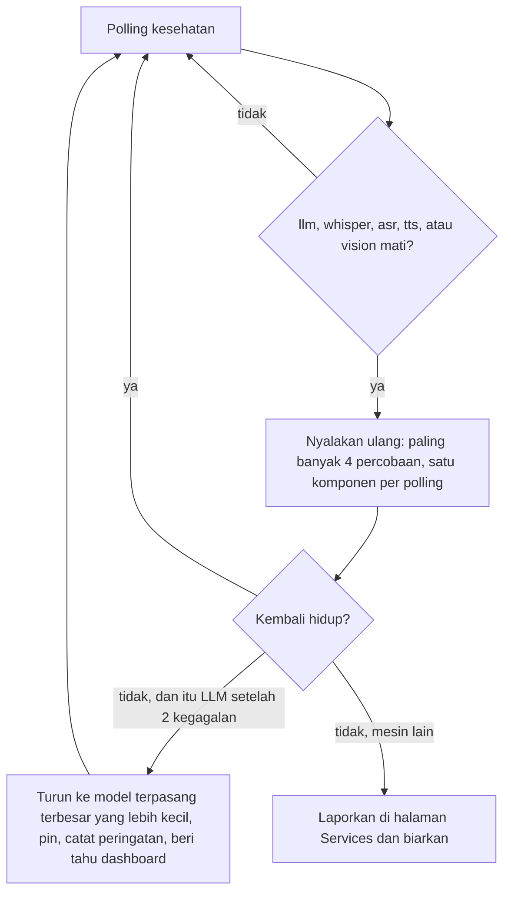

# Keandalan: apa yang terjadi saat sesuatu mati

> **Bahasa Indonesia.** Diterjemahkan dari [versi Inggris](../../en/04-brain/reliability.md) pada
> **2026-11-16**. Versi Inggris adalah naskah utama.

Sasaran rancangannya adalah **robot yang selamat dari kerusakan komponen dan tak pernah meninggalkan motor menyala**. Halaman ini mendaftar apa yang
dilakukan tiap kegagalan, apa yang menjaga robot tetap hidup, dan, sama pentingnya, apa yang *belum* terbukti.

## Apa yang terjadi saat tiap bagian mati

| Yang mati | Yang dilakukan robot | Dibuktikan oleh |
|---|---|---|
| **`robot-core`** (orkestrator, pemegang detak) | Tubuh tak melihat baris selama 500 ms dan **menolkan motor atas wewenangnya sendiri** | 🧪 terhadap inti firmware acuan dan simulator host (`scripts/serial/watchdog_test.py --sim`: bunuh otak dengan `kill -9`, lihat roda berhenti). **Belum diperiksa di silikon nyata, dan tak pernah di ESP32** |
| **`robot-ui` atau `robot-face`** | Tidak ada. Robot tetap mendengar, menjawab, dan bergerak; detak tak pernah berhenti | ✅ `SIGKILL` pada `robot-ui` (M8) |
| **`robot-llm`** | Robot mengucapkan kalimat siap pakai agar layanan mati terdengar, bukan senyap. Keepalive menyalakannya ulang, dan mengecilkan model jika tak mau kembali | ✅ latihan kegagalan |
| **`robot-whisper`** (pengurai) | Robot tuli. Keepalive menyalakannya ulang. Ia diawasi pada barisnya sendiri, karena `robot-asr` tetap tersambung dan hijau saat pengurai di baliknya mati: "robot tuli dengan semua lampu menyala" | ✅ dilatih 2026-10-14: dibunuh, ditandai mati dalam 1 detik, dinyalakan ulang pada 4 detik, sehat pada 12 detik |
| **`robot-tts`** atau speaker | Balasan tidak hilang. Kalimat dibuang, halaman Services merah, dan ucapan **berikutnya** mencoba lagi, jadi membebaskan memori memulihkannya tanpa nyala ulang | ✅ latihan kegagalan |
| **`robot-asr`** (mikrofon) | Keepalive menyalakannya ulang. Gerbang mikrofon yang tertutup tak pernah bertahan lebih lama dari satu batas waktu giliran, jadi pesan "selesai" yang terlewat tak dapat membuat robot tuli selamanya | ✅ diperbaiki setelah terjadi, dengan uji regresi |
| **Giliran yang macet** | Giliran tak dapat macet: ia punya batas waktu, dan robot kembali diam | ✅ latihan kegagalan |
| **Kabel USB ke tubuh** | Hubungan tersambung ulang sendiri. Sementara itu watchdog tubuh sudah menghentikan motor | 🧪 |

Sumber: [`failure_drills.py`](../../../scripts/hardening/failure_drills.py) (24 dari 24 lulus), [`system-overview.md`](../../../dev-docs/architecture/system-overview.md),
[`PROGRESS.md`](../../../dev-docs/ai/PROGRESS.md).

## Keepalive

Di bawah `./run.sh` tak ada yang menyalakan ulang layanan mogok: keluaran bukan nol sebuah layanan saat keluar ditujukan ke systemd. Jadi `robot-core` menjalankan
**keepalive** dari polling kesehatannya.



Sakelar: `CORE_KEEPALIVE=1` menyalakan ulang mesin, `CORE_KEEPALIVE_LLM_FALLBACK=1` mengizinkan LLM mengecil.

**Mesin-mesinnya sengaja tidak diperlakukan sama.**

* `asr`, `whisper`, `tts`, dan `vision` hanya dinyalakan ulang. Model mana yang mereka muat adalah keputusan pemilik, dihitung di halaman Memory. Program yang diam-diam
  menukar `large-v3-turbo` dengan `tiny` karena nyala ulang gagal akan menjawab masalah memori dengan menurunkan transkripsi tanpa mengatakannya.
* **LLM** pengecualian, karena ia baris terbesar di anggaran dan satu-satunya yang punya alternatif yang benar-benar lebih kecil yang masih menjawab. Setelah dua nyala ulang gagal ia
  turun ke model terpasang **terbesar** yang lebih kecil (agar sesedikit mungkin hilang), mencatat peringatan yang menyebut pertukarannya, dan **tak pernah naik kembali**: itu
  penilaian soal mutu, dan milik pemilik.

Terukur pada gangguan nyata 2026-10-06, dengan model 4B terpilih di papan penuh:

```
19:11:31  llm is down; restarting it (attempt 1 of 4)
19:11:54  llm did not come back: exiting due to model loading error
19:11:57  llm is down; restarting it (attempt 2 of 4)
19:12:28  failed 2 restarts with Qwen3-4B; falling back to LFM2.5-2.6B-Q5_K_M
19:12:42  llm is back up
```

**Semuanya dibatasi, dan itulah intinya.** Empat nyala ulang lalu berhenti, dua penurunan lalu berhenti, satu komponen per polling. Putaran nyala ulang terhadap papan yang sekadar
penuh *lebih buruk* daripada layanan yang berhenti, karena ia menghabiskan memori yang dibutuhkan percobaan berikutnya. Dua mesin menyala bersamaan adalah satu-satunya kasus yang pasti
gagal: whisper butuh 1,3 GB berurutan sementara LLM butuh 2,8 GB.

`UNKNOWN` bukan `DOWN`: itulah keadaan layanan mikrofon dan suara pada beberapa detik pertama setelah core menyala, sebelum tersambung. Memperlakukannya sebagai gangguan menyalakan
ulang layanan yang sedang naik dengan baik.

## Detak: mekanisme keselamatan terpenting

* Jetson mengirim `PING` tiap **200 ms** selama hubungan aktif.
* Jika tubuh tidak menerima baris jenis apa pun selama **500 ms**, ia menolkan semua motor sendiri dan masuk ke diam yang aman. Gerak tidak lanjut sendiri: perintah baru dibutuhkan
  setelah `PING` kembali.
* Setiap `DRIVE` membawa **durasi**, dan tubuh berhenti saat habis. Gerak tak pernah terbuka, menunggu `STOP` yang mungkin tak pernah datang.

Jetson menjalankan Linux penuh di papan terbatas memori. Ia *pasti* suatu saat macet atau dimatikan pada saat buruk. Robot yang remnya `STOP` dari proses mati menabrak tembok, jadi
tubuh tak pernah mengandalkan Jetson untuk menghentikannya. Rincian di [Watchdog](../03-firmware/watchdog.md).

## Yang **belum** terbukti

Membaca daftar ini lebih berguna daripada tabel di atas.

| Belum terbukti | Mengapa penting |
|---|---|
| Watchdog di **perangkat keras nyata**, dan **ESP32** khususnya | Protokol dan aturan 500 ms hanya diuji terhadap inti firmware acuan dan simulator. README firmware menyatakan tak ada hal lain yang boleh dipercaya sebelum uji watchdog lulus di silikon nyata. Prosedur terpandu ada ([Watchdog](../03-firmware/watchdog.md#membuktikannya-di-papan-sungguhan)) tetapi belum pernah dijalankan |
| Arah roda pada sasis nyata | Tanda di firmware adalah bawaan, bukan pengukuran. Konvensi tandanya ([ditetapkan](voice-pipeline.md#5-bertindak)) belum diperiksa pada sasis |
| Jalur **systemd** | Unit belum pernah dipasang atau di-boot di papan ini. Empat kesalahan ditemukan dengan membacanya terhadap jalur pengembangan |
| **Proses 24 jam** | 24 dari 24 latihan kegagalan lulus dan soak 45 menit (313 giliran, tanpa galat) bersih, tetapi soak 24 jam belum dijalankan |
| Fitur kamera dengan orang sungguhan | Diuji dengan kamera berskrip dan foto |

## Memeriksanya sendiri

```
python scripts/hardening/failure_drills.py     # membunuh tiap layanan sungguhan dan memeriksa yang dituntut dokumen
python scripts/hardening/soak.py --minutes 60  # kenaikan RAM, suhu, motor macet, OOM
./scripts/measure/whats_running.py             # keadaan, GPU atau CPU, RSS dan swap per layanan
./run.sh status
```

Halaman Services dashboard menunjukkan hal yang sama secara langsung, dan menyalakan, menghentikan, atau menyalakan ulang layanan lewat pengawas yang benar-benar berkuasa.
