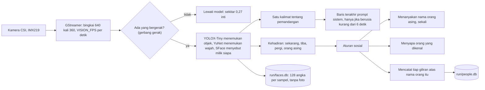

# Penglihatan dan orang

> **Bahasa Indonesia.** Diterjemahkan dari [versi Inggris](../../en/04-brain/vision-and-people.md) pada
> **2026-11-16**. Versi Inggris adalah naskah utama.

Robot dapat **melihat** (objek dan wajah) dan **tahu dengan siapa ia berbicara** (menyapa dengan nama dan melanjutkan percakapan dari tempat berhenti). Keduanya opsional.
Dengan `VISION_ENABLED=0`, atau tanpa kamera, robot persis seperti sebelumnya.

Keadaan: ✅ dibangun dan diuji lewat orkestrator nyata dan terhadap model bahasa nyata dengan kamera berskrip. **Belum dicoba dengan orang sungguhan di depannya.**

## Melihat (`robot-vision`)

* **Kameranya** IMX219 pada konektor CSI Jetson. Dijangkau lewat Argus NVIDIA dan GStreamer, karena sensor berada di balik prosesor gambar dan tak dapat dibaca
  seperti kamera USB. **Argus hanya mengizinkan satu program sekali waktu**: hentikan `robot-vision` sebelum menjalankan apa pun yang membuka sensor.
* **Model berjalan di CPU**, lewat onnxruntime yang sudah terpasang. Tanpa OpenCV, tanpa PyTorch. Konteks GPU keempat akan menghabiskan 0,6 sampai 1,3 GiB. Total biaya: sekitar **213 MiB**.
* **Gerbang gerak yang menjaganya murah.** Selagi ruangan diam, model dilewati. Ambangnya diukur terhadap derau sensor ini (tebakan pertama tidak melewatkan apa pun).
  Ukur lagi bila kamera, pencahayaan, atau `VISION_FPS` berubah.
* **Model dipilih menurut lisensi dan akurasi**: YOLOX (Apache-2.0), YuNet (MIT), dan SFace (Apache-2.0), ketimbang YOLOv8 (AGPL-3.0) dan InsightFace (nonkomersial).
* **Model diberi tahu pemandangan dalam satu kalimat**, hanya bila pemandangan berusia kurang dari enam detik dan hanya untuk wajah yang cocok. Barisnya diletakkan **terakhir**
  di prompt agar awal prompt yang tercache selamat. Redaksi yang "lebih tajam" mendapat 0 dari 3 melawan 3 dari 3 pada model yang sama: jangan ubah tanpa menguji.
* Jika tak ada bingkai selama 10 detik, jalur kamera dihentikan dengan bersih dan dinyalakan ulang, menunda hingga 30 detik. Layanan tak pernah keluar karena kamera tak ada.

Rincian dan pengukuran: [`vision.md`](../../../dev-docs/modules/vision.md).

## Mengenal orang (`robot-core`)

Ia menambah **tanpa proses, model, atau ketergantungan**: 0 MiB selain satu berkas sqlite. Ingatan bekerja lewat prompt, bukan pencarian: giliran terakhir kembali sebagai giliran obrolan biasa,
plus beberapa baris catatan yang ditulis model bahasa saat orang itu pergi.

Ceritanya, dalam enam langkah:

1. Wajah yang tak dikenal berdiri sendiri di depan kamera sekitar 4 detik. Robot berkata: "Halo! Sepertinya kita belum pernah bertemu. Siapa namamu? Aku akan mengingatmu, kecuali
   kamu lebih suka tidak."
2. Hal berikutnya yang dikatakan, lewat suara atau ketikan, dibaca dengan aturan sederhana (`parse_name`): nama, penolakan ("tidak, terima kasih": berhenti bertanya selama lima menit),
   atau hal lain (giliran biasa, dan pertanyaan tetap terbuka).
3. Sebuah nama membuat `robot-vision` mempelajari wajah (dari 3 bingkai), mencatat orangnya, dan menyambutnya dalam bahasa yang dipakainya.
4. Sejak itu, setiap giliran selagi wajah itu terlihat dicatat atas namanya, dan model diperlihatkan dengan siapa ia berbicara dan apa yang dikatakan terakhir kali.
5. Mereka pergi: keluar dari gambar selama 2 menit. **Kunjungan** (percakapan itu) berakhir. Model bahasa menulis ringkasannya dan memperbarui beberapa baris catatan berjalan tentang orang itu.
6. Mereka kembali: disapa dengan nama dalam bahasa mereka sendiri, dengan akhir percakapan terakhir sudah dalam konteks.

### Yang disimpan, dan yang tidak

| Tabel | Isi |
|---|---|
| `people` | Nama (unik, tak peka huruf besar-kecil), pertama dan terakhir terlihat, kunjungan, bahasa terakhir, catatan berjalan |
| `turns` | Siapa yang mengatakan, teksnya, balasan mentah model, bahasa, diketik atau diucapkan, kunjungan mana |
| `conversations` | Satu per orang dan kunjungan: ringkasannya, siapa yang menulis (model atau cadangan sederhana), kapan |

**Logs → Conversations** di dashboard mendaftar setiap percakapan per orang, yang terbaru dulu, dengan ringkasannya.

### Aturan yang membuatnya aman dibiarkan menyala di sebuah ruangan

| Aturan | Mengapa |
|---|---|
| **Ini data pribadi dan tak pernah meninggalkan robot.** `run/people.db` dan `run/faces.db`, diabaikan git, tak dikirim ke mana pun | Ini wajah dan percakapan. Jangan disalin keluar |
| **Hanya giliran yang dikaitkan dengan wajah yang dikenali yang disimpan** | Pertanyaan ketikan tanpa siapa pun di depan kamera tak pernah dicatat |
| **Forget menghapus keduanya**: sampel wajah dan orang itu beserta semua yang dikatakan kepadanya | `CORE_PEOPLE=0` menghapus seluruh fitur |
| **Robot bertanya sekali**, dan hanya saat satu wajah tak dikenal yang dekat, jelas, dan stabil sendirian di pandangan | Dua wajah tak dapat ditanyai: ia tak tahu siapa yang menjawab |
| **Orang asing tidak mewarisi apa pun**: percakapan orang sebelumnya keluar dari prompt begitu wajah tak dikenal sendirian di pandangan | Kata-kata satu orang tak boleh sampai ke orang berikutnya |
| **Nama yang sudah dikenal tak pernah diberikan kepada wajah yang tak dikenali sebagai nama itu** | Tak dapat mencuri identitas dengan menyebut nama |
| **Robot tak pernah menyela orang.** Giliran yang dimulainya sendiri dibuang bila ada yang sedang berjalan | |
| **Tak ada anti-pemalsuan.** Foto orang terdaftar cocok | **Jangan pernah menaruh hal penting di balik wajah** |

Rancangan dan aturan lengkap: [`people.md`](../../../dev-docs/modules/people.md).

## Batas yang perlu diketahui

* Kata-kata sapaan robot hanya sebaik modelnya: pada model 0,6B saluran-salurannya benar tetapi sapaannya buruk. Nilai pada model 3B atau lebih besar.
* Baris yang **diketik** dicatat atas nama siapa yang dilihat kamera, bukan siapa yang mengetik. Halaman menyebut atas nama siapa ia dicatat.
* Pertanyaan pertama diajukan dalam `CORE_DEFAULT_LANGUAGE`: robot tak dapat tahu bahasa orang asing sebelum mereka bicara. Sambutannya mengikuti yang mereka ucapkan.
