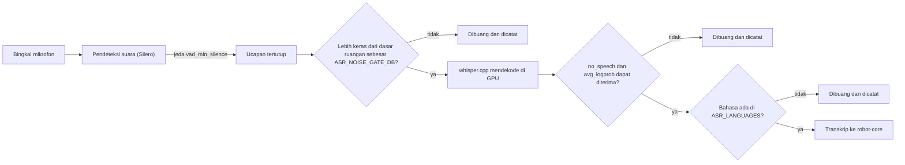
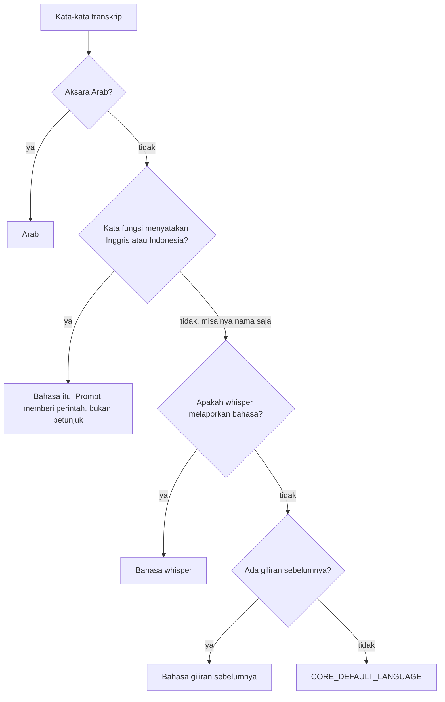
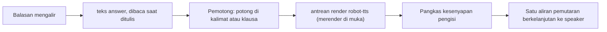

# Alur suara

> **Bahasa Indonesia.** Diterjemahkan dari [versi Inggris](../../en/04-brain/voice-pipeline.md) pada
> **2026-11-16**. Versi Inggris adalah naskah utama.

Lima tahap sebuah giliran secara rinci: [mendengar](#1-mendengar), [memutuskan bahasa](#2-memutuskan-bahasa), [berpikir](#3-berpikir), [berbicara](#4-berbicara), dan
[bertindak](#5-bertindak). Untuk versi satu halaman lihat [Satu giliran](../01-overview/one-turn.md).

Pengaturan yang disebut di sini ada di `config/*.env` (butuh nyala ulang) atau berupa *pin* di dashboard (langsung). Pin mengalahkan berkas, dan
`./run.sh <mode> --check` mendaftar pin yang berlaku.

## 1. Mendengar

`robot-asr` memiliki mikrofon. `robot-whisper` melakukan dekode. Di antara keduanya, sebuah bunyi harus melewati **tiga gerbang** sebelum menjadi giliran.



| Gerbang | Pengaturan | Mengapa ada |
|---|---|---|
| Level, sebelum dekode | `ASR_NOISE_GATE_DB` (6,0 dB di berkas) | Bunyi yang hampir tak melampaui dasar ruangan tak layak didekode |
| Keyakinan, setelah dekode | `ASR_MAX_NO_SPEECH` (0,6), `ASR_MIN_LOGPROB` (-1,0) | whisper menilai transkripnya sendiri. Terukur: ucapan nyata sampai 0 dB rasio sinyal-derau tetap di bawah 0,09, sedangkan derau tanpa isi berada di 0,82 sampai 0,91. Sebelum gerbang ini, dua puluh detik gemerincing didekode sebagai "(knocking)" dan "(thud)" |
| Bahasa | `ASR_LANGUAGES` (`id,en,ar`) | Robot hanya menjawab dalam bahasa yang dikuasainya |

**Setiap pembuangan adalah satu baris log dengan angka yang dipakai membuangnya.** Bacalah sebelum mengubah ambang:

```
grep 'robot-asr: dropped' .cache/tmp/asr.log
```

Ia menjawab "mengapa ia menjawab sesuatu yang tak diucapkan siapa pun" dan "mengapa ia jadi tuli".

**Peredam derau ada dan mati.** Peredam (GTCRN) membuat whisper *lebih buruk* di setiap rasio sinyal-derau yang diuji (27% sampai 314% lebih banyak galat kata), karena artefaknya
bukan derau yang dilatihkan pada whisper. Ujinya memakai derau sintetis, jadi suara penentu milik ruangan nyata:
`./scripts/measure/denoise_ab.py --noise <30 detik rekaman di sana>`.

### Pengurai

* **whisper.cpp**, program C++ ~30 MB, menjalankan bobot **large-v3-turbo** yang dikonversi ke GGML (32 lapisan encoder dan 4 lapisan decoder: empat lapisan decoder adalah tanda
  turbo). Versi PyTorch dari model yang sama butuh `transformers` dan PyTorch di runtime, yang dilarang di sini dan tak sanggup dibayar memori.
* **Ukuran model adalah pilihan di `config/whisper.env`** (`WHISPER_MODEL`), dibuat di halaman Memory. **Pilih model terkuantisasi ketimbang yang lebih kecil**: terukur 2026-09-15 pada
  sembilan sampel di tiga bahasa, turbo q5_0 melawan turbo fp16 **lebih kecil 656 MiB, lebih cepat 223 ms per dekode, dan memberi transkrip identik karakter demi karakter** ✅.
* **Ia harus berjalan di GPU** (`WHISPER_REQUIRE_GPU=1`). Pengurai yang menyala di CPU dihentikan dan dilaporkan, bukan melanjutkan dengan faktor waktu nyata sekitar 8 (23,5 detik
  melawan 0,5 detik per ucapan, terukur pada `small`) tanpa apa pun di log pada saat yang penting.
* Mikrofon adalah sumber PulseAudio bernama (`PULSE_SOURCE`). Sumber monitor, yang merekam speaker robot sendiri, tak pernah ditawarkan sebagai mikrofon.

### Yang boleh dilakukan mikrofon saat robot berbicara

Lihat [tiga mode dengar](../01-overview/one-turn.md#dapatkah-dipotong). Pada dua mode tanpa-sela mikrofon **ditutup**, bukan diabaikan: `robot-core` mengirim pesan `gate` ke
`robot-asr` dan bingkai dibuang sampai `CORE_LISTEN_TAIL_MS` setelah sampel terakhir. Menyaring transkrip yang sudah selesai tak cukup, karena ucapan yang dimulai saat pemutaran masih
didekode saat pemutaran selesai, dan saat itu ruangan sepi dan gema tampak seperti pertanyaan.

## 2. Memutuskan bahasa

Balasan mengikuti bahasa yang **Anda ucapkan**, diputuskan dari **kata-kata Anda**, bukan tebakan pengurai. Pada 2026-10-12 log menunjukkan pertanyaan Inggris tentang nama tempat diberi tag
Indonesia oleh whisper dan dijawab dalam bahasa yang salah, maka aturannya berubah.



* **Sapaan mengikuti ejaannya**: "Hello?" Inggris, "Halo" Indonesia. Hanya sapaan tanpa petunjuk di ejaannya, seperti "assalamualaikum", yang pergi ke bawaan.
* **Setiap potongan yang diucapkan, diucapkan dalam bahasa tulisnya**, karena bidang `language` milik model tiba setelah audio sudah mulai.
* Aturannya ada di `src/robot/core/language.py`. Untuk melihat koreksi: `grep 'recogniser said' .cache/tmp/core.log`.

## 3. Berpikir

### Yang diperlihatkan kepada model

Prompt sistem dibangun dari bagian-bagian ini, **dalam urutan ini**. Urutannya disengaja.

| # | Bagian | Mengapa di situ |
|---|---|---|
| 1 | **Persona** | Instruksi tetap. Tak pernah berubah antargiliran |
| 2 | **Catatan dari dokumen Anda**, bila ada yang cocok, dengan peringatan bahwa bahasanya tak berarti | Diletakkan sebelum aturan bahasa: jika sesudahnya, catatan Inggris menarik balasan Arab menjadi Indonesia (terukur) |
| 3 | **Aturan bahasa** tetap | |
| 4 | Arti tiap **bidang balasan** | Tata bahasa memaksakan bentuk; ini menjelaskan artinya, atau model mengisi bidang dengan valid dan acak |
| 5 | **Baris bahasa** giliran ini ("The person just spoke English. Reply in English.") | |
| 6 | **Dengan siapa ia berbicara** dan apa yang dikatakan terakhir kali | Berubah saat orangnya berubah |
| 7 | **Yang dilihat kamera** | **Terakhir**, disengaja: llama.cpp memakai ulang awal tak berubah terpanjang dari prompt sebelumnya, dan ini satu-satunya baris yang terus berubah. Di mana pun lebih awal ia akan membuang awalan persona yang tercache tiap giliran |

Setelah prompt sistem datang giliran terakhir sebagai pesan obrolan biasa lalu pesan baru.

Terukur: dalam 12 giliran, 3014 token prompt baru dan **11.574 dipakai ulang dari cache**, itulah sebabnya persona murah dipertahankan panjang.

### Yang harus dijawab model

Jawabannya **satu objek JSON**, dan bentuknya dipaksakan tata bahasa llama.cpp, bukan diminta di prompt. Ia tak pernah kembali sebagai prosa, JSON setengah jadi, atau bidang karangan.

```json
{"answer": "Baik, saya maju sedikit.", "language": "id",
 "foot_direction": "forward", "foot_step": 2,
 "hand_movement": "none", "face": "happy", "style": "cheerful"}
```

| Bidang | Nilai | Dipakai untuk |
|---|---|---|
| `answer` | teks | **Satu-satunya yang diucapkan.** Pertama dalam objek, agar dapat dibaca dari aliran selagi sisanya masih ditulis |
| `language` | `id`, `en`, `ar` | Dicatat; bahasa yang benar-benar dipakai berbicara diputuskan seperti di [langkah 2](#2-memutuskan-bahasa) |
| `foot_direction` | `none`, `forward`, `backward`, `left`, `right`, `turn_left`, `turn_right` | Perintah `DRIVE`, lihat [langkah 5](#5-bertindak) |
| `foot_step` | 0 sampai 10 | Berapa langkah pendek |
| `hand_movement` | `none`, `wave`, `point`, `home`, `nod` | Perintah `HAND` |
| `face` | `neutral`, `happy`, `thinking`, `listening`, `speaking`, `sad` | Bawaannya ditimpa [wajah fase](../01-overview/one-turn.md#yang-dilakukan-wajah) |
| `style` | `neutral`, `cheerful`, `calm`, `excited`, `apologetic` | Dibawa serta; suara tidak berubah karenanya saat ini |

### Anggaran balasan dan jendela konteks adalah satu pengaturan

`LLM_CTX` adalah jendelanya. Balasan boleh memakai sisanya: `CORE_MAX_TOKENS=auto` berarti *jendela − anggaran prompt (66%) − margin 128*, dibatasi 1024. **Untuk jawaban lebih panjang, naikkan
`LLM_CTX` dan biarkan `CORE_MAX_TOKENS`.** Angka tetap untuk membuat jawaban sengaja lebih pendek.

Balasan yang menyentuh batas lebih buruk daripada pendek: tata bahasa masih di dalam string `answer`, jadi objek tak pernah tertutup dan `language`, `foot_direction`, `foot_step`, `hand_movement`,
`face`, dan `style` tak pernah dihasilkan. Robot mengucapkan setengah kalimat dan tidak bergerak. Kini ia mengatakannya, dengan peringatan `truncated` di log dan peristiwa `truncated` di dashboard.
`./run.sh headless --check` mencetak pembagiannya.

## 4. Berbicara



* **Potongan pertama sengaja pendek** (`CORE_FIRST_MIN_CHARS` 24, `CORE_FIRST_MAX_CHARS` 40, dan boleh putus di klausa). Setiap karakter yang ditunggu sebelum batas pertama
  langsung menambah jeda kata pertama. Potongan berikutnya dapat lebih panjang, karena audio sudah diputar.
* **Render dan pemutaran adalah tugas terpisah.** Dulu satu loop, dan memutar satu kalimat memblokir render berikutnya, terdengar seperti dua detik senyap antarkalimat. Kini suara merender di muka,
  jadi faktor waktu nyata di bawah 1 menutup celahnya. Terukur pada balasan lima kalimat: 15,05 detik audio dalam 15,74 detik waktu dinding, audio pertama pada 599 ms ✅.
* **Pengakuannya dirender di muka.** Ada 20 frasa per bahasa (60 seluruhnya, 9,5 MiB). Terukur, frasa dari cache mulai dalam **123 ms**; frasa yang sama yang disintesis butuh 420 sampai
  620 ms ✅. Frasanya mengakui dan tak berjanji apa-apa ("baik", "sebentar"), karena satu dipilih sebelum model menghasilkan satu token dan tak dapat tahu apakah berikutnya pertanyaan atau sapaan.
* **Mengapa suara dulu terdengar tak rata, dan apa yang memperbaikinya.** Bukan speaker dan bukan model. Setiap panggilan diberi lempeng kesenyapan tetap (74% dari kata empat huruf), dan menggabung
  kalimat antre membuat balasan yang sama berbeda panjang 12 sampai 19% antargiliran. `TTS_TRIM_SILENCE` menghapus pengisi (40 ms dipertahankan di awal, tempat setiap milidetik adalah latensi;
  280 ms di akhir, karena begitulah bunyi batas kalimat), dan `TTS_BATCH_SENTENCES=1` membuat kata yang sama keluar sama panjang, dalam 0,1%.
* **Waktu dan nada tepat.** Speaker hanya menerima 16 kHz mono, dan suara menghasilkan 44,1 kHz, jadi PulseAudio melakukan resampling. Itu kerja nyata di papan yang terbebani, tetapi menjaga waktu dan
  nada sempurna.
* **Suara di GPU adalah syarat** (`TTS_REQUIRE_GPU=1`). Jika GPU tak bisa didapat, kalimat dibuang, halaman Services merah, dan ucapan berikutnya mencoba lagi. Lihat
  [Model dan memori](models-and-memory.md) untuk mengapa suara GPU cepat dan rapuh.

## 5. Bertindak

Bidang tubuh balasan menjadi perintah serial. Mereka dimulai **selagi kalimat masih diucapkan**: ucapan dan gerak tumpang tindih dengan sengaja.

| Bidang balasan | Menjadi | Rincian |
|---|---|---|
| `foot_direction` dan `foot_step` | `DRIVE vx vy omega ms` | Satu **langkah** 600 ms. Langkah lurus 0,2 m/s, sekitar **12 cm**. Langkah belok 1,2 rad/s, sekitar **41°**. Sepuluh langkah paling banyak yang dapat diminta: 6 detik |
| `hand_movement` | `HAND <gestur>` | `wave`, `point`, `home`, `nod` |
| `face` | `FACE <nama>` | Di bawah aturan fase bawaan wajah ditentukan fase |
| tiap fase | satu baris JSON | Objek yang sama yang ditampilkan dashboard, sekali per fase, untuk tubuh yang membacanya |

Bagaimana arah menjadi `vx vy omega` (satu langkah satuan, sebelum diskala 0,2 m/s):

| `foot_direction` | vx | vy | omega |
|---|---|---|---|
| `forward` / `backward` | +1 / −1 | 0 | 0 |
| `left` / `right` | 0 | +1 / −1 | 0 |
| `turn_left` / `turn_right` | 0 | 0 | +1,2 / −1,2 |

> **Ditetapkan 2026-11-16:** `+vy` adalah geseran ke **kiri** dan `+omega` belok ke kiri (x ke depan, y ke kiri, berlawanan arah jarum jam). Dokumen protokol, skrip uji awal, konsol manual, dan alias
> alat yang berkata sebaliknya sudah dikoreksi. Belum diperiksa pada sasis sungguhan; lihat [Gerak](../03-firmware/motion.md).

### Tiga lapis mencegah model menabrakkan robot ke tembok

1. **Orkestrator menjepit** setiap nilai sebelum dipakai.
2. **Hubungan serial menjepit lagi** sebelum menulis: kecepatan paling banyak ±1,0 m/s ke samping dan ke depan, ±3,0 rad/s saat berputar, dan paling lama 10 detik per perintah.
3. **Tubuh memeriksa lagi** dengan batas yang sama, dan setiap `DRIVE` punya durasi, jadi ia berhenti sendiri saat waktunya habis.

`ERR` atau motor macet yang dilaporkan tubuh ditambahkan sebagai catatan ke prompt giliran berikutnya, agar robot dapat berkata "saya tersangkut" alih-alih mengumumkan ia berjalan.

Protokol baris perintah ada di [Protokol serial](../05-interfaces/serial-protocol.md).
