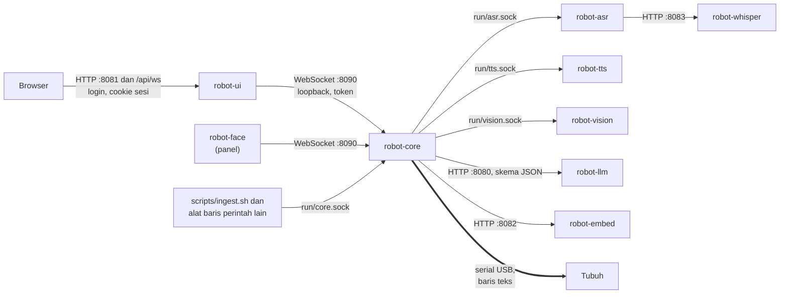

# Antarmuka: setiap kabel di satu tempat

> **Bahasa Indonesia.** Diterjemahkan dari [versi Inggris](../../en/05-interfaces/README.md) pada
> **2026-11-16**. Versi Inggris adalah naskah utama.

Bab ini mendaftar **setiap tempat dua bagian robot berkomunikasi**, dalam format apa, dan siapa yang boleh
menjangkaunya. Jika Anda membangun sesuatu yang tersambung (tubuh baru, layar baru, skrip), mulailah di sini.

*Setiap panah adalah sambungan di komputer ini, kecuali browser (di jaringan Anda) dan panah tebal (kabel USB).
`robot-core` ada di tengah semuanya dan satu-satunya yang berbicara dengan tubuh.*

## Daftar antarmuka

| # | Antara | Transportasi | Format | Siapa yang dapat menjangkau | Halaman |
|---|---|---|---|---|---|
| 1 | `robot-core` dan **tubuh** | serial USB, 115200 baud | **baris teks ASCII** berakhir baris baru | kabelnya | [Protokol serial](serial-protocol.md) |
| 2 | `robot-core` dan **model bahasa** | HTTP di `127.0.0.1:8080` | permintaan obrolan; balasan dibatasi **skema JSON** | komputer ini | [JSON balasan](../05-interfaces/reply-json.md) |
| 3 | `robot-core` ke **tubuh**, sekali per fase giliran | baris serial yang sama | satu **baris JSON** ringkas berawalan `{` | kabelnya | [JSON balasan](../05-interfaces/reply-json.md#baris-yang-diterima-tubuh) |
| 4 | Semua yang mengamati atau mengarahkan `robot-core` | **WebSocket** `ws://127.0.0.1:8090` | objek JSON, satu per pesan | loopback, plus **token** bila `CORE_WS_TOKEN` diatur | [WebSocket](../05-interfaces/websocket.md) |
| 5 | **Browser** dan `robot-ui` | HTTP `0.0.0.0:8081`, plus WebSocket di `/api/ws` | halaman, JSON | jaringan Anda, di balik **login** | [WebSocket](../05-interfaces/websocket.md#lewat-dashboard) |
| 6 | Alat baris perintah dan `robot-core` | soket Unix `run/core.sock` | JSON dipisah baris baru | izin berkasnya | [WebSocket](../05-interfaces/websocket.md#soket-lokal) |
| 7 | `robot-core` dan `robot-asr`, `robot-tts`, `robot-vision` | soket Unix di `run/` | JSON dipisah baris baru (audio tidak pernah lewat) | izin berkasnya | |
| 8 | `robot-asr` dan `robot-whisper`; `robot-core` dan `robot-embed` | HTTP di loopback | API bawaan mesinnya | komputer ini | |
| 9 | **Orang dan berkas** dengan setiap program | `config/*.env`, `run/settings.json`, `.env` | baris `KUNCI=nilai`, JSON | sistem berkas | [Konfigurasi](../05-interfaces/configuration.md) |

Keterpaparan dalam satu kalimat: **hanya `robot-ui` yang mendengarkan di jaringan** (`UI_HOST=0.0.0.0`, port 8081, di
balik login). WebSocket orkestrator terikat ke `127.0.0.1`, dan mesin-mesinnya juga ke `127.0.0.1`. Halaman terbuka
yang bisa menggerakkan robot lebih buruk daripada tanpa halaman, jadi `robot-ui` **menolak menyala** tanpa
`ROBOT_UI_PASSWORD`.

## Mengapa pilihan ini

* **Teks biasa di jalur serial, JSON di tempat lain.** Orang dapat membuka `screen` dan membaca lalu lintas tubuh,
  atau `nc -U run/core.sock` untuk layanan. Lajunya rendah, jadi byte tambahan tidak berarti.
* **Soket Unix antarlayanan**: tanpa alokasi port, tanpa terpapar ke jaringan, dan izin berkas yang mengatur akses.
* **Satu pemilik tubuh.** Menaruh port serial di balik `robot-core` berarti detak dan penjepitan keluaran model
  ada tepat di satu tempat.

## Halaman di bab ini

| Halaman | Isi |
|---|---|
| [Protokol serial](serial-protocol.md) | Setiap baris antara otak dan tubuh, dengan contoh, alasan galat, dan penemuan |
| [JSON balasan](../05-interfaces/reply-json.md) | Yang harus dijawab model, dan yang dikirim ke tubuh |
| [WebSocket dan soket](../05-interfaces/websocket.md) | Pesan yang dapat dikirim dan diterima dashboard, panel, atau skrip |
| [Konfigurasi](../05-interfaces/configuration.md) | Di mana tiap pengaturan berada, siapa yang menang, dan 32 pengaturan langsung |
