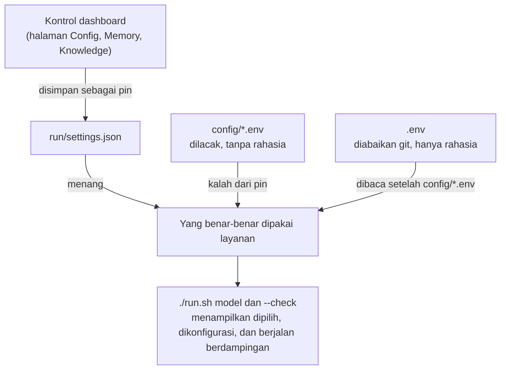

# Konfigurasi: di mana tiap pengaturan berada, dan siapa yang menang

> **Bahasa Indonesia.** Diterjemahkan dari [versi Inggris](../../en/05-interfaces/configuration.md) pada
> **2026-11-16**. Versi Inggris adalah naskah utama. Label pengaturan di tabel adalah teks dari kode dan tidak diterjemahkan.

Ada tiga tempat asal sebuah pengaturan, dan **pin dari dashboard mengalahkan kedua berkas**. Mengetahui urutan ini adalah hampir
semua yang perlu diketahui tentang mengapa sebuah pengaturan "tidak berbuat apa-apa".

| Tempat | Isi | Dilacak git? | Perubahan berlaku |
|---|---|---|---|
| **`run/settings.json`** | Semua yang disetel dari dashboard: pin. Digabung **di atas** berkas env saat mulai | tidak (`run/` diabaikan git) | langsung untuk sebagian besar; lihat di bawah |
| **`config/*.env`** | Bawaan per layanan: port, jalur model, ambang. **Tanpa rahasia** (batasan keras 8) | ya | pada nyala ulang layanan itu berikutnya |
| **`.env`** | Rahasia: kata sandi dashboard dan rahasia penanda tangan cookie-nya, dan token WebSocket | **tidak pernah** (diabaikan git) | pada nyala ulang berikutnya |

Tiga hal yang pernah menjebak orang, semua di [`TROUBLESHOOTING.md`](../../../dev-docs/ai/TROUBLESHOOTING.md):

* **Pin menumpuk dan terlupakan.** `CORE_MAX_TOKENS=260` pernah duduk di `config/core.env` tanpa berbuat apa-apa karena bawaan registri
  diterapkan di atasnya pada setiap startup. `./run.sh <mode> --check` mendaftar apa yang dipin dashboard. Menghapus pin usang adalah
  cara mendapatkan berkas env kembali.
* **Startup hanya menerapkan pilihan eksplisit.** Menerapkan bawaan registri akan menimpa `config/core.env`, jadi startup menerapkan
  `settings.saved()` dan tak lebih.
* **Urutan menyalakan memengaruhi pengiriman pengaturan.** `run_stack.sh` menyalakan `robot-core` sebelum `robot-asr`, jadi
  pengaturan suara didorong ke `robot-asr` **saat ia tersambung**, bukan sekali saat core mulai.

### Yang dikatakan pin di robot ini, 2026-11-16

`./run.sh headless --check` mendaftar pin dashboard. Ini berlaku dan **berbeda dari berkas env atau bawaan registri**, begitulah nilai
di berkas "tidak berbuat apa-apa":

| Pin (`run/settings.json`) | Berlaku | Kata berkas atau bawaan |
|---|---|---|
| `listen_tail_ms` | **100** | `CORE_LISTEN_TAIL_MS=700` |
| `asr_noise_gate_db` | **12** | `ASR_NOISE_GATE_DB=6.0` |
| `vad_min_silence` | **0.2** | `VAD_MIN_SILENCE=0.65` |
| `vad_threshold` | **0.6** | 0,5 |
| `mic_gain` | **52** | 100 |
| `tts_volume` | **11** | `TTS_VOLUME=100` |
| `people_greet` | **off** | on |

Pilihan model (`llm_model`, `asr_model`) dan `persona` juga dipin, dan sesuai dengan berkas. Teks persona tidak diperbanyak di sini.

## Langsung dan butuh nyala ulang

Registri di [`settings.py`](../../../src/robot/core/settings.py) adalah sumber tunggal pembagian ini, jadi kontrol tak dapat muncul di
"langsung" padahal diam-diam butuh nyala ulang. **32 pengaturan: 26 berlaku langsung, 6 hanya menyalakan ulang komponennya sendiri.**

* **Langsung (hot):** berlaku seketika, disimpan ke `run/settings.json`, dan bertahan saat nyala ulang.
* **Butuh nyala ulang:** berkas model, mikrofon, speaker, sakelar GPU, dan port serial. Masing-masing punya tombol sendiri yang
  menyalakan ulang hanya komponen itu, yang lampunya menjadi kuning saat pulih. Mengganti LLM adalah **muat ulang**, bukan nyala
  ulang: whisper dan suara dihentikan dulu, LLM dimuat, lalu mereka kembali (sekitar 30 detik tuli dan bisu).

Tiap kontrol berada di halaman yang dapat menyatakan apakah nilainya benar: **model di Memory**, yang menghitungnya terhadap batas;
persona di **Knowledge**, di samping dokumen yang dinalarnya; yang tak butuh konteks itu di **Config**.

Dibangkitkan dari registri pada 2026-11-16. Jika tabel ini dan `settings.py` berbeda, `settings.py` yang benar.

## 32 pengaturan langsung

#### Hardware (perangkat keras)

| Pengaturan (`key`) | Apa itu | Berlaku | Rentang atau pilihan | Bawaan | Halaman |
|---|---|---|---|---|---|
| `vad_threshold` | Speech threshold | langsung | 0.1 to 0.9 | `0.5` | config |
| `asr_noise_gate_db` | Must beat the room by (dB) | langsung | 0 to 30 | `6.0` | config |
| `auto_trigger` | Auto trigger (follow the room noise) | langsung | `off` / `on` | `off` | config |
| `mic_gain` | Microphone amplification (%) | langsung | 0 to 200 | `100` | config |
| `asr_denoise` | Noise cancelling | langsung | `off` / `on` | `off` | config |
| `mic_source` | Microphone | menyalakan ulang asr |  | dari berkas env | config |
| `speaker_sink` | Speaker | menyalakan ulang tts |  | dari berkas env | config |
| `tts_volume` | Speaker volume (%) | langsung | 0 to 200 | `100` | config |
| `serial_port` | Microcontroller port | menyalakan ulang serial |  | dari berkas env | config |

#### Listening (mendengar)

| Pengaturan (`key`) | Apa itu | Berlaku | Rentang atau pilihan | Bawaan | Halaman |
|---|---|---|---|---|---|
| `barge_in_grace_ms` | Barge-in grace (ms) | langsung | 0 to 2000 | `0` | config |
| `listen_mode` | What the microphone may do while the robot talks | langsung | `interrupt` / `no_interrupt` / `wake_word` | `no_interrupt` | config |
| `listen_tail_ms` | Deaf for after speaking (ms) | langsung | 0 to 5000 | `700` | config |
| `wake_word` | Wake word | langsung |  | `robot` | config |
| `vad_min_silence` | End-of-speech silence (s) | langsung | 0.2 to 2 | `0.65` | config |
| `asr_max_no_speech` | Reject if whisper says no speech | langsung | 0 to 1 | `0.6` | config |
| `asr_model` | Listening model (whisper size) | menyalakan ulang asr |  | dari berkas env | memory |

#### Thinking (berpikir)

| Pengaturan (`key`) | Apa itu | Berlaku | Rentang atau pilihan | Bawaan | Halaman |
|---|---|---|---|---|---|
| `temperature` | LLM temperature | langsung | 0 to 1.5 | `0.7` | config |
| `max_tokens` | Max reply tokens | langsung | 32 to 2048 | dari berkas env | config |
| `llm_model` | LLM model file | menyalakan ulang llm |  | dari berkas env | memory |

#### Knowledge (pengetahuan)

| Pengaturan (`key`) | Apa itu | Berlaku | Rentang atau pilihan | Bawaan | Halaman |
|---|---|---|---|---|---|
| `persona` | Persona / system prompt | langsung |  | dari berkas env | knowledge |
| `rag_k` | Retrieved chunks | langsung | 0 to 10 | `4` | config |

#### Speaking (berbicara)

| Pengaturan (`key`) | Apa itu | Berlaku | Rentang atau pilihan | Bawaan | Halaman |
|---|---|---|---|---|---|
| `first_max_chars` | Start speaking after at most (characters) | langsung | 20 to 240 | dari berkas env | config |
| `filler` | Acknowledge before answering | langsung | `on` / `off` | `on` | config |
| `first_min_chars` | ...but never shorter than (characters) | langsung | 2 to 80 | dari berkas env | config |
| `voice_en` | Voice: English | langsung |  | `en_US-lessac-medium` | config |
| `voice_id` | Voice: Bahasa Indonesia | langsung |  | `id_ID-news_tts-medium` | config |
| `voice_ar` | Voice: Arabic | langsung |  | `ar_JO-kareem-medium` | config |
| `supertonic_voice` | Voice (Supertonic) | langsung |  | `M1` | config |
| `supertonic_steps` | Synthesis steps (Supertonic) | langsung | 1 to 16 | `4` | config |
| `tts_use_gpu` | Synthesise on the GPU | menyalakan ulang tts | `0` / `1` | dari berkas env | config |

#### People (orang)

| Pengaturan (`key`) | Apa itu | Berlaku | Rentang atau pilihan | Bawaan | Halaman |
|---|---|---|---|---|---|
| `people_ask` | Ask strangers their name | langsung | `on` / `off` | `on` | config |
| `people_greet` | Greet people who come back | langsung | `on` / `off` | `on` | config |

## Berkas env

Nilai adalah yang **dipegang berkas** pada 2026-11-16: pin dashboard dapat menimpanya (lihat tabel di atas), dan model serta port
berubah dengan halaman Memory. `./run.sh <mode> --check` dan `./run.sh model` adalah jawaban jujur atas "apa yang dipakai sekarang".

| Berkas | Layanan | Pengaturan yang penting |
|---|---|---|
| `config/llm.env` | `robot-llm` | `LLM_MODEL` (`LFM2.5-2.6B-Q5_K_M`), `LLM_CTX` (2048), `LLM_NGL` 99 (semua lapisan di GPU), `LLM_PORT` 8080, terikat ke `127.0.0.1` |
| `config/whisper.env` | `robot-whisper` | `WHISPER_MODEL` (`ggml-large-v3-turbo-q8_0`), `WHISPER_USE_GPU=1`, **`WHISPER_REQUIRE_GPU=1`**, port 8083, `WHISPER_LANGUAGE=auto` |
| `config/asr.env` | `robot-asr` | `PULSE_SOURCE` (mikrofon), `VAD_MIN_SILENCE` 0,65, `ASR_NOISE_GATE_DB` 6,0, `ASR_MAX_NO_SPEECH` 0,6, `ASR_DENOISE=off`, `ASR_LANGUAGES=id,en,ar` |
| `config/tts.env` | `robot-tts` | `TTS_ENGINE=supertonic`, `SUPERTONIC_VOICE=M1`, `SUPERTONIC_STEPS=4`, `TTS_USE_GPU=1`, **`TTS_REQUIRE_GPU=1`**, `TTS_BATCH_SENTENCES=1`, `TTS_TRIM_SILENCE=1`, `PULSE_SINK`, `TTS_VOLUME=100` |
| `config/embed.env` | `robot-embed` | `EMBED_MODE=on-demand`, `EMBED_IDLE_S=90`, `EMBED_EVICT=llm`, `EMBED_NGL=0` (CPU), port 8082 |
| `config/vision.env` | `robot-vision` | `VISION_ENABLED=1`, 640×360 pada `VISION_FPS=2`, `VISION_MOTION=2.0`, `VISION_OBJECTS=1`, `VISION_FACES=1`, `VISION_USE_GPU=0`, `VISION_THREADS=3` |
| `config/core.env` | `robot-core` | format dan anggaran balasan (`CORE_REPLY_FORMAT=json`, `CORE_MAX_TOKENS=auto`), mendengar (`CORE_LISTEN_MODE=no_interrupt`, `CORE_LISTEN_TAIL_MS=700`, `CORE_WAKE_WORD=robot`), berbicara (`CORE_FILLER=1`, `CORE_FIRST_MAX_CHARS=40`, `CORE_FACE_MODE=phases`), `CORE_KEEPALIVE=1`, **port tubuh** `STM32_PORT` (kosong: ditemukan penemuan), WebSocket (`CORE_WS_HOST=127.0.0.1`, `CORE_WS_PORT=8090`), dan `CORE_PEOPLE*` |
| `config/ui.env` | `robot-ui` | `UI_HOST=0.0.0.0`, `UI_PORT=8081`, `CORE_WS_URL` |
| `config/face.env` | `robot-face` | `FACE_WS_URL`, `FACE_CHAT_LINES=7`, `FACE_PING_S=20`, `FACE_DEAD_LINK_S=45`, `SLINT_BACKEND=linuxkms-software` |

Setiap berkas punya komentar yang menjelaskan **mengapa** bawaannya demikian, beserta pengukurannya. Baca komentarnya sebelum mengubah nilai.

### Dua syarat yang tampak seperti pengaturan

`WHISPER_REQUIRE_GPU=1` dan `TTS_REQUIRE_GPU=1` bukan preferensi. Mesin suara yang menyala di CPU dulu diam saja: satu baris log yang
tergulung, dan robot yang "hanya menjadi lebih lambat". Atur ke 0 hanya dengan sengaja.

## Rahasia

| Nama | Di | Yang dilindungi |
|---|---|---|
| `ROBOT_UI_USER`, `ROBOT_UI_PASSWORD` | `.env` | login dashboard. `robot-ui` **menolak menyala** tanpa kata sandi |
| `ROBOT_UI_STORAGE_SECRET` | `.env` | tanda tangan cookie sesi. Jika tak ada, dibuat yang sementara dan sesi tak bertahan saat nyala ulang |
| `CORE_WS_TOKEN` | `.env` | WebSocket orkestrator, sebagai kunci kedua. Tercantum (kosong) di `.env.example` sejak 2026-11-16 |

Tidak ada rahasia di berkas yang dilacak, termasuk halaman ini. `cp .env.example .env` dan isi.

## Cara mengubah pengaturan, dan memastikannya berlaku

| Anda ingin… | Lakukan | Periksa dengan |
|---|---|---|
| Mencoba nilai | kontrol dashboard; berlaku langsung | halamannya sendiri; `set_result` yang ditampilkan |
| Menjadikannya bawaan layanan | sunting baris `config/*.env`, **dan hapus pin** bila ada | `./run.sh headless --check` |
| Mengganti model | halaman **Memory** | `./run.sh model` (dipilih, dikonfigurasi, berjalan harus sama) |
| Melihat semua yang berlaku | | `./run.sh <mode> --check` mencetak konfigurasi yang akan dipakai dan tak menyalakan apa pun |
| Mencari port mikrokontroler yang dipilih | | `grep 'robot-core: microcontroller' .cache/tmp/core.log` |
