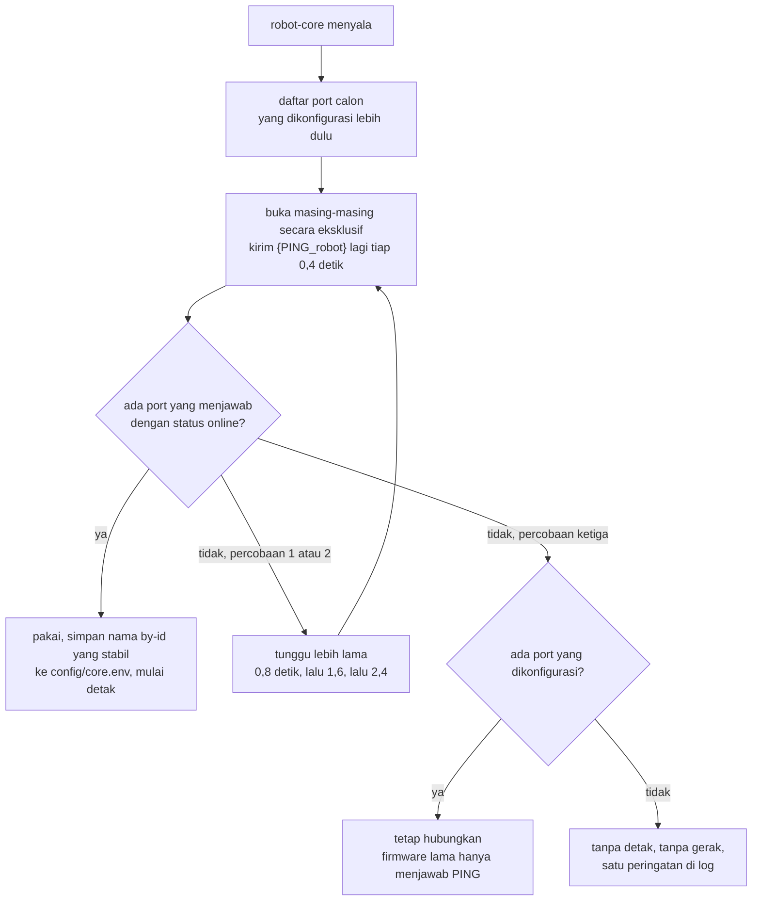

# Protokol serial: otak ke tubuh

> **Bahasa Indonesia.** Diterjemahkan dari [versi Inggris](../../en/05-interfaces/serial-protocol.md) pada
> **2026-11-16**. Versi Inggris adalah naskah utama: jika berbeda, ikuti versi Inggris.

Ini adalah **satu-satunya** antarmuka antara otak dan tubuh. Kedua sisi mengimplementasikannya. Kontraknya
adalah [`serial-protocol.md`](../../../dev-docs/architecture/serial-protocol.md); halaman ini menjelaskannya dengan
contoh.

## Hubungannya

| | |
|---|---|
| Transportasi | tubuh acuan: USB-CDC. ESP32 robot: kabel USB dengan chip USB-UART 📐 |
| Nama perangkat | `STM32_PORT` di `config/core.env`. **Kosong saat ini**, jadi port ditemukan saat menyala lewat penemuan |
| Baud | 115200 (`SerialLink`). Harus sama dengan UART tubuh jika memakai chip USB-UART |
| Pembingkaian | **baris ASCII diakhiri `\n`**, paling banyak **255 byte** sebelum baris baru |
| Mengapa teks | Orang dapat membaca lalu lintasnya dengan `screen`. Lajunya rendah |

Pakai nama stabil (`/dev/serial/by-id/…`), bukan `ttyACM0`: di papan ini `ttyACM0` pernah menjadi **kartu suara** USB.

## Jetson ke tubuh: perintah

| Baris | Arti | Jawaban |
|---|---|---|
| `DRIVE <vx> <vy> <omega> <ms>` | Bergerak, lalu berhenti sendiri. m/s, m/s, rad/s, 1 sampai 10 000 ms | `OK DRIVE`, nanti `DONE DRIVE` |
| `STOP` | Hentikan semua gerak sekarang | `OK STOP` |
| `FACE <nama>` | Tampilkan ekspresi | `OK FACE`, atau `ERR FACE unknown` |
| `HAND <gestur>` | Urutan servo bawaan | `OK HAND`, nanti `DONE HAND` |
| `PING` | Detak, tiap **200 ms** | `OK PING` |
| `STATUS` | Minta baris status, **tiap 2 detik** oleh `robot-core` | `STAT …` (tanpa `OK` terpisah) |
| `WHEEL <i> <rad/s> <ms>` | **Hanya uji awal**: putar roda 0 sampai 3, melewati kinematika | `OK WHEEL`, nanti `DONE WHEEL` |
| `{PING_robot}` | Penemuan: "siapa tubuhnya?" | `{"device":"…","status":"online"}` |
| `{ … }` (apa pun yang diawali `{`) | [Baris balasan](../05-interfaces/reply-json.md): informasi | **tanpa jawaban** |

Kata kerja boleh dalam huruf apa pun. `WHEEL` sengaja **tidak** dapat dijangkau dari model.

```
DRIVE 0.5 0.0 0.0 1500     # maju 0,5 m/s selama 1,5 detik
DRIVE 0.0 0.3 0.0 1000     # geser ke kiri selama 1 detik
DRIVE 0.0 0.0 1.2 800      # berputar di tempat (ke kiri)
FACE happy
HAND wave
STOP
WHEEL 0 5.0 1000           # uji awal: hanya depan kiri, 5 rad/s selama 1 detik
```

> **Kerangka (ditetapkan 2026-11-16):** x ke depan, y ke kiri, omega berlawanan arah jarum jam. `+vy` menggeser
> ke **kiri**; `+omega` belok ke kiri. Lihat [Gerak](../03-firmware/motion.md).

## Tubuh ke Jetson: jawaban

| Baris | Arti |
|---|---|
| `OK <kata kerja>` | Diterima dan dimulai |
| `ERR <kata kerja> <alasan>` | Ditolak. `alasan` satu kata: `unknown`, `badargs`, `range`, `toolong`, `empty`, atau `watchdog` |
| `DONE <kata kerja>` | Aksi berwaktu selesai (`DRIVE`, `WHEEL`, atau `HAND`) |
| `STAT batt=<V> motors=<state> temp=<C> up=<ms>` | Jawaban atas `STATUS`. `state` adalah `ok` atau `stall` |

**Setiap perintah mendapat tepat satu respons**, sehingga model tidak bisa mengumumkan "maju" sementara roda
tersangkut. `robot-core` mencocokkan respons dengan perintah **menurut kata kerja**, masuk lebih dulu keluar
lebih dulu, dan menunggu **1 detik** sebelum melaporkan `timeout`. Saat hubungan putus, perintah gerak ditolak
seketika dengan `disconnected`.

### Yang dilakukan Jetson dengan penolakan

* `ERR` dicatat sebagai peringatan dan ditampilkan di dashboard.
* Ia ditambahkan sebagai **catatan perangkat keras** pada prompt model berikutnya: *"the body refused DRIVE
  (range)"*. Paling banyak empat catatan terakhir disimpan.
* Pengecualian: `ERR {"…` adalah tubuh yang belum membaca baris balasan. Itu diabaikan.

## Detak dan watchdog

`PING` tiap 200 ms. Jika tubuh tidak melihat **baris jenis apa pun selama 500 ms**, ia menghentikan motor sendiri
dan tidak lanjut sampai ada perintah baru. Semuanya ada di [Watchdog](../03-firmware/watchdog.md).

## Penemuan: port mana tubuhnya?

Setiap kali menyala, di setiap mode, `robot-core` mengirim baris `{PING_robot}` ke **setiap** port serial:
tiap `/dev/serial/by-id/*`, `ttyACM*`, `ttyUSB*`, dan `ttyTHS*` yang ada.



* Balasan **apa pun** dengan JSON `status` bernilai `online` dihitung. `device` hanya label: firmware acuan berkata
  `STM32`, contoh kontrak berkata `ESP32`.
* Pesan boot sebelum jawaban dilewati: probe membaca baris demi baris sampai menemukan jawabannya.
* Probe yang sama ada di balik **Config → Hardware → Ping all ports**.
* Lihat hasilnya dengan `grep 'robot-core: microcontroller' .cache/tmp/core.log`.
* Galat izin berarti pengguna layanan tidak ada di grup `dialout`.

## `STATUS` dan penanda macet

Kontrak menyatakan orkestrator harus menampilkan `motors=stall` "agar robot dapat berkata *saya tersangkut*
alih-alih berbohong". Baris `STAT` dengan macet yang **terkonfirmasi** menjadi catatan perangkat keras *"a wheel is
stalled -- you are not actually moving"*.

* **`robot-core` menanyakan `STATUS` tiap 2 detik** (`STATUS_PERIOD_S`), di samping detak. Sebelum 2026-11-16 tidak
  ada yang mengirimnya, sehingga baterai, suhu, dan penanda macet tak pernah tiba (Masalah Diketahui #20, kini selesai).
* **Macet dipercaya setelah dua sampel berturut-turut** (`STALL_CONFIRM_SAMPLES`, sekitar 2 sampai 4 detik). Uji
  macet firmware acuan tidak punya waktu tunggu, jadi tik-tik awal setiap gerak tampak seperti macet. Hanya macet
  terkonfirmasi yang sampai ke model.
* **Tubuh yang tidak mengenal `STATUS`** menjawab `ERR STATUS unknown`; Jetson berhenti bertanya, sekali, tanpa
  melaporkan penolakan, dan bertanya lagi setelah tersambung ulang.

## Memperluas protokol

1. Tambahkan perintah ke dokumen kontrak **lebih dulu**.
2. Implementasikan cabang pengurai di tubuh.
3. Implementasikan pengirim di `serial_link.py`.
4. Beri definisi alat untuk model **hanya jika model perlu memicunya**.

Satu baris, satu aksi, satu respons. Jika perintah butuh sub-perintah atau penyarangan, tubuh sebaiknya memiliki
lebih banyak perilaku; protokolnya tidak perlu tumbuh.

## Penjepitan, di dua tempat

Angka dari model dijepit di Jetson (`serial_link.py`) dan diperiksa ulang di tubuh (`protocol.h`). Kedua himpunan batas
identik. Nilainya ada di [Gerak](../03-firmware/motion.md#batas-di-dua-tempat).
