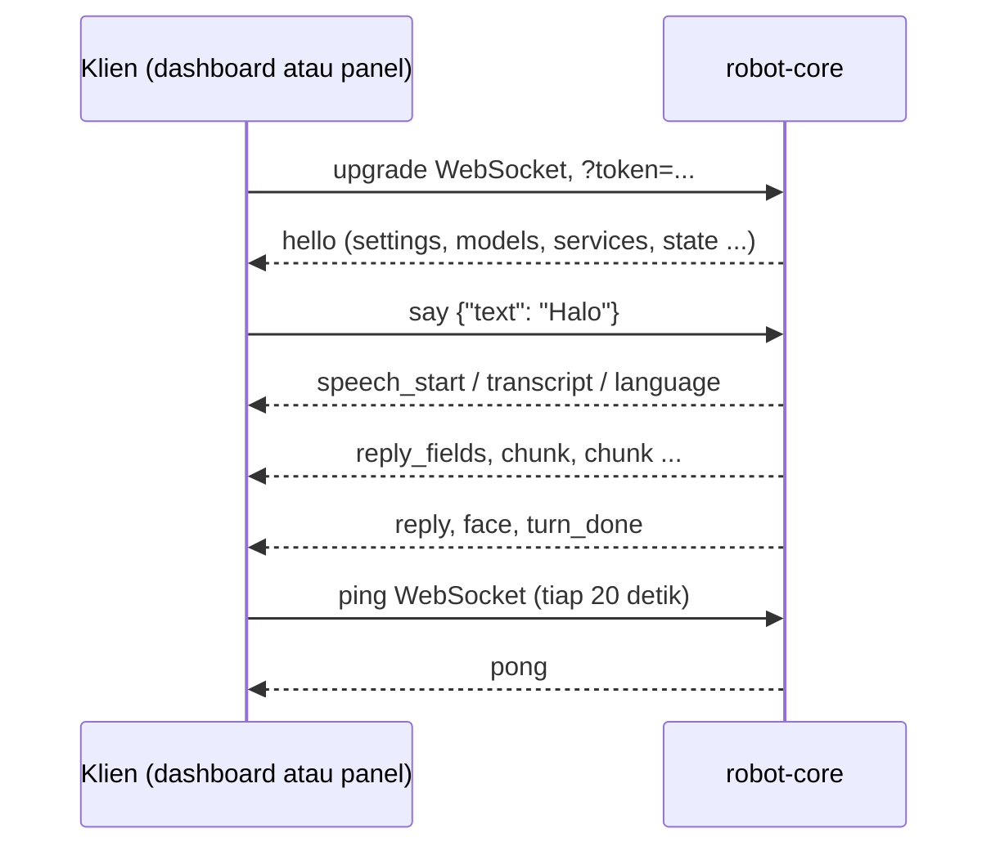

# WebSocket dan soket lokal

> **Bahasa Indonesia.** Diterjemahkan dari [versi Inggris](../../en/05-interfaces/websocket.md) pada
> **2026-11-16**. Versi Inggris adalah naskah utama.

`robot-core` dapat diamati dan diarahkan oleh apa pun yang berbicara JSON lewat WebSocket. Dashboard (`robot-ui`) dan panel di robot
(`robot-face`) adalah dua klien semacam itu, dan keduanya opsional: **tidak ada yang bergantung padanya**, dan salah satu dapat
dimatikan selagi robot tetap mendengar, menjawab, dan bergerak.

## Menyambung

| | |
|---|---|
| Alamat | `ws://127.0.0.1:8090/` (`CORE_WS_HOST`, `CORE_WS_PORT`). **Hanya loopback** secara bawaan |
| Token | Bila `CORE_WS_TOKEN` diatur, permintaan upgrade harus membawa `?token=<itu>`. Tanpanya server menjawab `401` dan mencatat peer yang ditolak |
| Pembingkaian | satu **objek** JSON per pesan, ke dua arah |
| Menyambung ulang | Dashboard mencoba tiap 2 detik, jadi menyalakannya sebelum orkestrator, atau memutar ulang orkestrator di bawahnya, tetap bekerja |
| Keepalive | `robot-core` **tidak pernah mengirim** ping WebSocket, walau menjawabnya. Menjaga hubungan hidup adalah tugas klien |

Token adalah kunci kedua di belakang login sesi dashboard: sesuatu yang sekadar menjangkau port tidak dapat menggerakkan robot.
Token ada di `.env` (diabaikan git), tidak pernah di berkas yang dilacak. `config/core.env` membawa `CORE_WS_TOKEN=` **kosong**,
unit systemd membaca `.env` setelahnya, dan `.env.example` mencantumkan token (sejak 2026-11-16), jadi **harus diatur di `.env`**
❓. Tanpa token, port menerima klien mana pun yang dapat menjangkaunya, yang di loopback berarti apa pun yang berjalan di robot.

Saat tersambung, server mengirim satu `hello` dengan semua yang dibutuhkan halaman untuk menggambar dirinya: `settings`, `models`,
`budget`, `selection` (dengan `llm_ctx`), `groups`, `values`, `services`, `state`, `languages`, `overview`, dan `microcontroller`.
Klien yang terbuka di tengah sesi tak perlu menangani kasus khusus "tersambung terlambat".

## Klien ke server

Setiap jenis di bawah adalah pesan `{"type": "<jenis>", ...}`. Penangan yang gagal menjawab `{"type": "error", "reason": "..."}` dan
**tak pernah menjatuhkan orkestrator**.

### Berbicara

| Jenis | Bidang | Fungsi | Jawaban |
|---|---|---|---|
| `say` | `text`, opsional `speak` (benar untuk menjawab dengan suara), `source` | Memulai giliran dengan teks ketikan, tanpa mikrofon. Senyap kecuali `speak` diatur | peristiwa giliran |
| `cancel` | | Membatalkan giliran yang berjalan | peristiwa giliran |
| `talk_state` | | Semua yang dibutuhkan halaman Conversation saat terbuka di tengah percakapan | `talk_state` |
| `metrics` | | Angka giliran terbaru | `metrics` |
| `ping` | | Kehidupan dan lampu layanan | `pong` |

### Mengonfigurasi

| Jenis | Bidang | Fungsi | Jawaban |
|---|---|---|---|
| `set` | `key`, `value` | Menerapkan satu pengaturan. Pengaturan langsung berlaku seketika; yang butuh nyala ulang hanya menyalakan ulang komponennya | `set_result`, dan `budget` disiarkan ulang |
| `apply` | `values` | Menerapkan pilihan model (halaman Memory) | `apply_result` |
| `budget` | `preview` | Menghitung pilihan **hipotetis** terhadap batas memori, tanpa mengubah apa pun | `budget` |
| `models` | | Katalog model terpasang | `models` |
| `restart` | `component` | Menyalakan ulang satu layanan lewat pengawas yang berkuasa | `restart_result` |
| `ping_ports` | | Ping setiap port serial dengan `{PING_robot}` | `ping_result`, lalu `microcontroller` |
| `preview_voice` | `lang`, `voice` | Memutar suara sebelum dipakai | `preview_result` |
| `logs` | `level`, `limit` | Catatan terbaru orkestrator | `logs` |
| `set_log_level` | `level` (`DEBUG`, `INFO`, `WARNING`, `ERROR`) | Mengubah level log core, asr, dan tts | `log_level` |

### Pengetahuan dan orang

| Jenis | Bidang | Fungsi | Jawaban |
|---|---|---|---|
| `ingest` | `path` atau `text` (dengan `source`) | Menambah dokumen atau fakta ketikan. `path` harus di bawah `run/uploads/` atau `knowledge/`: browser dapat mengirim JSON apa pun, dan memasukkan `.env` lalu membacanya kembali akan berhasil | `ingesting` |
| `knowledge` | | Hitungan, sumber, antrean | `knowledge` |
| `forget` | `source` atau `all` | Menghapus potongan dokumen | `forgotten` |
| `document`, `describe` | `source` | Tiga tampilan dokumen: teks, potongan, tentang | `document`, `described` |
| `people_history`, `conversations`, `conversation_turns` | `name`, `limit`, `visit` | Apa yang dikatakan kepada siapa | nama yang sama |
| `people_forget_conversation` | `name` | Menghapus percakapan satu orang | `vision_result` |
| `vision_status`, `vision_people`, `vision_enroll`, `vision_forget`, `vision_configure` | | Layanan kamera | `vision_result` |

## Server ke klien: peristiwa

Datang sendiri saat sesuatu terjadi. Klien menampilkan yang dipahaminya dan mengabaikan sisanya.

| Peristiwa | Artinya |
|---|---|
| `speech_start`, `speech_end` | Mikrofon mendengar ucapan mulai dan berakhir (`audio_s` pada akhir) |
| `ignored` | Ucapan dibuang, dengan `reason` dan `mode` yang membuangnya |
| `transcript` | Yang didengar whisper. `turn_id` giliran dimulai di sini |
| `initiated` | Giliran yang dimulai robot sendiri, dengan `reason` |
| `language` | Bagaimana bahasa giliran diputuskan (`language_source`) |
| `reply_fields` | Bidang tubuh balasan untuk satu fase: objek yang disebut dashboard *Reply JSON*, dan juga yang diterima tubuh |
| `chunk` | Satu potong jawaban saat menuju suara, dengan `seq` |
| `reply` | Seluruh teks jawaban saat lengkap |
| `face` | `{phase, face}` untuk setiap pergantian wajah |
| `tool_result` | Catatan dari sebuah aksi (penolakan dari tubuh) |
| `truncated` | Balasan menyentuh batas token: bidang tubuh tak pernah tiba |
| `turn_timeout` | Giliran dipaksa berakhir setelah `after_s` |
| `turn_done` | Giliran selesai, dengan rincian waktu tahap terukur |
| `serial_tx` | **Baris persis yang ditulis ke tubuh**, termasuk penjepitan dan pembulatan |
| `serial_up`, `serial_down`, `serial_error`, `serial_done`, `serial_status`, `serial_online` | Hubungan dan jawaban tubuh. `serial_status` tiba sekitar tiap 2 detik dan membawa `stall_confirmed` |
| `health` | Lampu layanan, sekitar tiap 3 detik |
| `keepalive` | Keepalive menyalakan ulang sesuatu, menyerah, atau mengecilkan LLM |
| `budget`, `models` | Penghitungan memori dan katalog model berubah |
| `microcontroller` | Yang ditemukan penemuan |
| `presence`, `people` | Siapa yang dilihat kamera, dan siapa yang dikenal |

Setiap peristiwa giliran membawa `turn_id`. Rincian waktu giliran dijelaskan di
[Satu giliran](../01-overview/one-turn.md).

## Lewat dashboard

Browser tidak pernah tersambung ke port 8090. Ia membuka `WS /api/ws` di `robot-ui` (port 8081), yang diautentikasi oleh **cookie sesi
bertanda tangan yang sama dengan halaman**, jadi tak butuh token sampingan dan soket tak dapat dibuka tanpa login. `robot-ui`
menyampaikan antara browser dan `robot-core`:

* Browser yang terbuka di tengah sesi langsung mendapat `hello` dari keadaan terakhir yang diketahui.
* Peristiwa mengantre per browser, sampai 512. **Browser yang tak sanggup mengikuti kehilangan peristiwa, bukan robotnya.**
* Jika orkestrator tidak tersambung, pesan browser dijawab dengan `error: orchestrator not connected`.

## Soket lokal

`run/core.sock` membawa **JSON dipisah baris baru** (satu objek JSON per baris, sampai 1 MiB). Dapat dibaca dengan
`nc -U run/core.sock`. Ia dipakai `scripts/ingest.sh` dan uji asap. Himpunannya lebih kecil: `say`, `cancel`, `ping` (dijawab `pong`
dengan `state`, `turns`, `last_language`, `llm_ok`, `serial_ok`, `motors`), `ingest`, `forget`, `knowledge`, dan `metrics`.
Berbeda dengan dashboard, `ingest` soket lokal tidak dibatasi pada dua folder: ia dilindungi izin berkas.

Pembingkaian yang sama menghubungkan `robot-core` ke `robot-asr`, `robot-tts`, dan `robot-vision`. **Audio tidak pernah lewat soket
ini.** Layanan suara memiliki speaker dan layanan mikrofon memiliki mikrofon; yang berjalan adalah teks dan peristiwa kendali.
Misalnya `robot-asr` mengirim `speech_start`, `speech_end`, `final`, `noise_reject`, dan `level`; `robot-tts` menjawab `started`,
`finished`, dan `cancelled`; dan `robot-core` mengirim ke suara `speak`, `speak_end`, `cancel`, `configure`, dan `prerender`.

## Menulis klien baru

1. Buka WebSocket (dengan token bila ada) dan baca `hello`.
2. Gambar dari `hello`, lalu perbarui dari peristiwa. Jangan melakukan polling.
3. Kirim ping WebSocket tiap 20 detik, dan anggap diam lebih dari sekitar 45 detik sebagai hubungan mati lalu sambung ulang, apa pun
   yang masih dipercaya TCP (`FACE_PING_S=20` dan `FACE_DEAD_LINK_S=45` milik panel; 20 detik juga yang dipakai dashboard browser).
4. Jangan pernah mengandaikan hubungan bertahan: sambung ulang, dan harapkan `hello` baru.
