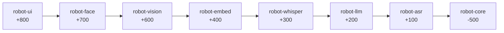

# Produksi: unit systemd

> **Bahasa Indonesia.** Diterjemahkan dari [versi Inggris](../../en/07-operations/systemd.md) pada
> **2026-11-16**. Versi Inggris adalah naskah utama.

> **Belum pernah di-boot di papan ini** ❓. Sembilan unit dan `robot.target` di [`deploy/systemd/`](../../../deploy/systemd/)
> sudah dibaca, diperiksa dengan `systemd-analyze verify`, dan empat kesalahan ditemukan dan diperbaiki dengan membacanya
> terhadap jalur pengembangan (2026-10-22). Belum ada yang menjalankan `install_services.sh` lalu reboot. Anggap halaman ini
> rancangan, dan Masalah Diketahui #2 sebagai daftar tugas.

Robot yang dibiarkan menyala butuh sesuatu yang menyalakan ulang layanan mogok, mengisolasinya, dan menyatakan proses mana
yang harus dibunuh kernel **terakhir** saat memori habis. systemd melakukan ketiganya.

## Unit-unitnya

Semua unit milik `robot.target` (`PartOf=`), menyala ulang saat gagal, dan berhenti mencoba setelah **5 kegagalan dalam
300 detik** (`StartLimitBurst=5`, `StartLimitIntervalSec=300`) agar papan yang sekadar penuh tidak berputar-putar.

| Unit | Mulai setelah | Jeda nyala ulang | Mati saat OOM | Batas | Catatan |
|---|---|---|---|---|---|
| `robot-core` | menginginkan `llm`, `asr`, `tts` | 3 dtk | **−500: terakhir** | | Memegang detak. Grup `dialout` untuk port serial |
| `robot-asr` | `sound.target` | 3 dtk | +100 | | Grup `audio` |
| `robot-llm` | `network-online.target` | 5 dtk | +200 | | Membuang cache halaman model sebelum mulai |
| `robot-whisper` | `network.target` | 5 dtk | +300 | | Pembuangan cache yang sama |
| `robot-embed` | `network.target` | 5 dtk | +400 | | **Tidak diaktifkan saat boot**: core menyalakannya sesuai kebutuhan |
| `robot-vision` | `nvargus-daemon.service` | 5 dtk | +600 | `MemoryHigh` 450 M, `MemoryMax` 600 M | **Tanpa `PrivateTmp`**: soket daemon kamera ada di `/tmp` |
| `robot-face` | `robot-core` | 5 dtk | +700 | `MemoryMax` 200 M | Grup `video render input` |
| `robot-ui` | `robot-core` | 5 dtk | +800: pertama | | |
| `robot-tts` | `sound.target` | 3 dtk | bawaan | `MemoryHigh` 1000 M, `MemoryMax` 1200 M | Grup `audio`. Batasnya membatasi pertumbuhannya, yang 342 ke 889 MiB dalam 45 menit dan belum terbukti mendatar |

*Cara membaca kolom OOM: angka lebih tinggi dibunuh lebih dulu. Urutannya disengaja: dashboard dulu, lalu panel, kamera,
embedding opsional, pengurai suara, dan LLM, dan **`robot-core` terakhir**, karena kehilangannya berarti kehilangan detak,
dan keselamatan robot lalu bergantung sepenuhnya pada watchdog tubuh.*

*Kiri ke kanan: dibunuh pertama sampai terakhir.*

### Ketergantungan: `Wants`, bukan `Requires`

`robot-core` **menginginkan** LLM, mikrofon, dan suara tetapi tidak **mewajibkan**nya. Itu rancangannya: orkestrator
tersambung ulang ke yang lain sendiri dan mengucapkan kalimat siap pakai saat LLM tak terjangkau. Ketergantungan keras
mengubah satu kerusakan menjadi runtuhan berantai.

## Isolasi, dan keputusan di baliknya

| Pengaturan | Di mana | Mengapa |
|---|---|---|
| `ProtectSystem=strict`, `PrivateTmp=true` | semua | layanan tak dapat menulis di luar yang diberikan |
| `ReadWritePaths=` `run` dan `config` | core | Apply, tab Hardware, dan penemuan mikrokontroler menulis `config/*.env` |
| **Tanpa** `NoNewPrivileges` | core, ui, tts | `robot-core` mengawasi yang lain dengan `sudo -n systemctl` untuk `start`, `stop`, atau `restart` pada `robot-<x>`, dan `sudo` menolak berjalan di bawah bendera itu. **Aturan sudoers adalah batas hak istimewa** (enam unit, tiga kata kerja). Diusulkan 2026-10-22, **menunggu konfirmasi pemilik** |
| `Environment=XDG_RUNTIME_DIR`, `PULSE_SERVER` | asr, tts, core | unit sistem tidak mendapat keduanya, dan PulseAudio menjawab "Connection refused". Butuh `enable-linger` |
| Urutan `EnvironmentFile=` | core | `vision.env`, lalu `core.env`, lalu `.env`: token di `.env` harus dibaca **setelah** `core.env` yang membawa `CORE_WS_TOKEN=` kosong |
| `OOMScoreAdjust=-500` | core | lihat di atas |

## Mengapa "jalan di `run.sh`" tidak berarti "jalan di systemd"

Empat perbedaan ditemukan dan masing-masing direproduksi pada 2026-10-22:

| Perbedaan | Yang rusak |
|---|---|
| `NoNewPrivileges=true` | `sudo -n systemctl …` ditolak, sehingga Restart, keepalive, dan server embedding sesuai kebutuhan gagal |
| Tanpa `XDG_RUNTIME_DIR` | `pactl`, `arecord`, dan `aplay` tak menemukan server audio pengguna |
| `EnvironmentFile=` **mempertahankan `# komentar` di akhir** | komentar menjadi bagian nilai: `robot-tts` mati pada `could not convert string to float: '40        # ...'` |
| `ProtectSystem=strict` | `config/*.env` read-only bagi proses yang menulisnya |

dan yang kelima: `robot-core` tidak pernah membaca `.env`, jadi `CORE_WS_TOKEN` kosong dan WebSocket menerima siapa saja.
`tests/test_config_files.py` kini membaca berkasnya **seperti systemd**.

## Sebelum dibiarkan tanpa pengawasan

1. Jalankan langkah di [Memasang, bagian 7](install.md#7-untuk-robot-yang-dibiarkan-menyala-produksi).
2. Reboot dan pastikan `systemctl status robot-core` dan `./scripts/measure/whats_running.py`.
3. `python scripts/hardening/failure_drills.py` terhadap tumpukan **systemd**, bukan hanya `run.sh`.
4. Jalankan **soak 24 jam**: belum pernah dijalankan, dan kriteria sukses versi 1 berkata "berjalan 24 jam tanpa OOM kill
   atau motor macet".
5. **Buktikan watchdog tubuh di papan sungguhan**, bukan hanya simulator ([Watchdog](../03-firmware/watchdog.md)).
