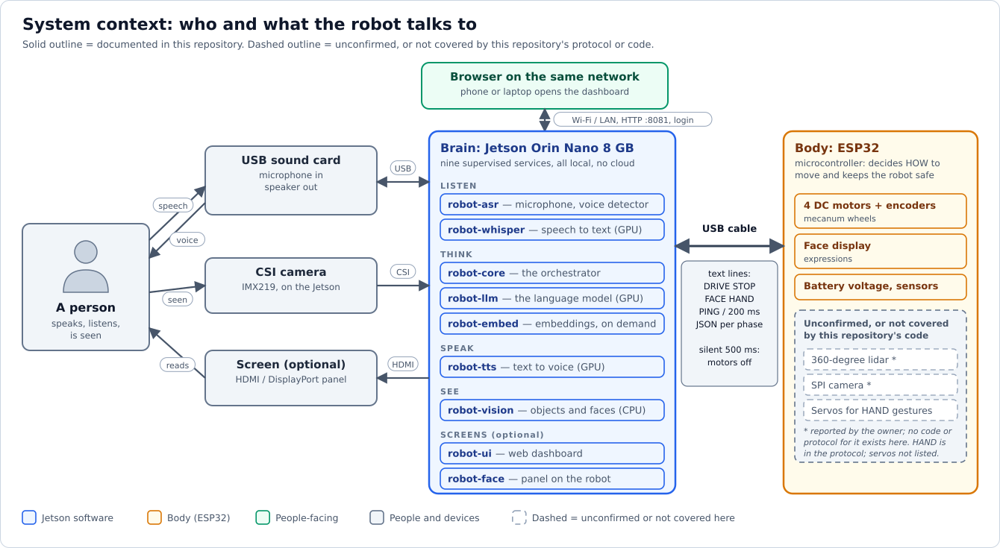

# Buku panduan robot

> **Versi Bahasa Indonesia.** Diterjemahkan dari versi Inggris ([`../en/README.md`](../en/README.md))
> pada **2026-11-12**, dan peta bab serta tabel "Baca ini jika" diperbarui pada **2026-11-16**.
> Versi Inggris adalah naskah utama: jika keduanya berbeda, ikuti
> versi Inggris. Halaman lain masih dalam bahasa Inggris dan akan diterjemahkan bertahap.

Robot yang bisa diajak bicara dalam **Bahasa Inggris, Bahasa Indonesia, atau Bahasa Arab**.
Ia mendengarkan, berpikir, menjawab dengan suara, melihat siapa yang ada di depannya, dan
bergerak. Semuanya berjalan **di dalam robot itu sendiri, tanpa cloud**: sebuah Jetson Orin
Nano sebagai otak, dan sebuah mikrokontroler sebagai tubuh.

*Cara membaca gambar: pengguna berbicara kepada robot lewat mikrofon dan speaker, dan
terlihat oleh kamera. Di dalam robot, Jetson menjalankan sembilan program kecil
("layanan"). Salah satunya, `robot-core`, mengirim perintah teks biasa lewat kabel USB ke
mikrokontroler, yang mengubahnya menjadi gerakan. Browser di jaringan yang sama dapat
membuka dashboard.*

*(Label di dalam gambar memakai istilah teknis dalam bahasa Inggris, seperti nama layanan
dan perintah. Nama berkas, perintah, dan pengaturan memang tidak diterjemahkan.)*

## Seberapa yakin kita? Empat lencana

Tubuh robot belum pernah dijalankan bersama Jetson ini, jadi halaman-halaman ini
menyebutkan sejauh mana setiap klaim sudah terbukti:

| Lencana | Artinya |
|---|---|
| ✅ **Terukur** | Sudah dijalankan di robot ini dan diperiksa: ada angka atau baris log |
| 🧪 **Diuji tanpa perangkat keras** | Hanya dicakup oleh unit test atau simulator di komputer |
| 📐 **Dirancang atau dilaporkan** | Ada di rancangan, atau disampaikan pemilik proyek, tetapi belum pernah diperiksa di sini |
| ❓ **Belum diketahui** | Butuh keputusan pemilik, atau perlu dilihat langsung pada robotnya |

## Baca ini jika Anda…

| Anda… | Baca |
|---|---|
| Baru, dan ingin tahu ini apa | [Apa itu robot ini](01-overview/what-it-is.md) |
| Penasaran bagaimana percakapan berjalan | [Satu giliran, dari awal sampai akhir](01-overview/one-turn.md) |
| Mencari arti sebuah istilah | [Daftar istilah](01-overview/glossary.md) |
| Ingin tahu program mana mengerjakan apa | [Otak: proses dan port](04-brain/README.md) |
| Menelusuri robot yang lambat atau "tuli" | [Alur suara](04-brain/voice-pipeline.md), lalu [Keandalan](04-brain/reliability.md) |
| Memilih atau mengganti model | [Model dan memori](04-brain/models-and-memory.md) |
| Mengajari robot dari dokumen | [Pengetahuan](04-brain/knowledge.md) |
| Menulis atau memeriksa firmware tubuh robot | [Tubuh: firmware](03-firmware/README.md), lalu [ESP32 sebagai tubuh](03-firmware/esp32-conformance.md) |
| Memastikan robot berhenti saat otaknya mati | [Watchdog](03-firmware/watchdog.md) |
| Memeriksa arah putar roda | [Gerak: dari kalimat ke empat roda](03-firmware/motion.md) |
| Memasang kabel tubuh robot | [Perangkat keras: apa yang diketahui](02-hardware/README.md) dan [kabel acuan](02-hardware/reference-wiring.md), usulan yang belum pernah diperiksa pada papan sungguhan. Kabel ESP32 yang sebenarnya butuh pemilik proyek |
| Memakai dashboard atau layar di robot | [Dashboard dan panel](06-dashboard/README.md) |
| Menyambungkan layar, skrip, atau tubuh baru | [Antarmuka](05-interfaces/README.md) |
| Mengubah pengaturan, tetapi tidak terjadi apa-apa | [Konfigurasi](05-interfaces/configuration.md) |
| Memasang papan atau menyalakan robot | [Pemasangan](07-operations/install.md), lalu [Menjalankan sehari-hari](07-operations/running.md) |
| Robot "tuli", bisu, lambat, atau macet | [Indeks gejala](07-operations/troubleshooting-index.md) |
| Bertanya "mengapa bukan ROS 2?" atau "mengapa model itu?" | [Keputusan](08-decisions/README.md) |
| Mencari yang menunggu keputusan pemilik | [Menunggu pemilik proyek](08-decisions/open-decisions.md) |
| Akan mengubah kode (manusia atau AI) | [`AGENTS.md`](../../AGENTS.md) dulu |
| Menemui pesan galat | [`TROUBLESHOOTING.md`](../../dev-docs/ai/TROUBLESHOOTING.md), bisa dicari berdasarkan gejala |

## Peta buku panduan

Semua bab sudah tersedia dalam Bahasa Indonesia, diterjemahkan dari versi Inggris pada 2026-11-16.

| Bab | Keadaan |
|---|---|
| [**01 Gambaran umum**](01-overview/what-it-is.md): apa itu robot ini, satu giliran, daftar istilah | ✍️ ditulis |
| [**02 Perangkat keras**](02-hardware/README.md): apa yang diketahui dan belum, sisi Jetson, kabel acuan | ◐ **sebagian**: komponen, daya, dan kabel tubuh yang sebenarnya butuh pemilik proyek |
| [**03 Firmware**](03-firmware/README.md): tubuh acuan, watchdog, gerak, simulator, apa yang harus dilakukan ESP32 | ✍️ ditulis |
| [**04 Otak**](04-brain/README.md): proses, alur suara, model dan memori, pengetahuan, penglihatan dan orang, keandalan | ✍️ ditulis |
| [**05 Antarmuka**](05-interfaces/README.md): protokol serial, JSON balasan, WebSocket, konfigurasi | ✍️ ditulis |
| [**06 Dashboard dan panel**](06-dashboard/README.md): setiap halaman, dan panel di robot | ✍️ ditulis dari kode sumber; **belum ada tangkapan layar** |
| [**07 Operasional**](07-operations/README.md): pemasangan, menjalankan, systemd, indeks gejala | ✍️ ditulis |
| [**08 Keputusan**](08-decisions/README.md): batasan keras, alternatif yang ditolak, yang menunggu pemilik proyek | ✍️ ditulis |

## Fakta singkat (per 2026-11-12)

| | |
|---|---|
| Otak | Jetson Orin Nano 8 GB (Super), JetPack 6.2.1, tanpa desktop. **7620 MiB** RAM dapat dipakai, dibagi bersama oleh CPU dan GPU |
| Tubuh | Mikrokontroler lewat serial USB: sebuah **ESP32** (dilaporkan pemilik proyek; lihat [daftar istilah](01-overview/glossary.md#pengendali-tubuh-body-controller)) |
| Bahasa | Inggris, Indonesia, Arab; dipilih per kalimat dari kata-kata yang diucapkan |
| Jaringan | Tidak ada yang keluar dari robot. Dashboard hanya ada di jaringan Anda sendiri |
| Kecepatan ✅ | Dari akhir ucapan sampai kata pertama jawaban: **median 2181 ms, terbaik 1554 ms** (target 1500 ms). Kalimat singkat "oke, sebentar ya" bisa mulai dalam sekitar **123 ms** |
| Pengujian | 1378 tes Python dan 634 pemeriksaan inti firmware, semuanya lulus pada 2026-11-16 |
| Proses | 9: `robot-llm`, `robot-whisper`, `robot-asr`, `robot-tts`, `robot-core`, `robot-embed`, `robot-vision`, `robot-ui`, `robot-face` |

Angka berasal dari [`PROGRESS.md`](../../dev-docs/ai/PROGRESS.md) dan
[`AGENTS.md`](../../AGENTS.md). Keduanya adalah catatan yang selalu diperbarui; tabel ini hanya
potret pada satu tanggal.

## Aturan penulisan

* **Versi Inggris adalah naskah utama.** Halaman Indonesia mengikutinya dan menyebut tanggal
  penerjemahannya.
* **Halaman menyebutkan sumbernya.** Sebuah angka diikuti keterangan di mana ia diukur.
  Klaim tanpa lencana dan tanpa sumber adalah kesalahan pada halaman itu.
* **Gambar berupa teks.** Diagram SVG bisa disunting dengan tangan; diagram alur memakai Mermaid.
* **Nama berkas, perintah, dan pengaturan tidak diterjemahkan.**
